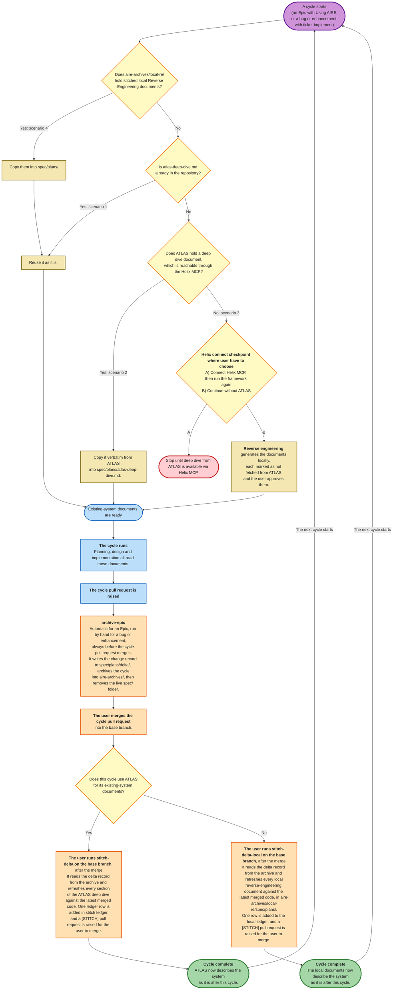
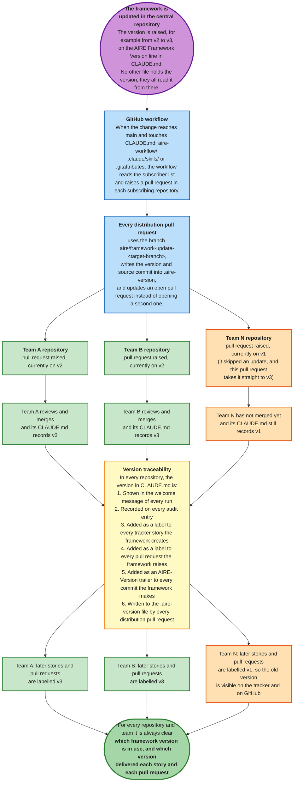

# AIRE Workflow: End-to-End Flows

These diagrams show how the framework runs from start to finish.

## Index

1. [Greenfield End-to-End Flow: From Idea to Epic Release](#1-greenfield-end-to-end-flow-from-idea-to-epic-release)
2. [Brownfield End-to-End Flow: From Idea to Epic Release](#2-brownfield-end-to-end-flow-from-idea-to-epic-release)
3. [Bug End-to-End Flow: From Defect Ticket to Merged Fix](#3-bug-end-to-end-flow-from-defect-ticket-to-merged-fix)
4. [Enhancement End-to-End Flow: From Enhancement Ticket to Merged Change](#4-enhancement-end-to-end-flow-from-enhancement-ticket-to-merged-change)
5. [Mid-Epic Enhancement: epic-enhance](#5-mid-epic-enhancement-epic-enhance)
6. [Mid-Epic Bug Fix: epic-bugfix](#6-mid-epic-bug-fix-epic-bugfix)
7. [Mid-Epic Change Request: epic-change-request](#7-mid-epic-change-request-epic-change-request)
8. [Defect Lifecycle: From a Verification Engineer Finding a Bug to Ready for Testing](#8-defect-lifecycle-from-a-verification-engineer-finding-a-bug-to-ready-for-testing)
9. [Existing-System Documentation: How It Stays Current](#9-existing-system-documentation-how-it-stays-current)
10. [Distribution and Governance](#10-distribution-and-governance)
11. [AI-Origin Detection: Line-Level Defect Provenance](#11-ai-origin-detection-line-level-defect-provenance)
12. [How Code Gets Evaluated](#12-how-code-gets-evaluated)


---

# 1. Greenfield End-to-End Flow: From Idea to Epic Release

A new project with no existing code, from the first idea to the merged Epic.

```mermaid
flowchart TD
    %% Ideation, before the AIRE workflow starts
    IDEA(["The user has an idea"])
    IDEA --> INTAKE["<b>The user runs the intent-intake skill</b><br/>The framework collects six baseline fields: the outcome,<br/>how success is measured, the success signal, what is out of scope,<br/>the known constraints, and the confidence level with open unknowns.<br/>It creates an Epic in Jira, Azure DevOps or GitHub, labelled intent-intake."]
    INTAKE --> REFINE["<b>The user runs the intent-refinement skill</b><br/>The framework works through the Epic until it defines:<br/>measurable criteria with thresholds, scope, constraints,<br/>domain model, quality expectations and risks.<br/>It updates the same Epic created by intent-intake skill and adds the label intake-refined."]
    REFINE --> EPIC_READY["The Epic is fully detailed and ready to build.<br/>Both intent skills are optional.<br/>"]

    %% Planning
    EPIC_READY --> TRIGGER["<b>The user starts the framework</b><br/>by typing <b>Using AIRE, &lt;epic reference&gt;</b><br/>with a Jira, Azure DevOps or GitHub link, <br/>or a request to implement an Epic present on ATLAS fetched through the Helix MCP."]
    TRIGGER --> WD["<b>Workspace Detection</b><br/>The framework asks once, in the chat, which tracker to use.<br/>It records the Parent Epic, copies the Epic content into <b>epic-brief.md."]
    WD --> BRANCH["<b>The framework creates the Epic branch</b><br/>named <b>epic/&lt;epic-id&gt;-&lt;epic-title&gt;</b>, cut from the current branch.<br/>The base branch and the Epic branch are recorded<br/>in runtime-artifacts/aire-state.md. All work happens on this branch."]
    BRANCH --> ATLAS_SYNC{"<b>ATLAS artifact question</b>, asked once by the framework in chat<br/>Push the artifacts the framework creates in this cycle<br/>(spec/, runtime-artifacts/, reports/; never code)<br/>to ATLAS through the Helix MCP?"}
    ATLAS_SYNC -->|"Yes: a team folder named after the cycle is created in ATLAS,<br/>and every artifact is pushed there before each commit"| CTX{"<b>Context question</b>, asked once by the framework<br/>Are there reference materials for the new work,<br/>such as wireframes, mockups or API specifications,<br/>placed under spec/context-project/new-references/ ?<br/>The user gives a path that the framework can refer, or answers no."}
    ATLAS_SYNC -->|"No: the artifacts stay in the repository only"| CTX
    CTX --> RA["<b>Requirements Analysis</b><br/>The framework reads epic-brief.md, chooses the depth<br/>(minimal, standard or comprehensive), and writes its questions<br/>to a file for user to answer."]
    RA --> RA_Q{"The user answers<br/>every question."}
    RA_Q -->|"An answer is unclear"| RA_FOLLOW["The framework asks follow-up questions<br/>until every decision is clear."]
    RA_FOLLOW --> RA_Q
    RA_Q -->|"Every decision is clear"| RA_GEN["The framework writes <b>requirements.md</b>.<br/>Every requirement gets a permanent identifier such as REQ-F-03.<br/>."]
    RA_GEN --> RA_APPROVE{"<b>Requirements approval checkpoint</b><br/>The user chooses Request Changes<br/>or Approve and Continue."}
    RA_APPROVE -->|"Request Changes"| RA
    RA_APPROVE -->|"Approve and Continue"| RA_COMMIT["The planning documents are committed and pushed<br/>on the Epic branch. No pull request is raised here."]

    %% User stories and dependency graph
    RA_COMMIT --> US_GEN["<b>User Stories</b><br/>The framework writes <b>stories.md</b> and <b>personas.md</b> in one pass,<br/>for a fixed team size of two. Every story lists its acceptance criteria<br/>and the requirements it covers.<br/>The Story Tracker is filled in with status Ready for Development."]
    US_GEN --> STORY_CP{"<b>Story set approval checkpoint</b><br/>The framework presents the complete story set.<br/>The user chooses Request Changes or Approve and Continue."}
    STORY_CP -->|"Request Changes"| US_GEN
    STORY_CP -->|"Approve and Continue"| PUSH_TRK["<b>Push to the tracker</b><br/>Each story is created in the chosen tracker, set to Ready for Development,<br/>linked to the Parent Epic, and its tracker ID is written back.<br/>For Local, nothing leaves the repository."]
    PUSH_TRK --> TRK_STORIES[("The tracker now holds every story,<br/>each linked to the Parent Epic.")]
    PUSH_TRK --> DG["<b>Dependency Graph</b> (automatic)<br/>The framework works out which stories need which others first,<br/>writes <b>dependency-graph.yml</b>, and shows which stories can start now.<br/>The stories, personas and graph are then committed and pushed to the epic branch."]
    DG --> WP["<b>Workflow Planning</b> (automatic)<br/>The framework decides which design stages this Epic needs,<br/>records its reasons in <b>executions.md</b>, and continues."]
    WP --> AD["<b>Application Design</b> (Conditional)<br/>Components, methods, services and their dependencies,<br/>written to application-design.md and approved by the user."]

    %% System-level design
    AD --> FD["<b>Functional Design</b> (Conditional)<br/>Domain model, business rules, validation, data flows,<br/>integrations and edge cases written to functional-design.md and approved by the user."]
    FD --> NFR_R["<b>Non-functional Requirements</b> (Conditional)<br/>How fast, secure, reliable and scalable the system must be,<br/>recorded as measurable targets in nfr.md and approved by the user."]
    NFR_R --> NFR_D["<b>Non-functional Design</b> (Conditional)<br/>How those targets will be met, added to nfr.md."]
    NFR_D --> INFRA["<b>Infrastructure Design</b> (Conditional)<br/>Environments, hosting, storage, messaging, networking and monitoring,<br/> written to infrastructure-design.md and approved by the user<br/>"]

    %% Design handoff checkpoint
    INFRA --> ARCHDOC["<b>Design handoff checkpoint:</b><br/>The framework asks once: Set up the CI/CD eval pipeline? (yes/no). On yes, it generates the CI pipeline,<br/>guides the User for manual CI setup steps, and waits for user input to proceed.<br/>It writes spec/behavior.feature for epic level gherkin scenarios,<br/>and assembles <b>spec/plans/architecture.md</b> from the approved designs.<br/>It derives the architecture rubric from architecture.md and a security rubric<br/>from the OWASP Top 10. "]
    ARCHDOC --> SPECSET{"<b>Behaviour specs and test plans</b> (before any code)<br/>For every story: <b>spec/behavior/story-N.M.feature</b>, one scenario<br/>per acceptance criterion including failure paths, and the manual test plan<br/>in <b>spec/test-plans/&lt;ticket-id&gt;-&lt;title&gt;/</b>, written by the ve-implement skill.<br/>Every acceptance criterion needs a scenario and a test case.<br/>The user reviews the whole set once:<br/>Request Changes or Continue to Next Stage."}
    SPECSET -->|"Request Changes"| SPECSET
    SPECSET -->|"Continue to Next Stage"| DESIGN_PUSH["The design documents, contracts, test plans and evaluation files<br/>are committed and pushed on the Epic branch."]
    DESIGN_PUSH --> SMOKE["<b>CI smoke test</b> (only when CI was selected)<br/>A scratch pull request with no changes proves the CI environment works.<br/>It is merged and deleted on success."]
    SMOKE --> STOP["<b>Development handoff:</b><br/>The framework reports how many stories exist, which can start now,<br/>and which design stages ran or were skipped.<br/>Developer: pull the Epic branch and type <b>dev-implement</b>, once per story."]

    %% dev-implement, one story at a time
    STOP -->|"The developer types dev-implement<br/>and names a story"| SS{"<b>Doability checkpoint</b><br/>Every prerequisite story must be Ready for Testing,<br/>or have its pull request merged.<br/>The framework never merges a pull request itself."}
    SS -->|"A prerequisite story is not merged"| BLOCK["The run stops and names each unmerged prerequisite stories<br/>and its pull request state."]
    BLOCK -.-> SS
    SS -->|"Every prerequisite is merged"| INDEV["<b>The story moves to In Development</b> (automatic)<br/>on the Story Tracker and is assigned<br/>to the developer automatically.<br/>The first story to start also moves the Epic to In Development."]
    INDEV --> SBR["<b>Story branch checkpoint</b><br/>The Epic branch is refreshed. <br/>The branch <b>story/&lt;N.M&gt;-&lt;story-title&gt;</b> is cut from the Epic branch,<br/>never from the base branch."]
    SBR --> BASE["<b>Baselines</b> (before any code is written)<br/>The full test suite, the seven static evals and the existing<br/>Playwright suite all run, so problems that were already there<br/>are never blamed on this story."]
    BASE --> PLAN["<b>Plan</b><br/>The implementation plan is written, each step tagged with<br/>the requirements and acceptance criteria it serves."]
    PLAN --> GEN["<b>Code generation</b><br/>Application code goes into src/ and tests into tests/.<br/>"]

    GEN --> COV{"<b>Unit tests and coverage</b><br/>Tests run, and coverage of the changed lines<br/>must reach the configured minimum (90 percent by default)."}
    COV -->|"A test fails or coverage is short"| COV_FIX["The framework finds the cause and fixes the code,<br/>adding tests only for paths that are genuinely untested.<br/>It never deletes or weakens a test. Up to three attempts."]
    COV_FIX --> COV
    COV -->|"Pass"| BEHV{"<b>Behaviour tests in Podman</b><br/>B1: this story's scenarios. B2: every other story already started.<br/>B3: Runs on the last story only, the full epic scenarios."}
    BEHV -->|"A scenario fails"| BEHV_FIX["The framework fixes the code, never the scenario.<br/>Up to three attempts."]
    BEHV_FIX --> BEHV
    BEHV -->|"Pass"| API_T{"<b>API and contract tests</b> (when the story touches an endpoint)<br/>Happy path, every response code, 401 versus 403,<br/>error format, request validation and response schema."}
    API_T -->|"A check fails"| API_FIX["The framework fixes it and runs the tests again.<br/>Up to three attempts."]
    API_FIX --> API_T
    API_T -->|"Pass, or no endpoint touched"| PLACE["<b>Test placement check</b><br/>Every new test must sit in the right folder<br/>under tests/. Misplaced files are moved."]
    PLACE --> REG{"<b>Full regression</b><br/>The whole suite runs again and is compared with the baseline.<br/>Only tests that passed before and fail now count."}
    REG -->|"A new failure"| REG_FIX["This story caused it, so this story fixes it,<br/>never by deleting or weakening the test. Up to three attempts."]
    REG_FIX --> REG
    REG -->|"No new failures"| STATIC{"<b>Static Evals</b><br/>Lint, type check, security scan, dependency vulnerabilities,<br/>licences, complexity and secrets, compared with the baseline.<br/>Only new findings in changed files count."}
    STATIC -->|"A new finding"| STATIC_FIX["The framework fixes the code and never suppresses<br/>the finding. Up to three attempts."]
    STATIC_FIX --> STATIC
    STATIC -->|"Clean"| PW{"<b>Playwright</b><br/>runs only on Frontend stories: Playwright's own Planner, Generator and Healer agents<br/>write and repair the browser tests, which run with a visible browser.<br/>The existing Playwright suite runs again and compared against the baseline."}
    PW -->|"A test fails"| PW_FIX["The framework fixes the code.<br/>Up to three attempts."]
    PW_FIX --> PW
    PW -->|"Pass"| ACR["<b>Automated code review</b><br/>Checks every acceptance criterion and covered requirement,<br/>runs the Security Baseline review on the changed code,<br/>and scores J1 (architecture) and J2 (security) against their rubrics.<br/>Both judge scores must reach their minimum. A versioned report is written."]
    ACR --> RDG{"<b>Review result</b><br/>Clean, or are there blocker or high findings,<br/>or a judge score below its minimum?"}
    RDG -->|"Findings"| REM["<b>Automatic remediation</b><br/>The framework fixes every blocker and high finding, runs the tests<br/>and the regression again, and reviews again.<br/>Up to three attempts."]
    REM --> ACR
    RDG -->|"Clean"| EVID["<b>Evidence check and scorecard</b><br/>Every evidence file must exist, follow its format and agree<br/>with the scorecard, eval.json and eval-summary.md.<br/>When CI is on, this story's CI manifest file is written."]
    EVID --> COMMIT["<b>Commit:</b><br/> the commit carries an AIRE-Version trailer."]
    COMMIT --> PREFLIGHT{"<b>CI preflight checkpoint</b> (only when CI is on)<br/>CI's own commands run in a clean environment against the commit.<br/>"}
    PREFLIGHT -->|"Fails"| PRE_FIX["The framework fixes the CI."]
    PRE_FIX --> PREFLIGHT
    PREFLIGHT -->|"Clean, or CI is off"| STORY_PR["<b>Story pull request</b> (through pr-generator)<br/>The story branch is pushed and a [STORY] pull request is opened<br/>into the Epic branch, labelled ai-generated and with the AIRE version.<br/>The Eval scorecard is pasted into its description."]
    STORY_PR --> GH_STORY[("GitHub: the story pull request<br/>targets the Epic branch.")]
    STORY_PR --> CI_EVAL["<b>CI evaluation</b> (only when CI is on)<br/>CI runs the same evals in a clean environment, and the self-repair job<br/>handles genuine code failures."]
    CI_EVAL --> PR_REV["<b>Automatic pull request review</b><br/>The framework posts its review as a comment."]
    PR_REV --> RFD["<b>The story stays In Development</b><br/>The pull request link is recorded. Only the Verification Engineer<br/>moves the story to Ready for Testing."]

    %% Merge and the next story
    RFD --> PR_HUMAN{"<b>Human review</b><br/>The developer and the Verification Engineer review<br/>the story pull request. Approved, or changes requested?"}
    PR_HUMAN -->|"Changes requested"| PF_READ["<b>Pull request fix: the developer types pr-fix &lt;PR number&gt;</b><br/>It reads every unresolved review comment on the PR. <br/>It asks a question only when a comment would change an approved<br/>acceptance criterion, or when two reviewers disagree."]
    PF_READ --> PF_FIX["<b>Fix on the same story branch</b><br/><br/>The fix is planned and made, then every dev-implement check runs again<br/>on the whole story, plus a check that each requested fix is correct.<br/>"]
    PF_FIX --> PF_UPDATE["<b>Update the same pull request</b><br/>Commit and push, refresh the scorecard, reply to each comment,<br/> and post an automatic review.<br/>It never merges, approves or resolves review threads."]
    PF_UPDATE --> PR_HUMAN
    PR_HUMAN -->|"Approved"| MERGE_STORY["<b>The developer merges the story pull request</b> into the Epic branch.<br/>The framework never merges on anyone's behalf.<br/>A story that depends on this one can start only after this merge."]
    MERGE_STORY --> MORE{"More stories<br/>to build?"}
    MORE -->|"Yes: type dev-implement again"| SS
    MORE -->|"No"| ALL_DONE["Every story has been built and merged into the Epic branch.<br/>Verification Engineer sign-off has been running per story<br/>as each pull request merged."]

    MERGE_STORY -.-> SIGNOFF
    ALL_DONE --> SIGNOFF["<b>Verification Engineer sign-off with /ve-list-work</b> on the Epic branch,<br/>story by story as each pull request merges.<br/>The Verification Engineer builds the Epic branch locally, runs the story's<br/>test steps, and records one decision per story, for example PROJ-102 approve.<br/>Approve: comment, ve-approved label, and the story moves to Ready for Testing.<br/>Reject: comment, ve-rejected label, and the story stays In Development;<br/>the problem is logged with /raise-defect and can be fixed with epic-bugfix workflow.<br/>When every story is approved, it offers to move the Epic to Ready for Testing."]

    %% Cycle close
    SIGNOFF --> EPIC_PR["<b>The user runs pr-generator on the Epic branch</b><br/>It raises or updates the [EPIC] pull request into the base branch."]
    EPIC_PR --> GH_EPIC[("GitHub: the Epic pull request<br/>targets the base branch.")]
    EPIC_PR --> ARCHIVE["<b>archive-epic runs automatically</b><br/>It writes the cycle's change record (delta.md), copies spec/, reports/,<br/>runtime-artifacts/ and tests/.evals/rubrics/ into aire-archives/epics/,<br/>removes the archived folders from root, and commits and pushes into the open Epic pull request."]
    ARCHIVE --> MERGE_EPIC["<b>The user merges the Epic pull request</b> into the base branch.<br/>This is always a human decision."]
    MERGE_EPIC --> DONE(["<b>EPIC COMPLETE</b>"])

    classDef intent fill:#EDE7F6,stroke:#5E35B1,stroke-width:2px,color:#1F1F1F
    classDef trigger fill:#CE93D8,stroke:#6A1B9A,stroke-width:3px,color:#1F1F1F
    classDef planning fill:#BBDEFB,stroke:#1565C0,stroke-width:2px,color:#1F1F1F
    classDef checkpoint fill:#FFF9C4,stroke:#F57F17,stroke-width:2px,color:#1F1F1F
    classDef design fill:#E1BEE7,stroke:#6A1B9A,stroke-width:2px,color:#1F1F1F
    classDef handoff fill:#B39DDB,stroke:#4527A0,stroke-width:3px,color:#1F1F1F
    classDef stop fill:#FFCDD2,stroke:#C62828,stroke-width:3px,color:#1F1F1F
    classDef build fill:#C8E6C9,stroke:#2E7D32,stroke-width:2px,color:#1F1F1F
    classDef verify fill:#C5E1A5,stroke:#33691E,stroke-width:2px,color:#1F1F1F
    classDef heal fill:#FFE082,stroke:#FF6F00,stroke-width:2px,color:#1F1F1F
    classDef review fill:#B3E5FC,stroke:#0277BD,stroke-width:2px,color:#1F1F1F
    classDef pr fill:#B2EBF2,stroke:#00695C,stroke-width:2px,color:#1F1F1F
    classDef vEng fill:#B2DFDB,stroke:#00695C,stroke-width:2px,color:#1F1F1F
    classDef close fill:#FFE0B2,stroke:#E65100,stroke-width:2px,color:#1F1F1F
    classDef prfix fill:#FFCCBC,stroke:#BF360C,stroke-width:2px,color:#1F1F1F
    classDef external fill:#FFFDE7,stroke:#F57F17,color:#1F1F1F
    classDef done fill:#A5D6A7,stroke:#2E7D32,stroke-width:3px,color:#1F1F1F

    class IDEA,INTAKE,REFINE,EPIC_READY intent
    class TRIGGER trigger
    class WD,BRANCH,RA,RA_FOLLOW,RA_GEN,RA_COMMIT,US_GEN,PUSH_TRK,DG,WP planning
    class ATLAS_SYNC,CTX,RA_Q,RA_APPROVE,STORY_CP,SS,COV,BEHV,API_T,REG,STATIC,PW,RDG,PREFLIGHT,MORE checkpoint
    class AD,FD,NFR_R,NFR_D,INFRA design
    class ARCHDOC,SPECSET,DESIGN_PUSH,SMOKE handoff
    class STOP,BLOCK stop
    class INDEV,SBR,BASE,PLAN,GEN,PLACE,COMMIT,RFD build
    class COV_FIX,BEHV_FIX,API_FIX,REG_FIX,STATIC_FIX,PW_FIX,PRE_FIX heal
    class ACR,REM,PR_REV,EVID,CI_EVAL review
    class STORY_PR,MERGE_STORY pr
    class PR_HUMAN checkpoint
    class PF_READ,PF_FIX,PF_UPDATE prfix
    class SIGNOFF vEng
    class ALL_DONE,EPIC_PR,ARCHIVE,MERGE_EPIC close
    class TRK_STORIES,GH_STORY,GH_EPIC external
    class DONE done
```

---

# 2. Brownfield End-to-End Flow: From Idea to Epic Release

A new project with existing codebase. 

```mermaid
flowchart TD
    %% Ideation and optional local baseline
    IDEA(["The user has an idea"])
    IDEA --> INTAKE["<b>The user runs the intent-intake skill</b><br/>Six baseline fields, and an Epic created in Jira,<br/>Azure DevOps or GitHub, labelled intent-intake."]
    INTAKE --> REFINE["<b>The user runs the intent-refinement skill</b><br/>The Epic is elaborated until it is verifiable<br/>and labelled intake-refined."]
    REFINE --> EPIC_READY["The Epic is fully detailed and ready to build.<br/>Both intent skills are optional."]

    %% Planning
    EPIC_READY --> TRIGGER["<b>The user starts the framework</b><br/>by typing <b>Using AIRE, &lt;epic reference&gt;</b><br/>with a tracker link<br/>or a request to implement an Epic present on ATLAS fetched through the Helix MCP."]
    TRIGGER --> WD["<b>Workspace Detection</b><br/>The framework asks once which tracker to use, records the Parent Epic,<br/>copies the Epic into <b>epic-brief.md</b>, finds the existing code,<br/>and records where that code lives (the Code Root)."]
    WD --> ATLAS{"<b>Existing-system truth</b><br/>Is spec/plans/atlas-deep-dive.md already here?<br/>If not, does ATLAS hold a deep dive, that can be fetched through the Helix MCP?"}
    ATLAS -->|"Found locally"| REUSE["The deep dive is reused as it is."]
    ATLAS -->|"Found on ATLAS"| PULL["The deep dive is copied verbatim into<br/><b>atlas-deep-dive.md</b> with its source recorded.<br/>ATLAS content is read-only."]
    ATLAS -->|"Not found, or Helix not connected"| CONNECT{"<b>Helix connect checkpoint</b><br/>A) Connect Helix MCP or create the deep dive on ATLAS, then rerun the framework.<br/>B) Continue without ATLAS and generate the Reverse Engineering documents locally."}
    CONNECT -->|"A"| HALT_A(["The workflow stops until Deep dive document on ATLAS and Helix MCP connection is available."])
    CONNECT -->|"B"| RE["<b>Reverse Engineering</b><br/>The framework analyses the code and writes the business overview,<br/>architecture, code structure, APIs, component inventory, technology stack<br/>and dependencies. Each document notes that ATLAS was not consulted.<br/>The user approves the result."]
    REUSE --> BRANCH
    PULL --> BRANCH
    RE --> BRANCH
    BRANCH["<b>The framework creates the Epic branch</b><br/>named <b>epic/&lt;epic-id&gt;-&lt;epic-title&gt;</b>, and records it with the base branch."]
    BRANCH --> ATLAS_SYNC{"<b>ATLAS artifact question</b>, asked once by the framework in chat<br/>Push the artifacts the framework creates in this cycle<br/>(spec/, runtime-artifacts/, reports/; never code)<br/>to ATLAS through the Helix MCP?"}
    ATLAS_SYNC -->|"Yes: a team folder named after the cycle is created in ATLAS,<br/>and every artifact is pushed there before each commit"| CTX{"<b>Context question</b>, asked once by the framework chat, in two parts:<br/>1) Existing knowledge about the current system,<br/>under spec/context-project/existing-knowledge/<br/>2) Reference materials for the new work,<br/>under spec/context-project/new-references/<br/>Each part is answered with a path to a reference document or with no."}
    ATLAS_SYNC -->|"No: the artifacts stay in the repository only"| CTX
    CTX --> RA["<b>Requirements Analysis</b><br/>The framework reads epic-brief.md together with the existing-system<br/>documents, chooses the depth, and writes its questions to a file.<br/>"]
    RA --> RA_Q{"The user answers<br/>every question."}
    RA_Q -->|"An answer is unclear"| RA_FOLLOW["The framework asks follow-up questions<br/>until every decision is clear."]
    RA_FOLLOW --> RA_Q
    RA_Q -->|"Every decision is clear"| RA_GEN["The framework writes <b>requirements.md</b>,<br/>with a permanent identifier for every requirement."]
    RA_GEN --> RA_APPROVE{"<b>Requirements approval checkpoint</b><br/>Request Changes or Approve and Continue."}
    RA_APPROVE -->|"Request Changes"| RA
    RA_APPROVE -->|"Approve and Continue"| RA_COMMIT["The planning documents are committed and pushed<br/>on the Epic branch. No pull request is raised here."]

    RA_COMMIT --> US_GEN["<b>User Stories</b><br/>The framework writes <b>stories.md</b> and <b>personas.md</b> in one pass,<br/>for a fixed team size of two. Every story lists its acceptance criteria<br/>and the requirements it covers.<br/>The Story Tracker is filled in with status Ready for Development."]
    US_GEN --> STORY_CP{"<b>Story set approval checkpoint</b><br/>Request Changes or Approve and Continue."}
    STORY_CP -->|"Request Changes"| US_GEN
    STORY_CP -->|"Approve and Continue"| PUSH_TRK["<b>Push to the tracker</b><br/>Each story is created, set to Ready for Development and linked<br/>to the Parent Epic. For Local, nothing leaves the repository."]
    PUSH_TRK --> TRK_STORIES[("The tracker now holds every story,<br/>each linked to the Parent Epic.")]
    PUSH_TRK --> DG["<b>Dependency Graph</b> (automatic)<br/>dependency-graph.yml is written, and the stories, personas<br/>and graph are committed and pushed together."]
    DG --> WP["<b>Workflow Planning</b> (automatic)<br/>executions.md records which design stages run and why."]
    WP --> AD["<b>Application Design</b> (Conditional)<br/>Components, methods, services and their dependencies,<br/>written to application-design.md and approved by the user."]

    AD --> DESIGN["<b>System-level design stages</b> (Conditional)<br/>Functional design, non-functional requirements, non-functional design<br/>and infrastructure design. The existing architecture from ATLAS is the<br/>starting point, and each document records the change from it.<br/>Each stage is written to its document and approved by the user."]
    DESIGN --> ARCHDOC["<b>Design handoff checkpoint:</b><br/>The framework asks once: Set up the CI/CD eval pipeline? (yes/no). On yes, it generates the CI pipeline,<br/>guides the User for manual CI setup steps, and waits for user input to proceed.<br/>It writes spec/behavior.feature for epic level gherkin scenarios,<br/>and assembles <b>spec/plans/architecture.md</b> from the approved designs and ATLAS.<br/>It derives the architecture rubric from architecture.md and a security rubric<br/>from the OWASP Top 10. "]
    ARCHDOC --> SPECSET{"<b>Behaviour specs and test plans</b> (before any code)<br/>For every story, its .feature scenario and manual test plan.<br/>Every acceptance criterion needs a scenario and a test case.<br/>Request Changes or Continue to Next Stage."}
    SPECSET -->|"Request Changes"| SPECSET
    SPECSET -->|"Continue to Next Stage"| DESIGN_PUSH["The design documents, contracts, test plans and evaluation files<br/>are committed and pushed on the Epic branch."]
    DESIGN_PUSH --> SMOKE["<b>CI smoke test</b> (only when CI was selected)<br/>A scratch pull request with no changes proves the CI environment works.<br/>It is merged and deleted on success."]
    SMOKE --> STOP["<b>Development handoff:</b><br/>The framework reports how many stories exist, which can start now,<br/>and which design stages ran or were skipped.<br/>Developer: pull the Epic branch and type <b>dev-implement</b>, once per story."]

    %% dev-implement, one story at a time
    STOP -->|"The developer types dev-implement<br/>and names a story"| SS{"<b>Doability checkpoint</b><br/>Every prerequisite story must be Ready for Testing,<br/>or have its pull request merged.<br/>The framework never merges a pull request itself."}
    SS -->|"A prerequisite story is not merged"| BLOCK["The run stops and names each unmerged prerequisite stories<br/>and its pull request state."]
    BLOCK -.-> SS
    SS -->|"Every prerequisite is merged"| INDEV["<b>The story moves to In Development</b> (automatic)<br/>on the Story Tracker and is assigned<br/>to the developer automatically.<br/>The first story to start also moves the Epic to In Development."]
    INDEV --> SBR["<b>Story branch checkpoint</b><br/>The Epic branch is refreshed. <br/>The branch <b>story/&lt;N.M&gt;-&lt;story-title&gt;</b> is cut from the Epic branch,<br/>never from the base branch."]
    SBR --> BASE["<b>Baselines</b> (before any code is written)<br/>The full test suite, the seven static evals and the existing<br/>Playwright suite all run, so problems that were already there<br/>are never blamed on this story."]
    BASE --> PLAN["<b>Plan</b><br/>The implementation plan is written, each step tagged with<br/>the requirements and acceptance criteria it serves."]
    PLAN --> GEN["<b>Code generation</b><br/>Application code goes into src/ and tests into tests/.<br/>"]

    GEN --> COV{"<b>Unit tests and coverage</b><br/>Tests run, and coverage of the changed lines<br/>must reach the configured minimum (90 percent by default)."}
    COV -->|"A test fails or coverage is short"| COV_FIX["The framework finds the cause and fixes the code,<br/>adding tests only for paths that are genuinely untested.<br/>It never deletes or weakens a test. Up to three attempts."]
    COV_FIX --> COV
    COV -->|"Pass"| BEHV{"<b>Behaviour tests in Podman</b><br/>B1: this story's scenarios. B2: every other story already started.<br/>B3: Runs on the last story only, the full epic scenarios."}
    BEHV -->|"A scenario fails"| BEHV_FIX["The framework fixes the code, never the scenario.<br/>Up to three attempts."]
    BEHV_FIX --> BEHV
    BEHV -->|"Pass"| API_T{"<b>API and contract tests</b> (when the story touches an endpoint)<br/>Happy path, every response code, 401 versus 403,<br/>error format, request validation and response schema."}
    API_T -->|"A check fails"| API_FIX["The framework fixes it and runs the tests again.<br/>Up to three attempts."]
    API_FIX --> API_T
    API_T -->|"Pass, or no endpoint touched"| PLACE["<b>Test placement check</b><br/>Every new test must sit in the right folder<br/>under tests/. Misplaced files are moved."]
    PLACE --> REG{"<b>Full regression</b><br/>The whole suite runs again and is compared with the baseline.<br/>Only tests that passed before and fail now count."}
    REG -->|"A new failure"| REG_FIX["This story caused it, so this story fixes it,<br/>never by deleting or weakening the test. Up to three attempts."]
    REG_FIX --> REG
    REG -->|"No new failures"| STATIC{"<b>Static Evals</b><br/>Lint, type check, security scan, dependency vulnerabilities,<br/>licences, complexity and secrets, compared with the baseline.<br/>Only new findings in changed files count."}
    STATIC -->|"A new finding"| STATIC_FIX["The framework fixes the code and never suppresses<br/>the finding. Up to three attempts."]
    STATIC_FIX --> STATIC
    STATIC -->|"Clean"| PW{"<b>Playwright</b><br/>runs only on Frontend stories: Playwright's own Planner, Generator and Healer agents<br/>write and repair the browser tests, which run with a visible browser.<br/>The existing Playwright suite runs again and compared against the baseline."}
    PW -->|"A test fails"| PW_FIX["The framework fixes the code.<br/>Up to three attempts."]
    PW_FIX --> PW
    PW -->|"Pass"| ACR["<b>Automated code review</b><br/>Checks every acceptance criterion and covered requirement,<br/>runs the Security Baseline review on the changed code,<br/>and scores J1 (architecture) and J2 (security) against their rubrics.<br/>Both judge scores must reach their minimum. A versioned report is written."]
    ACR --> RDG{"<b>Review result</b><br/>Clean, or are there blocker or high findings,<br/>or a judge score below its minimum?"}
    RDG -->|"Findings"| REM["<b>Automatic remediation</b><br/>The framework fixes every blocker and high finding, runs the tests<br/>and the regression again, and reviews again.<br/>Up to three attempts."]
    REM --> ACR
    RDG -->|"Clean"| EVID["<b>Evidence check and scorecard</b><br/>Every evidence file must exist, follow its format and agree<br/>with the scorecard, eval.json and eval-summary.md.<br/>When CI is on, this story's CI manifest file is written."]
    EVID --> COMMIT["<b>Commit:</b><br/> the commit carries an AIRE-Version trailer."]
    COMMIT --> PREFLIGHT{"<b>CI preflight checkpoint</b> (only when CI is on)<br/>CI's own commands run in a clean environment against the commit.<br/>"}
    PREFLIGHT -->|"Fails"| PRE_FIX["The framework fixes the CI."]
    PRE_FIX --> PREFLIGHT
    PREFLIGHT -->|"Clean, or CI is off"| STORY_PR["<b>Story pull request</b> (through pr-generator)<br/>The story branch is pushed and a [STORY] pull request is opened<br/>into the Epic branch, labelled ai-generated and with the AIRE version.<br/>The Eval scorecard is pasted into its description."]
    STORY_PR --> GH_STORY[("GitHub: the story pull request<br/>targets the Epic branch.")]
    STORY_PR --> CI_EVAL["<b>CI evaluation</b> (only when CI is on)<br/>CI runs the same evals in a clean environment, and the self-repair job<br/>handles genuine code failures."]
    CI_EVAL --> PR_REV["<b>Automatic pull request review</b><br/>The framework posts its review as a comment."]
    PR_REV --> RFD["<b>The story stays In Development</b><br/>The pull request link is recorded. Only the Verification Engineer<br/>moves the story to Ready for Testing."]

    %% Merge and the next story
    RFD --> PR_HUMAN{"<b>Human review</b><br/>The developer and the Verification Engineer review<br/>the story pull request. Approved, or changes requested?"}
    PR_HUMAN -->|"Changes requested"| PF_READ["<b>Pull request fix: the developer types pr-fix &lt;PR number&gt;</b><br/>It reads every unresolved review comment on the PR. <br/>It asks a question only when a comment would change an approved<br/>acceptance criterion, or when two reviewers disagree."]
    PF_READ --> PF_FIX["<b>Fix on the same story branch</b><br/><br/>The fix is planned and made, then every dev-implement check runs again<br/>on the whole story, plus a check that each requested fix is correct.<br/>"]
    PF_FIX --> PF_UPDATE["<b>Update the same pull request</b><br/>Commit and push, refresh the scorecard, reply to each comment,<br/> and post an automatic review.<br/>It never merges, approves or resolves review threads."]
    PF_UPDATE --> PR_HUMAN
    PR_HUMAN -->|"Approved"| MERGE_STORY["<b>The developer merges the story pull request</b> into the Epic branch.<br/>The framework never merges on anyone's behalf.<br/>A story that depends on this one can start only after this merge."]
    MERGE_STORY --> MORE{"More stories<br/>to build?"}
    MORE -->|"Yes: type dev-implement again"| SS
    MORE -->|"No"| ALL_DONE["Every story has been built and merged into the Epic branch.<br/>Verification Engineer sign-off has been running per story<br/>as each pull request merged."]

    MERGE_STORY -.-> SIGNOFF
    ALL_DONE --> SIGNOFF["<b>Verification Engineer sign-off with /ve-list-work</b> on the Epic branch,<br/>story by story as each pull request merges.<br/>The Verification Engineer builds the Epic branch locally, runs the story's<br/>test steps, and records one decision per story, for example PROJ-102 approve.<br/>Approve: comment, ve-approved label, and the story moves to Ready for Testing.<br/>Reject: comment, ve-rejected label, and the story stays In Development;<br/>the problem is logged with /raise-defect and can be fixed with epic-bugfix workflow.<br/>When every story is approved, it offers to move the Epic to Ready for Testing."]

    SIGNOFF --> EPIC_PR["<b>The user runs pr-generator on the Epic branch</b><br/>It raises or updates the [EPIC] pull request into the base branch."]
    EPIC_PR --> GH_EPIC[("GitHub: the Epic pull request<br/>targets the base branch.")]
    EPIC_PR --> ARCHIVE["<b>archive-epic runs automatically</b><br/>Change record, archive into aire-archives/epics/, removal of the<br/>live cycle folders, and a commit into the open Epic pull request."]
    ARCHIVE --> MERGE_EPIC["<b>The user merges the Epic pull request.</b>"]
    MERGE_EPIC --> STITCH["<b>On the base branch, the user runs stitch-delta,<br/>or stitch-delta-local if ATLAS is not being used</b><br/><b>stitch-delta:</b> the whole ATLAS deep dive is refreshed against the merged code.<br/><b>stitch-delta-local:</b> the local documents in aire-archives/local-re/ are refreshed.<br/>A ledger row is added and a [STITCH] pull request is raised."]
    STITCH --> DONE(["<b>RELEASE COMPLETE</b><br/>The next cycle reads current-system truth from ATLAS,<br/>which already includes this one."])

    classDef intent fill:#EDE7F6,stroke:#5E35B1,stroke-width:2px,color:#1F1F1F
    classDef trigger fill:#CE93D8,stroke:#6A1B9A,stroke-width:3px,color:#1F1F1F
    classDef planning fill:#BBDEFB,stroke:#1565C0,stroke-width:2px,color:#1F1F1F
    classDef checkpoint fill:#FFF9C4,stroke:#F57F17,stroke-width:2px,color:#1F1F1F
    classDef design fill:#E1BEE7,stroke:#6A1B9A,stroke-width:2px,color:#1F1F1F
    classDef handoff fill:#B39DDB,stroke:#4527A0,stroke-width:3px,color:#1F1F1F
    classDef stop fill:#FFCDD2,stroke:#C62828,stroke-width:3px,color:#1F1F1F
    classDef build fill:#C8E6C9,stroke:#2E7D32,stroke-width:2px,color:#1F1F1F
    classDef heal fill:#FFE082,stroke:#FF6F00,stroke-width:2px,color:#1F1F1F
    classDef review fill:#B3E5FC,stroke:#0277BD,stroke-width:2px,color:#1F1F1F
    classDef pr fill:#B2EBF2,stroke:#00695C,stroke-width:2px,color:#1F1F1F
    classDef vEng fill:#B2DFDB,stroke:#00695C,stroke-width:2px,color:#1F1F1F
    classDef close fill:#FFE0B2,stroke:#E65100,stroke-width:2px,color:#1F1F1F
    classDef prfix fill:#FFCCBC,stroke:#BF360C,stroke-width:2px,color:#1F1F1F
    classDef ATLAS fill:#F4E7B2,stroke:#75620C,stroke-width:2px,color:#1F1F1F
    classDef external fill:#FFFDE7,stroke:#F57F17,color:#1F1F1F
    classDef done fill:#A5D6A7,stroke:#2E7D32,stroke-width:3px,color:#1F1F1F

    class IDEA,INTAKE,REFINE,EPIC_READY intent
    class TRIGGER trigger
    class WD,BRANCH,RA,RA_FOLLOW,RA_GEN,RA_COMMIT,US_GEN,PUSH_TRK,DG,WP planning
    class ATLAS_SYNC,ATLAS,CONNECT,CTX,RA_Q,RA_APPROVE,STORY_CP,SS,COV,BEHV,API_T,REG,STATIC,PW,RDG,PREFLIGHT,MORE checkpoint
    class RRE,REUSE,PULL,RE ATLAS
    class AD,DESIGN design
    class ARCHDOC,SPECSET,DESIGN_PUSH,SMOKE handoff
    class STOP,BLOCK,HALT_A stop
    class INDEV,SBR,BASE,PLAN,GEN,PLACE,COMMIT,RFD build
    class COV_FIX,BEHV_FIX,API_FIX,REG_FIX,STATIC_FIX,PW_FIX,PRE_FIX heal
    class ACR,REM,PR_REV,EVID,CI_EVAL review
    class STORY_PR,MERGE_STORY pr
    class PR_HUMAN checkpoint
    class PF_READ,PF_FIX,PF_UPDATE prfix
    class SIGNOFF vEng
    class ALL_DONE,EPIC_PR,ARCHIVE,MERGE_EPIC,STITCH close
    class TRK_STORIES,GH_STORY,GH_EPIC external
    class DONE done
```

---

# 3. Bug End-to-End Flow: From Defect Ticket to Merged Fix

```mermaid
flowchart TD
    TRIGGER(["The user types <b>ticket-implement &lt;TICKET-ID&gt;</b><br/>and answers <b>A) Bug fix</b>.<br/>The router asks if CI is needed (yes/no)."])

    %% Analysis (bug-fix)
    TRIGGER --> TICKET["<b>Ticket capture</b><br/>The ticket is copied into <b>bug-brief.md</b>,<br/>and the state records Workflow Type: bug.<br/>For Local, the user describes the bug and it becomes BUG-LOCAL-N."]
    TICKET --> BRANCH["<b>The framework creates the bug branch</b><br/><b>bug/&lt;ticket-id&gt;-&lt;title&gt;</b>, cut from the base branch.<br/>All analysis, design and code happen on this one branch."]
    BRANCH --> ATLAS_SYNC{"<b>ATLAS artifact question</b>, asked once by the framework in chat<br/>Push the artifacts the framework creates in this cycle<br/>(spec/, runtime-artifacts/, reports/; never code)<br/>to ATLAS through the Helix MCP?"}
    ATLAS_SYNC -->|"Yes: a team folder named after the cycle is created in ATLAS,<br/>and every artifact is pushed there before each commit"| RE{"<b>Existing-system truth</b><br/>Read from the existing local deep dive or fetched from ATLAS via Helix MCP.<br/>Reverse engineering runs only if neither is available."}
    ATLAS_SYNC -->|"No: the artifacts stay in the repository only"| RE
    RE --> RA["<b>Requirements Analysis</b>, scoped to the bug<br/>bug-brief.md is the main input."]
    RA --> RA_APPROVE{"<b>Requirements approval checkpoint</b>"}
    RA_APPROVE -->|"Request Changes"| RA
    RA_APPROVE -->|"Approved: committed on the bug branch"| IMPACT["<b>Impact analysis</b><br/>The affected files, the root cause and how far the defect reaches,<br/>each with file and line evidence, in impact-analysis.md."]
    IMPACT --> ORIGIN["<b>AI-origin detection</b><br/>The Defect Provenance Analyst traces each defective line to the commit<br/>that introduced it, ignores the commits that only moved or reformatted code."]
    ORIGIN --> ORIGIN_Q{"Was any defective line<br/>introduced by AI-generated code?"}
    ORIGIN_Q -->|"Yes, on positive evidence"| LABEL["The <b>ai-generated-defect</b> label is added to the ticket<br/>automatically, checked, and the evidence is logged."]
    ORIGIN_Q -->|"No"| LINK
    LABEL --> LINK["<b>Cause link</b> (automatic)<br/>The bug is linked, is caused by, to the story, bug or enhancement ticket<br/>that introduced the code."]
    LINK --> STORY1{"<b>One story</b> is written from the ticket<br/> and no dependency graph."}
    STORY1 --> WP["<b>Workflow Planning</b> (automatic)<br/>"]
    WP --> DESIGN["<b>Design stages</b> (Conditional)<br/>Only those the fix needs, each written to its document<br/>and approved by the user."]
    DESIGN --> BOOT["<b>Design handoff checkpoint</b><br/>spec/behavior.feature, architecture.md, the rubrics and the configuration<br/>are created for the ticket.<br/>If the user asked for CI, it generates the CI pipeline,<br/>guides the User for manual CI setup steps, and waits for user input to proceed."]
    BOOT --> SPECSET{"<b>Behaviour spec and test plan</b> (before any code)<br/><b>spec/behavior/bug-&lt;ticket-id&gt;.feature</b>, with a scenario per acceptance<br/>criterion plus one that reproduces the defect, and the manual test plan<br/>in <b>spec/test-plans/&lt;ticket-id&gt;-&lt;title&gt;/</b>.<br/>Request Changes or Continue to Next Stage."}
    SPECSET -->|"Request Changes"| SPECSET
    SPECSET -->|"Continue to Next Stage"| PUSH["The analysis and design documents are committed and pushed<br/>on the bug branch.<br/>If CI was just set up, the smoke test runs."]
    PUSH --> BREAK{"<b>Continue to bug fix implementation now? (yes / no)</b>"}
    BREAK -->|"no"| HALT(["Paused with everything saved.<br/>Type ticket-implement &lt;TICKET-ID&gt; to resume."])

    %% Fix (bug-fix-implement)
    BREAK -->|"yes: same session"| INDEV["<b>The ticket moves to In Development</b> (automatic)<br/>It is assigned to the developer automatically."]
    INDEV --> BASELINE["<b>Baselines</b> (before any code is written)<br/>The full test suite, the seven static evals and the existing<br/>Playwright suite all run, so problems that were already there<br/>are never blamed on this fix."]
    BASELINE --> PLAN["<b>Plan</b><br/>The fix plan is written, each step tagged with<br/>the expected behaviour and impact entries it serves.<br/>Any newly implicated lines go through AI-origin detection as well."]
    PLAN --> GEN["<b>Code generation</b><br/>Application code goes into src/ and tests into tests/.<br/>"]

    GEN --> FIX{"<b>Unit tests and coverage</b><br/>Tests reproduce the defect, and coverage of the changed lines<br/>must reach the configured minimum (90 percent by default)."}
    FIX -->|"A test fails or coverage is short"| FIX_HEAL["The framework finds the cause and fixes the code,<br/>adding tests only for paths that are genuinely untested.<br/>It never deletes or weakens a test. Up to three attempts."]
    FIX_HEAL --> FIX
    FIX -->|"Pass"| BEHV{"<b>Behaviour tests in Podman</b><br/>B1: this ticket's scenarios. B2: every other feature file already started.<br/>B3: the full set, which always runs because the ticket is the cycle's only story."}
    BEHV -->|"A scenario fails"| BEHV_HEAL["The framework fixes the code, never the scenario.<br/>Up to three attempts."]
    BEHV_HEAL --> BEHV
    BEHV -->|"Pass"| APIGATE{"<b>API and contract tests</b> (when the fix touches an endpoint)<br/>Happy path, every response code, 401 versus 403,<br/>error format, request validation and response schema."}
    APIGATE -->|"A check fails"| API_HEAL["The framework fixes it and runs the tests again.<br/>Up to three attempts."]
    API_HEAL --> APIGATE
    APIGATE -->|"Pass, or no endpoint touched"| REGRESSION{"<b>Full regression</b><br/>The whole suite runs again and is compared with the baseline.<br/>Only tests that passed before and fail now count."}
    REGRESSION -->|"A new failure"| REG_HEAL["This fix caused it, so this fix repairs it,<br/>never by deleting or weakening the test. Up to three attempts."]
    REG_HEAL --> REGRESSION
    REGRESSION -->|"No new failures"| STATICCP{"<b>Static Evals</b><br/>Lint, type check, security scan, dependency vulnerabilities,<br/>licences, complexity and secrets, compared with the baseline.<br/>Only new findings in changed files count."}
    STATICCP -->|"A new finding"| STATIC_HEAL["The framework fixes the code and never suppresses<br/>the finding. Up to three attempts."]
    STATIC_HEAL --> STATICCP
    STATICCP -->|"Clean"| PW{"<b>Playwright</b><br/>runs only on Frontend fixes: Playwright's own Planner, Generator and Healer agents<br/>write and repair the browser tests, which run with a visible browser.<br/>The existing Playwright suite runs again and compared against the baseline."}
    PW -->|"A test fails"| PW_HEAL["The framework fixes the code.<br/>Up to three attempts."]
    PW_HEAL --> PW
    PW -->|"Pass"| ACR["<b>Automated code review</b><br/>Checks every acceptance criterion and covered requirement,<br/>runs the Security Baseline review on the changed code,<br/>and scores J1 (architecture) and J2 (security) against their rubrics.<br/>Both judge scores must reach their minimum. A versioned report is written."]
    ACR --> RDG{"<b>Review result</b><br/>Clean, or are there blocker or high findings,<br/>or a judge score below its minimum?"}
    RDG -->|"Findings"| REM["<b>Automatic remediation</b><br/>The framework fixes every blocker and high finding, runs the tests<br/>and the regression again, and reviews again.<br/>Up to three attempts."]
    REM --> ACR
    RDG -->|"Clean"| MANIFEST["<b>Evidence check and scorecard</b><br/>Every evidence file must exist, follow its format and agree<br/>with the scorecard, eval.json and eval-summary.md.<br/>When CI is on, this fix's CI manifest file is written."]
    MANIFEST --> COMMIT["<b>Commit:</b><br/>[BUG][ticket-id] on the bug branch; the commit carries an AIRE-Version trailer."]
    COMMIT --> PREFLIGHT{"<b>CI preflight checkpoint</b> (only when CI is on)<br/>CI's own commands run in a clean environment against the commit.<br/>"}
    PREFLIGHT -->|"Fails"| PRE_HEAL["The framework fixes the CI."]
    PRE_HEAL --> PREFLIGHT
    PREFLIGHT -->|"Clean, or CI is off"| BUG_PR["<b>Bug pull request</b> (through pr-generator)<br/>The bug branch is pushed and a [BUG] pull request is opened<br/>into the base branch, labelled ai-generated and with the AIRE version.<br/>The Eval scorecard is pasted into its description,<br/>and the test plan travels in the same pull request."]
    BUG_PR --> GH_BUG[("GitHub: the [BUG] pull request<br/>targets the base branch.")]
    BUG_PR --> CI_EVAL["<b>CI evaluation</b> (only when CI is on)<br/>CI runs the same evals in a clean environment, and the self-repair job<br/>handles genuine code failures."]
    CI_EVAL --> PR_REV["<b>Automatic pull request review</b><br/>The framework posts its review as a comment."]
    PR_REV --> STAYS["<b>The ticket stays In Development</b><br/>A tracker comment links the pull request. Only the Verification Engineer<br/>moves the ticket to Ready for Testing."]

    %% Pull request review
    STAYS --> PR_HUMAN{"<b>Human review</b><br/>The developer and the Verification Engineer review<br/>the bug pull request. Approved, or changes requested?"}
    PR_HUMAN -->|"Changes requested"| PF_READ["<b>Pull request fix: the developer types pr-fix &lt;PR number&gt;</b><br/>It reads every unresolved review comment on the PR. <br/>It asks a question only when a comment would change an approved<br/>acceptance criterion, or when two reviewers disagree."]
    PF_READ --> PF_FIX["<b>Fix on the same bug branch</b><br/><br/>The fix is planned and made, then every bug-fix-implement check runs again<br/>on the whole fix, plus a check that each requested fix is correct.<br/>"]
    PF_FIX --> PF_UPDATE["<b>Update the same pull request</b><br/>Commit and push, refresh the scorecard, reply to each comment,<br/> and post an automatic review.<br/>It never merges, approves or resolves review threads."]
    PF_UPDATE --> PR_HUMAN

    %% Verification Engineer and close
    PR_HUMAN -->|"Approved"| SIGNOFF["<b>Verification Engineer sign-off with /ve-list-work</b> on the bug branch,<br/>while the [BUG] pull request is still open. The Verification Engineer<br/>builds the bug branch locally, runs the test steps, and records one decision.<br/>Approve: comment, ve-approved label, ticket moves to Ready for Testing.<br/>Reject: comment, ve-rejected label, ticket stays In Development;<br/>the fix continues on the same pull request with pr-fix."]
    SIGNOFF --> ARCHIVE["<b>The user runs /archive-epic on the bug branch</b><br/>before the [BUG] pull request merges. It archives spec/, reports/,<br/>runtime-artifacts/ and tests/.evals/rubrics/ into aire-archives/bugs/,<br/>removes the live folders, and commits into the open pull request."]
    ARCHIVE --> MERGE["<b>The user merges the [BUG] pull request</b> into the base branch."]
    MERGE --> STITCH["<b>On the base branch, the user runs stitch-delta,<br/>or stitch-delta-local if ATLAS is not being used</b><br/><b>stitch-delta:</b> the whole ATLAS deep dive is refreshed against the merged code.<br/><b>stitch-delta-local:</b> the local documents in aire-archives/local-re/ are refreshed.<br/>A ledger row is added and a [STITCH] pull request is raised."]
    STITCH --> DONE(["<b>BUG FIX COMPLETE</b>"])

    classDef trigger fill:#CE93D8,stroke:#6A1B9A,stroke-width:3px,color:#1F1F1F
    classDef planning fill:#BBDEFB,stroke:#1565C0,stroke-width:2px,color:#1F1F1F
    classDef checkpoint fill:#FFF9C4,stroke:#F57F17,stroke-width:2px,color:#1F1F1F
    classDef design fill:#E1BEE7,stroke:#6A1B9A,stroke-width:2px,color:#1F1F1F
    classDef handoff fill:#B39DDB,stroke:#4527A0,stroke-width:3px,color:#1F1F1F
    classDef stop fill:#FFCDD2,stroke:#C62828,stroke-width:3px,color:#1F1F1F
    classDef build fill:#C8E6C9,stroke:#2E7D32,stroke-width:2px,color:#1F1F1F
    classDef heal fill:#FFE082,stroke:#FF6F00,stroke-width:2px,color:#1F1F1F
    classDef review fill:#B3E5FC,stroke:#0277BD,stroke-width:2px,color:#1F1F1F
    classDef pr fill:#B2EBF2,stroke:#00695C,stroke-width:2px,color:#1F1F1F
    classDef vEng fill:#B2DFDB,stroke:#00695C,stroke-width:2px,color:#1F1F1F
    classDef close fill:#FFE0B2,stroke:#E65100,stroke-width:2px,color:#1F1F1F
    classDef prfix fill:#FFCCBC,stroke:#BF360C,stroke-width:2px,color:#1F1F1F
    classDef origin fill:#F8BBD0,stroke:#AD1457,stroke-width:2px,color:#1F1F1F
    classDef external fill:#FFFDE7,stroke:#F57F17,color:#1F1F1F
    classDef done fill:#A5D6A7,stroke:#2E7D32,stroke-width:3px,color:#1F1F1F

    class TRIGGER trigger
    class TICKET,BRANCH,RA,IMPACT,WP planning
    class ATLAS_SYNC,RE,RA_APPROVE,ORIGIN_Q,STORY1,BREAK,FIX,BEHV,APIGATE,REGRESSION,STATICCP,PW,RDG,PREFLIGHT,PR_HUMAN checkpoint
    class ORIGIN,LABEL,LINK origin
    class DESIGN design
    class BOOT,SPECSET,PUSH handoff
    class HALT stop
    class INDEV,BASELINE,PLAN,GEN,MANIFEST,COMMIT,STAYS build
    class FIX_HEAL,BEHV_HEAL,API_HEAL,REG_HEAL,STATIC_HEAL,PW_HEAL,PRE_HEAL heal
    class ACR,REM,PR_REV,CI_EVAL review
    class PF_READ,PF_FIX,PF_UPDATE prfix
    class BUG_PR pr
    class SIGNOFF vEng
    class ARCHIVE,MERGE,STITCH close
    class GH_BUG external
    class DONE done
```




---

# 4. Enhancement End-to-End Flow: From Enhancement Ticket to Merged Change

```mermaid
flowchart TD
    TRIGGER(["The user types <b>ticket-implement &lt;TICKET-ID&gt;</b><br/>and answers <b>B) Enhancement</b>.<br/>The router asks if CI is needed (yes/no) ?"])

    %% Phase A: analysis
    TRIGGER --> TICKET["<b>Ticket capture</b><br/>The Enhancement ticket is copied into <b>enhancement-brief.md</b>,<br/>and the state records Workflow Type: enhancement.<br/>"]
    TICKET --> BRANCH["<b>The framework creates the enhancement branch first</b><br/><b>enhancement/&lt;ticket-id&gt;-&lt;title&gt;</b>, cut from the base branch,<br/>before any requirements are written."]
    BRANCH --> ATLAS_SYNC{"<b>ATLAS artifact question</b>, asked once by the framework in chat<br/>Push the artifacts the framework creates in this cycle<br/>(spec/, runtime-artifacts/, reports/; never code)<br/>to ATLAS through the Helix MCP?"}
    ATLAS_SYNC -->|"Yes: a team folder named after the cycle is created in ATLAS,<br/>and every artifact is pushed there before each commit"| RE{"<b>Existing-system truth</b><br/>read from the existing local deep dive or fetched from ATLAS via Helix MCP<br/>Reverse engineering runs only if neither is available."}
    ATLAS_SYNC -->|"No: the artifacts stay in the repository only"| RE
    RE --> RA["<b>Requirements Analysis</b>, scoped to the enhancement<br/>enhancement-brief.md is the main input."]
    RA --> RA_APPROVE{"<b>Requirements approval checkpoint</b>"}
    RA_APPROVE -->|"Request Changes"| RA
    RA_APPROVE -->|"Approved: committed on the branch"| IMPACT["<b>Impact analysis</b><br/>The affected files and components and how far the change reaches,<br/>with file and line evidence. There is no AI-origin detection like the bug flow."]
    IMPACT --> STORY1{"<b>One story is created</b> covering every requirement of this cycle.<br/>The user approves it."}
    STORY1 --> WP["<b>Workflow Planning</b> (automatic)"]
    WP --> DESIGN["<b>Design stages</b> (Conditional)<br/>Only those the change needs, each written to its document<br/>and approved by the user."]
    DESIGN --> BOOT["<b>Design handoff checkpoint</b><br/>behavior.feature, architecture.md, rubrics and configuration,<br/>created. If CI was requested<br/>, it generates the CI pipeline, guides the User for manual CI setup steps,<br/>and waits for user input to proceed."]
    BOOT --> SPECSET{"<b>Behaviour spec and test plan</b> (before any code)<br/><b>spec/behavior/enhancement-&lt;ticket-id&gt;.feature</b> and the manual<br/>test plan in <b>spec/test-plans/&lt;ticket-id&gt;-&lt;title&gt;/</b>.<br/>Request Changes or Continue to Next Stage."}
    SPECSET -->|"Request Changes"| SPECSET
    SPECSET -->|"Continue to Next Stage"| PUSH["The analysis and design documents are committed and pushed.<br/><br/>If CI was just set up, the smoke test runs."]
    PUSH --> READY{"<b>Ready to implement now? (yes / no)</b>"}
    READY -->|"no"| HALT(["Paused with everything saved.<br/>Type ticket-implement &lt;TICKET-ID&gt; to resume."])

    %% Phase B: implementation
    READY -->|"yes"| INDEV["<b>The ticket moves to In Development</b> (automatic)<br/>It is assigned to the developer."]
    INDEV --> BASELINE["<b>Baselines</b> (before any code is written)<br/>The full test suite, the seven static evals and the existing<br/>Playwright suite all run, so problems that were already there<br/>are never blamed on this change."]
    BASELINE --> PLAN["<b>Plan</b><br/>The implementation plan is written, each step tagged with<br/>the requirements and acceptance criteria it serves.<br/>The impact analysis is checked again against the current code."]
    PLAN --> GEN["<b>Code generation</b><br/>Application code goes into src/ and tests into tests/.<br/>"]

    GEN --> CODE{"<b>Unit tests and coverage</b><br/>Tests run, and coverage of the changed lines<br/>must reach the configured minimum (90 percent by default)."}
    CODE -->|"A test fails or coverage is short"| CODE_HEAL["The framework finds the cause and fixes the code,<br/>adding tests only for paths that are genuinely untested.<br/>It never deletes or weakens a test. Up to three attempts."]
    CODE_HEAL --> CODE
    CODE -->|"Pass"| BEHV{"<b>Behaviour tests in Podman</b><br/>B1: this ticket's scenarios. B2: every other feature file already started.<br/>B3: the full set, which always runs because the ticket is the cycle's only unit."}
    BEHV -->|"A scenario fails"| BEHV_HEAL["The framework fixes the code, never the scenario.<br/>Up to three attempts."]
    BEHV_HEAL --> BEHV
    BEHV -->|"Pass"| APIGATE{"<b>API and contract tests</b> (when the change touches an endpoint)<br/>Happy path, every response code, 401 versus 403,<br/>error format, request validation and response schema."}
    APIGATE -->|"A check fails"| API_HEAL["The framework fixes it and runs the tests again.<br/>Up to three attempts."]
    API_HEAL --> APIGATE
    APIGATE -->|"Pass, or no endpoint touched"| REGRESSION{"<b>Full regression</b><br/>The whole suite runs again and is compared with the baseline.<br/>Only tests that passed before and fail now count."}
    REGRESSION -->|"A new failure"| REG_HEAL["This change caused it, so this change repairs it,<br/>never by deleting or weakening the test. Up to three attempts."]
    REG_HEAL --> REGRESSION
    REGRESSION -->|"No new failures"| STATICCP{"<b>Static Evals</b><br/>Lint, type check, security scan, dependency vulnerabilities,<br/>licences, complexity and secrets, compared with the baseline.<br/>Only new findings in changed files count."}
    STATICCP -->|"A new finding"| STATIC_HEAL["The framework fixes the code and never suppresses<br/>the finding. Up to three attempts."]
    STATIC_HEAL --> STATICCP
    STATICCP -->|"Clean"| PW{"<b>Playwright</b><br/>runs only on Frontend changes: Playwright's own Planner, Generator and Healer agents<br/>write and repair the browser tests, which run with a visible browser.<br/>The existing Playwright suite runs again and compared against the baseline."}
    PW -->|"A test fails"| PW_HEAL["The framework fixes the code.<br/>Up to three attempts."]
    PW_HEAL --> PW
    PW -->|"Pass"| ACR["<b>Automated code review</b><br/>Checks every acceptance criterion and covered requirement,<br/>runs the Security Baseline review on the changed code,<br/>and scores J1 (architecture) and J2 (security) against their rubrics.<br/>Both judge scores must reach their minimum. A versioned report is written."]
    ACR --> DECIDE{"<b>Review result</b><br/>Clean, or are there blocker or high findings,<br/>or a judge score below its minimum?"}
    DECIDE -->|"Findings"| REM["<b>Automatic remediation</b><br/>The framework fixes every blocker and high finding, runs the tests<br/>and the regression again, and reviews again.<br/>Up to three attempts."]
    REM --> ACR
    DECIDE -->|"Clean"| MANIFEST["<b>Evidence check and scorecard</b><br/>Every evidence file must exist, follow its format and agree<br/>with the scorecard, eval.json and eval-summary.md.<br/>When CI is on, this change's CI manifest file is written."]
    MANIFEST --> COMMIT["<b>Commit:</b><br/>[ENH][ticket-id] on the enhancement branch; the commit carries an AIRE-Version trailer."]
    COMMIT --> PREFLIGHT{"<b>CI preflight checkpoint</b> (only when CI is on)<br/>CI's own commands run in a clean environment against the commit.<br/>"}
    PREFLIGHT -->|"Fails"| PRE_HEAL["The framework fixes the CI."]
    PRE_HEAL --> PREFLIGHT
    PREFLIGHT -->|"Clean, or CI is off"| ENH_PR["<b>Enhancement pull request</b> (through pr-generator)<br/>The enhancement branch is pushed and an [ENH] pull request is opened<br/>into the base branch, labelled ai-generated and with the AIRE version.<br/>The Eval scorecard is pasted into its description,<br/>and the test plan travels in the same pull request."]
    ENH_PR --> GH_ENH[("GitHub: the [ENH] pull request<br/>targets the base branch.")]
    ENH_PR --> CI_EVAL["<b>CI evaluation</b> (only when CI is on)<br/>CI runs the same evals in a clean environment, and the self-repair job<br/>handles genuine code failures."]
    CI_EVAL --> PR_REV["<b>Automatic pull request review</b><br/>The framework posts its review as a comment."]
    PR_REV --> STAYS["<b>The ticket stays In Development</b><br/>A tracker comment links the pull request. Only the Verification Engineer<br/>moves the ticket to Ready for Testing."]

    %% Pull request review
    STAYS --> PR_HUMAN{"<b>Human review</b><br/>The developer and the Verification Engineer review<br/>the enhancement pull request. Approved, or changes requested?"}
    PR_HUMAN -->|"Changes requested"| PF_READ["<b>Pull request fix: the developer types pr-fix &lt;PR number&gt;</b><br/>It reads every unresolved review comment on the PR. <br/>It asks a question only when a comment would change an approved<br/>acceptance criterion, or when two reviewers disagree."]
    PF_READ --> PF_FIX["<b>Fix on the same enhancement branch</b><br/><br/>The fix is planned and made, then every enhancement-implement check runs again<br/>on the whole change, plus a check that each requested fix is correct.<br/>"]
    PF_FIX --> PF_UPDATE["<b>Update the same pull request</b><br/>Commit and push, refresh the scorecard, reply to each comment,<br/> and post an automatic review.<br/>It never merges, approves or resolves review threads."]
    PF_UPDATE --> PR_HUMAN

    %% Verification Engineer and close
    PR_HUMAN -->|"Approved"| SIGNOFF["<b>Verification Engineer sign-off with /ve-list-work</b><br/>on the enhancement branch, while the [ENH] pull request is still open.<br/>Approve moves the ticket to Ready for Testing.<br/>Reject leaves it In Development; fix it on the same pull request with pr-fix."]
    SIGNOFF --> ARCHIVE["<b>The user runs /archive-epic on the enhancement branch</b><br/>before the [ENH] pull request merges. It archives into<br/>aire-archives/enhancements/ and commits into the open pull request."]
    ARCHIVE --> MERGE["<b>The user merges the [ENH] pull request.</b>"]
    MERGE --> STITCH["<b>On the base branch, the user runs stitch-delta,<br/>or stitch-delta-local if ATLAS is not being used</b><br/><b>stitch-delta:</b> the whole ATLAS deep dive is refreshed against the merged code.<br/><b>stitch-delta-local:</b> the local documents in aire-archives/local-re/ are refreshed.<br/>A ledger row is added and a [STITCH] pull request is raised."]
    STITCH --> DONE(["<b>ENHANCEMENT COMPLETE</b>"])

    classDef trigger fill:#CE93D8,stroke:#6A1B9A,stroke-width:3px,color:#1F1F1F
    classDef planning fill:#BBDEFB,stroke:#1565C0,stroke-width:2px,color:#1F1F1F
    classDef checkpoint fill:#FFF9C4,stroke:#F57F17,stroke-width:2px,color:#1F1F1F
    classDef design fill:#E1BEE7,stroke:#6A1B9A,stroke-width:2px,color:#1F1F1F
    classDef handoff fill:#B39DDB,stroke:#4527A0,stroke-width:3px,color:#1F1F1F
    classDef stop fill:#FFCDD2,stroke:#C62828,stroke-width:3px,color:#1F1F1F
    classDef build fill:#C8E6C9,stroke:#2E7D32,stroke-width:2px,color:#1F1F1F
    classDef heal fill:#FFE082,stroke:#FF6F00,stroke-width:2px,color:#1F1F1F
    classDef review fill:#B3E5FC,stroke:#0277BD,stroke-width:2px,color:#1F1F1F
    classDef pr fill:#B2EBF2,stroke:#00695C,stroke-width:2px,color:#1F1F1F
    classDef vEng fill:#B2DFDB,stroke:#00695C,stroke-width:2px,color:#1F1F1F
    classDef close fill:#FFE0B2,stroke:#E65100,stroke-width:2px,color:#1F1F1F
    classDef prfix fill:#FFCCBC,stroke:#BF360C,stroke-width:2px,color:#1F1F1F
    classDef external fill:#FFFDE7,stroke:#F57F17,color:#1F1F1F
    classDef done fill:#A5D6A7,stroke:#2E7D32,stroke-width:3px,color:#1F1F1F

    class TRIGGER trigger
    class TICKET,BRANCH,RA,IMPACT,WP planning
    class ATLAS_SYNC,RE,RA_APPROVE,STORY1,READY,CODE,BEHV,APIGATE,REGRESSION,STATICCP,PW,DECIDE,PREFLIGHT,PR_HUMAN checkpoint
    class DESIGN design
    class BOOT,SPECSET,PUSH handoff
    class HALT stop
    class INDEV,BASELINE,PLAN,GEN,MANIFEST,COMMIT,STAYS build
    class CODE_HEAL,BEHV_HEAL,API_HEAL,REG_HEAL,STATIC_HEAL,PW_HEAL,PRE_HEAL heal
    class ACR,REM,PR_REV,CI_EVAL review
    class PF_READ,PF_FIX,PF_UPDATE prfix
    class ENH_PR pr
    class SIGNOFF vEng
    class ARCHIVE,MERGE,STITCH close
    class GH_ENH external
    class DONE done
```




---

# 5. Mid-Epic Enhancement: epic-enhance

```mermaid
flowchart TD
    TRIGGER(["The user types <b>epic-enhance &lt;TICKET-ID or description&gt; on the epic branch</b><br/>while the Epic cycle is open."])
    TRIGGER --> CAP["<b>Capture the change</b><br/>Fetch the ticket, or take the description word for word."]
    CAP --> IMPACT["<b>Impact analysis: from code to stories</b><br/>The files and line ranges involved, mapped to the stories that own them<br/>using the story commit history and git blame.<br/>The acceptance criteria of every story are read, whether merged,<br/>in progress or not started, and each affected story's tests,<br/>scenarios and test cases are listed."]
    IMPACT --> ROUTE{"<b>State of each affected story</b>"}
    ROUTE -->|"Being built now, or its pull request is open"| BLOCK(["<b>The run stops: blocked</b><br/>Finish that story first, or put the change<br/>on its pull request review and run pr-fix."])
    ROUTE -->|"Only stories that have not started"| SPECONLY["<b>Specifications only</b><br/>Their acceptance criteria, scenarios and test plans are amended.<br/>The document is change-spec-X.Y.md."]
    ROUTE -->|"Merged or Ready for Testing"| TIA["<b>Test impact analysis: what the change affects</b><br/>For each earlier story the change touches, the framework checks<br/>every acceptance criterion: does it stay the same, change, or get replaced?<br/>It then writes the new change story: its acceptance criteria,<br/>the requirements it covers, the stories it needs first,<br/>and the stories that will need it.<br/>It lists exactly which existing tests may be changed or removed, and why.<br/>This is the <b>test change authorization list</b>. Any other test that breaks<br/>is treated as a bug in the new code.<br/>If something is too big, duplicated or unclear, the framework decides<br/>and writes its decision in the document."]
    TIA --> DOC["<b>The one document</b><br/>spec/plans/change-story-N.M.md<br/>The change, its impact, the new story, the test impact, the authorization list,<br/>the implementation plan, the tracker actions, and the decisions."]
    SPECONLY --> DOC
    DOC --> APPROVE{"<b>The only question: approve the plan</b><br/>A) Request Changes<br/>B) Approve and Build"}
    APPROVE -->|"A: overrule any decision"| DOC
    APPROVE -->|"B) Approve and Build"| CLAIM["<b>After approval</b><br/>If none of the affected stories has started yet, only their specifications,<br/>test plans and tracker items are updated and pushed on the Epic branch,<br/>and the run ends here; dev-implement builds those stories later.<br/>Otherwise the framework creates a story (or uses the ticket), links it<br/>to the Parent Epic, adds it to the Story Tracker and claims it In Development.<br/>Affected stories get a tracker comment, and the Epic is reopened<br/>only if it had already reached Ready for Testing."]
    CLAIM --> BRANCH["<b>Story branch and baselines</b><br/>story/&lt;tracker-id&gt;-&lt;N.M&gt;-&lt;title&gt;, cut from the Epic branch.<br/>Full test suite, static checks and Playwright baselines, before any edit."]
    BRANCH --> SPECS["<b>Specification edits on the story branch</b><br/>stories.md with the new story and marked amendments, requirements.md,<br/>the dependency graph, the new story's .feature file, amended scenarios<br/>in earlier stories' files, test plans through ve-implement, and<br/>architecture.md with its rubric only if a design decision changed."]
    SPECS --> BUILD["<b>Build</b><br/>First the application change, then the authorised test updates,<br/>then new tests. Earlier stories' Playwright tests change only through<br/>playwright-implement. The document's plan section is the plan."]
    BUILD --> COV{"<b>Unit tests and coverage</b><br/>Tests run, and coverage of the changed lines<br/>must reach the configured minimum (90 percent by default)."}
    COV -->|"A test fails or coverage is short"| COV_FIX["The framework finds the cause and fixes the code,<br/>adding tests only for paths that are genuinely untested.<br/>It never deletes or weakens a test. Up to three attempts."]
    COV_FIX --> COV
    COV -->|"Pass"| BEHV{"<b>Behaviour tests in Podman</b><br/>B1: this story's scenarios. B2: every other story already started.<br/>B3: Runs on the last story only, the full epic scenarios."}
    BEHV -->|"A scenario fails"| BEHV_FIX["The framework fixes the code, never the scenario.<br/>Up to three attempts."]
    BEHV_FIX --> BEHV
    BEHV -->|"Pass"| API_T{"<b>API and contract tests</b> (when the story touches an endpoint)<br/>Happy path, every response code, 401 versus 403,<br/>error format, request validation and response schema."}
    API_T -->|"A check fails"| API_FIX["The framework fixes it and runs the tests again.<br/>Up to three attempts."]
    API_FIX --> API_T
    API_T -->|"Pass, or no endpoint touched"| PLACE["<b>Test placement check</b><br/>Every new test must sit in the right folder<br/>under tests/. Misplaced files are moved."]
    PLACE --> REG{"<b>Full regression</b><br/>The whole suite runs again and is compared with the baseline.<br/>Only tests that passed before and fail now count."}
    REG -->|"A new failure"| REG_FIX["This story caused it, so this story fixes it,<br/>never by deleting or weakening the test. Up to three attempts."]
    REG_FIX --> REG
    REG -->|"No new failures"| STATIC{"<b>Static Evals</b><br/>Lint, type check, security scan, dependency vulnerabilities,<br/>licences, complexity and secrets, compared with the baseline.<br/>Only new findings in changed files count."}
    STATIC -->|"A new finding"| STATIC_FIX["The framework fixes the code and never suppresses<br/>the finding. Up to three attempts."]
    STATIC_FIX --> STATIC
    STATIC -->|"Clean"| PW{"<b>Playwright</b><br/>runs only on Frontend stories: Playwright's own Planner, Generator and Healer agents<br/>write and repair the browser tests, which run with a visible browser.<br/>The existing Playwright suite runs again and compared against the baseline."}
    PW -->|"A test fails"| PW_FIX["The framework fixes the code.<br/>Up to three attempts."]
    PW_FIX --> PW
    PW -->|"Pass"| TIR
    TIR{"<b>Test impact reconciliation</b><br/>The changes to tests and specifications match the authorization list exactly,<br/>and every new or amended acceptance criterion has a scenario and a test case."}
    TIR -->|"A mismatch: up to three attempts"| COV
    TIR -->|"Clean"| REVIEW["<b>Code review</b><br/>The change story's acceptance criteria plus every amended criterion<br/>of the affected stories, the Security Baseline, and J1 and J2,<br/>with automatic remediation."]
    REVIEW --> PR["<b>Commit and a [STORY] pull request into the Epic branch</b><br/>The description carries the scorecard and the change impact.<br/> and the automatic pr review follows."]
    PR --> HANDOFF(["<b>Handoff</b><br/>PR is reviewed by the Developer and Verification Engineer. If it is rejected, Developer can use pr-fix.<br/>After the merge, the Verification Engineer runs ve-list-work to approve or reject the change<br/>story."])

    classDef start fill:#CE93D8,stroke:#6A1B9A,stroke-width:3px,color:#1F1F1F
    classDef checkpoint fill:#FFF9C4,stroke:#F57F17,stroke-width:2px,color:#1F1F1F
    classDef step fill:#BBDEFB,stroke:#1565C0,stroke-width:2px,color:#1F1F1F
    classDef doc fill:#B39DDB,stroke:#4527A0,stroke-width:3px,color:#1F1F1F
    classDef build fill:#C8E6C9,stroke:#2E7D32,stroke-width:2px,color:#1F1F1F
    classDef heal fill:#FFE082,stroke:#FF6F00,stroke-width:2px,color:#1F1F1F
    classDef stop fill:#FFCDD2,stroke:#C62828,stroke-width:3px,color:#1F1F1F
    classDef done fill:#A5D6A7,stroke:#2E7D32,stroke-width:3px,color:#1F1F1F

    class TRIGGER start
    class ROUTE,APPROVE,TIR,COV,BEHV,API_T,REG,STATIC,PW checkpoint
    class CAP,IMPACT,TIA,SPECONLY step
    class DOC doc
    class CLAIM,BRANCH,SPECS,BUILD,REVIEW,PR build
    class PLACE build
    class COV_FIX,BEHV_FIX,API_FIX,REG_FIX,STATIC_FIX,PW_FIX heal
    class BLOCK stop
    class HANDOFF done
```



---

# 6. Mid-Epic Bug Fix: epic-bugfix

```mermaid
flowchart TD
    TRIGGER["The user types <b>epic-bugfix &lt;TICKET-ID or description&gt; on the epic branch</b><br/>while the Epic cycle is open"]
    TRIGGER --> CAP["<b>Capture the defect</b><br/>What was observed, what was expected (with the acceptance criterion<br/>or requirement it breaks), how to trigger it, the environment and the severity."]
    CAP --> LOCATE["<b>Locate the defect</b><br/>The root cause with exact file and line ranges <br/>, how far it reaches, and the paths, acceptance<br/>criteria and tests mapped to the stories that own them."]
    LOCATE --> PROV["<b>AI-origin detection, automatic</b><br/>The Defect Provenance Analyst traces each defective line range.<br/>"]
    PROV --> MARK{"<b>Does the introducing commit carry a AI generated marker?</b><br/>The ai-generated pull request label, a Claude co-author line,<br/>or an AIRE-Version trailer"}
    MARK -->|"At least one: AI-generated"| AILAB["<b>The label is applied automatically</b><br/>ai-generated-defect on the bug, checked,<br/>with the evidence recorded."]
    MARK -->|"None"| HUMAN["Verdict: human. No label."]
    AILAB --> LINK
    HUMAN --> LINK
    LINK["<b>Cause link, automatic</b><br/>The bug is linked, is caused by, to the originating story, with the<br/>direction checked, and the originating story gets a comment.<br/>One row per line range is added to the defect provenance log.<br/>The origin is recorded as this Epic, or as code already on the base branch."]
    LINK --> ROUTE{"<b>State of the originating story</b>"}
    ROUTE -->|"Its pull request is still open, or it is being built"| BLOCK(["<b>The run stops: blocked</b><br/>Finish that story first, or put the fix<br/>on its pull request review and run pr-fix.<br/>"])
    ROUTE -->|"Merged"| TIMPACT["<b>Test impact analysis: what the fix affects</b><br/><br/>The framework works out why no test caught the bug, and closes that gap:<br/>the test that reproduces the bug is kept in the test suite,<br/>a scenario for the bug is added to the behaviour spec,<br/>and the missed case is added to the original story's test plan."]
    TIMPACT --> DOC["<b>The one document</b><br/>spec/plans/bugfix-story-N.M.md<br/>The defect, the reproduction, the root cause, the AI-origin verdict table,<br/>the test impact, the fix plan, and the decisions."]
    DOC --> APPROVE{"<b>The only question: approve the plan</b><br/>A) Request Changes<br/>B) Approve and Fix"}
    APPROVE -->|"A: overrule any decision"| DOC
    APPROVE -->|"B) Approve and Fix"| CLAIM["<b>After approval</b><br/>The bug is linked to the Parent Epic, or created and then labelled and linked.<br/>It is added to the Story Tracker and claimed In Development.<br/>The originating story's status is left as it is."]
    CLAIM --> BRANCH["<b>Story branch and baselines</b><br/>story/&lt;bug-id&gt;-&lt;N.M&gt;-&lt;title&gt;, cut from the Epic branch,<br/>and every baseline."]
    BRANCH --> REPRO2{"<b>Reproduction on the branch</b><br/>The reproduction test must fail on the baseline."}
    REPRO2 -->|"It passes: already fixed"| FIXED(["The run stops: nothing to fix.<br/>"])
    REPRO2 -->|"It fails as documented"| FIX["<b>Specification edits, then the fix</b><br/>The bugfix story's .feature file with the bug scenario, test plans through<br/>ve-implement, the fix, and the reproduction and missed-case tests.<br/>Any lines changed beyond the defective ranges get their own provenance check."]
    FIX --> COV{"<b>Unit tests and coverage</b><br/>Tests run, and coverage of the changed lines<br/>must reach the configured minimum (90 percent by default)."}
    COV -->|"A test fails or coverage is short"| COV_FIX["The framework finds the cause and fixes the code,<br/>adding tests only for paths that are genuinely untested.<br/>It never deletes or weakens a test. Up to three attempts."]
    COV_FIX --> COV
    COV -->|"Pass"| BEHV{"<b>Behaviour tests in Podman</b><br/>B1: this story's scenarios. B2: every other story already started.<br/>B3: Runs on the last story only, the full epic scenarios."}
    BEHV -->|"A scenario fails"| BEHV_FIX["The framework fixes the code, never the scenario.<br/>Up to three attempts."]
    BEHV_FIX --> BEHV
    BEHV -->|"Pass"| API_T{"<b>API and contract tests</b> (when the story touches an endpoint)<br/>Happy path, every response code, 401 versus 403,<br/>error format, request validation and response schema."}
    API_T -->|"A check fails"| API_FIX["The framework fixes it and runs the tests again.<br/>Up to three attempts."]
    API_FIX --> API_T
    API_T -->|"Pass, or no endpoint touched"| PLACE["<b>Test placement check</b><br/>Every new test must sit in the right folder<br/>under tests/. Misplaced files are moved."]
    PLACE --> REG{"<b>Full regression</b><br/>The whole suite runs again and is compared with the baseline.<br/>Only tests that passed before and fail now count."}
    REG -->|"A new failure"| REG_FIX["This story caused it, so this story fixes it,<br/>never by deleting or weakening the test. Up to three attempts."]
    REG_FIX --> REG
    REG -->|"No new failures"| STATIC{"<b>Static Evals</b><br/>Lint, type check, security scan, dependency vulnerabilities,<br/>licences, complexity and secrets, compared with the baseline.<br/>Only new findings in changed files count."}
    STATIC -->|"A new finding"| STATIC_FIX["The framework fixes the code and never suppresses<br/>the finding. Up to three attempts."]
    STATIC_FIX --> STATIC
    STATIC -->|"Clean"| PW{"<b>Playwright</b><br/>runs only on Frontend stories: Playwright's own Planner, Generator and Healer agents<br/>write and repair the browser tests, which run with a visible browser.<br/>The existing Playwright suite runs again and compared against the baseline."}
    PW -->|"A test fails"| PW_FIX["The framework fixes the code.<br/>Up to three attempts."]
    PW_FIX --> PW
    PW -->|"Pass"| TIR
    TIR{"<b>Test impact reconciliation</b><br/>Only authorised test changes. The reproduction test failed on the baseline,<br/>passes now, and is committed to the suite."}
    TIR -->|"A mismatch: up to three attempts"| COV
    TIR -->|"Clean"| REVIEW["<b>Code review</b><br/>The bugfix acceptance criteria plus the criterion that was broken,<br/>the Security Baseline, and J1 and J2, with automatic remediation."]
    REVIEW --> PR["<b>Commit and a [STORY] pull request into the Epic branch</b><br/>The description carries the scorecard and the defect provenance,<br/>and the automatic pr review follows."]
    PR --> HANDOFF(["<b>Handoff</b><br/>The root cause and the AI-origin verdict are reported.<br/>PR is reviewed by the Developer and Verification Engineer. If it is rejected, Developer can use pr-fix.<br/>After the merge, the Verification Engineer runs ve-list-work to test the originating story again<br/>and to approve or reject the bugfix story."])

    classDef start fill:#CE93D8,stroke:#6A1B9A,stroke-width:3px,color:#1F1F1F
    classDef checkpoint fill:#FFF9C4,stroke:#F57F17,stroke-width:2px,color:#1F1F1F
    classDef step fill:#BBDEFB,stroke:#1565C0,stroke-width:2px,color:#1F1F1F
    classDef origin fill:#F8BBD0,stroke:#AD1457,stroke-width:2px,color:#1F1F1F
    classDef neutral fill:#ECEFF1,stroke:#546E7A,stroke-width:2px,color:#1F1F1F
    classDef doc fill:#B39DDB,stroke:#4527A0,stroke-width:3px,color:#1F1F1F
    classDef build fill:#C8E6C9,stroke:#2E7D32,stroke-width:2px,color:#1F1F1F
    classDef heal fill:#FFE082,stroke:#FF6F00,stroke-width:2px,color:#1F1F1F
    classDef stop fill:#FFCDD2,stroke:#C62828,stroke-width:3px,color:#1F1F1F
    classDef done fill:#A5D6A7,stroke:#2E7D32,stroke-width:3px,color:#1F1F1F

    classDef bigstart fill:#CE93D8,stroke:#6A1B9A,stroke-width:4px,color:#1F1F1F
    class TRIGGER bigstart
    class REPRO,MARK,ROUTE,APPROVE,REPRO2,TIR,COV,BEHV,API_T,REG,STATIC,PW checkpoint
    class CAP,LOCATE,TIMPACT step
    class PROV,AILAB,LINK origin
    class HUMAN,UND neutral
    class DOC doc
    class CLAIM,BRANCH,FIX,REVIEW,PR build
    class PLACE build
    class COV_FIX,BEHV_FIX,API_FIX,REG_FIX,STATIC_FIX,PW_FIX heal
    class NOREPRO,BLOCK,FIXED stop
    class HANDOFF done
```



---

# 7. Mid-Epic Change Request: epic-change-request

```mermaid
flowchart TD
    TRIGGER["The user types <b>epic-change-request &lt;TICKET-ID, description or file reference&gt; on the epic branch</b><br/>while the Epic cycle is open."]
    TRIGGER --> REFRESH["<b>Prepare the Epic branch</b><br/>The framework refreshes the Epic branch<br/>and checks that the working tree is clean."]
    REFRESH --> MODE["<b>Phase 1: how the change is given</b><br/>The framework asks the user how they want to share the requirement change:<br/>A) Describe the change in plain words.<br/>B) Give the ticket ID that describes the change.<br/>C) Edit requirements.md directly; the framework compares<br/>the edit with the Epic branch to find what changed.<br/>D) Point to a separate document that describes the change."]
    MODE --> DIFF["<b>Phase 2: find what changed in the requirements</b><br/>The framework compares the old and new requirements, one requirement ID at a time,<br/>and sorts each one: changed, newly added, removed, or untouched.<br/>It keeps the old and new text side by side."]
    DIFF --> LEDGER["<b>Phase 3: find everything the change affects</b><br/>For each changed requirement, the framework finds the stories built for it,<br/>then those stories' acceptance criteria, then the tests that check them.<br/>Because it starts from the requirement, it also finds requirements<br/>that no story has built yet."]
    LEDGER --> ROUTE{"<b>Phase 4: decide what to do with each affected story</b><br/>The framework looks at where each story stands,<br/>and checks live whether its pull request has merged."}
    ROUTE -->|"Being built now, or its pull request is open"| BLOCK(["<b>The run stops</b><br/>A story the change affects is still being built or reviewed.<br/>Finish that story first, or comment the change on its<br/>pull request and run pr-fix, then run this again."])
    ROUTE -->|"Not started"| SPECONLY["<b>Update the story before it is built</b><br/>The story has not started, so its acceptance criteria,<br/>behaviour scenarios and test cases are simply edited."]
    ROUTE -->|"Merged or Ready for Testing"| CRBORN["<b>Add a new story for the change</b><br/>The story is already built, so it is left as it is,<br/>and a new story is created to make the change."]
    ROUTE -->|"No story covers the requirement"| NEWSTORY["<b>Create a new story</b><br/>No existing story covers this requirement yet,<br/>so a new story is created for it."]
    SPECONLY --> VER
    CRBORN --> VER
    NEWSTORY --> VER
    VER["<b>Phases 5 and 6: record the new version of each requirement</b><br/>If another open change request already touches the same story,<br/>this change is added to it instead of starting a second one.<br/>A changed requirement gets a new version number, for example REQ-F-03@v2,<br/>and its old text is kept, crossed out. A new requirement is added as it is.<br/>A removed requirement is marked as removed, never deleted.<br/>Stories that cover a changed requirement now point to its new version."]
    VER --> CP{"<b>Phase 7,8 & 9: the single checkpoint</b><br/>A full report: what changed in the agreement, what that means for each story,<br/>which tests are affected, every file that would be written, and every decision<br/>the framework made with the alternative it rejected.<br/>A) Request Changes, or B) Approve and Apply"}
    CP -->|"A: overrule any decision; the draft is redone"| VER
    CP -->|"B"| APPLY["<b>Phase 10: apply</b><br/>The current state is checked again, then the bundle is written to<br/>spec/plans/change-requests/CR-n/ together with the amended requirements,<br/>stories, behaviour specifications, test plans, architecture and graph.<br/>Everything is committed and pushed on the Epic branch."]
    APPLY --> TRACKER["<b>Tracker updates</b><br/>Any new change request story is created, linked to the Parent Epic<br/>and left at Ready for Development. Affected stories<br/>receive a comment, and the Epic is reopened if it had reached Ready for Testing."]
    TRACKER --> HANDOFF(["<b>Handoff</b><br/><br/>To build the new story, type dev-implement and pick it. It runs every check<br/>and raises the [STORY] pull request."])
    APPLY -.->|"When every affected story was not yet started"| SPECDONE(["Nothing needs building now.<br/>The amended stories are built<br/>with dev-implement as usual."])

    classDef start fill:#CE93D8,stroke:#6A1B9A,stroke-width:3px,color:#1F1F1F
    classDef checkpoint fill:#FFF9C4,stroke:#F57F17,stroke-width:2px,color:#1F1F1F
    classDef step fill:#BBDEFB,stroke:#1565C0,stroke-width:2px,color:#1F1F1F
    classDef route fill:#E1BEE7,stroke:#6A1B9A,stroke-width:2px,color:#1F1F1F
    classDef doc fill:#B39DDB,stroke:#4527A0,stroke-width:3px,color:#1F1F1F
    classDef build fill:#C8E6C9,stroke:#2E7D32,stroke-width:2px,color:#1F1F1F
    classDef stop fill:#FFCDD2,stroke:#C62828,stroke-width:3px,color:#1F1F1F
    classDef done fill:#A5D6A7,stroke:#2E7D32,stroke-width:3px,color:#1F1F1F

    classDef bigstart fill:#CE93D8,stroke:#6A1B9A,stroke-width:4px,color:#1F1F1F
    class TRIGGER bigstart
    class ROUTE,CP checkpoint
    class MODE,DIFF,LEDGER,REFRESH step
    class SPECONLY,CRBORN,NEWSTORY route
    class VER doc
    class APPLY,TRACKER build
    class BLOCK stop
    class HANDOFF,SPECDONE done
```



---

# 8. Defect Lifecycle: From a Verification Engineer Finding a Bug to Ready for Testing

```mermaid
flowchart TD
    FOUND(["The Verification Engineer finds a bug<br/>while testing"])

    FOUND --> RD["<b>The Verification Engineer runs /raise-defect</b><br/>Five fields: title, description, severity (Low, Medium, High, Critical),<br/>environment found and discovery activity.<br/>On Jira, Components is always Default and Associated Org is always All."]
    RD --> RD_DRAFT["<b>The framework drafts the defect</b><br/>Issue type Bug, labelled bug, defect, ai-generated<br/>and the AIRE version."]
    RD_DRAFT --> RD_CP{"<b>Approval checkpoint</b><br/>Does the Verification Engineer<br/>approve the draft?"}
    RD_CP -->|"Edits needed"| RD
    RD_CP -->|"Approved"| RD_CREATE["<b>The defect is created</b> in the chosen tracker<br/>(or recorded locally as BUG-LOCAL-N), checked,<br/>and logged in runtime-artifacts/audit.md with its link."]
    RD_CREATE --> TRK_BUG[("The tracker now holds<br/>the bug ticket.")]

    TRK_BUG --> DEV_TRIGGER(["The developer types <b>ticket-implement &lt;TICKET-ID&gt;</b><br/>and answers <b>A) Bug fix</b>."])
    DEV_TRIGGER --> ANALYSIS["<b>bug-fix: analysis and design</b><br/>Ticket capture, bug branch, existing-system truth, requirements,<br/>impact analysis with AI-origin detection, one story, design stages,<br/>and the bug's contract and test plan, approved before any code.<br/>Everything is pushed on the bug branch, then the developer is asked<br/>whether to continue with the fix."]
    ANALYSIS --> FIXFLOW["<b>bug-fix-implement: the fix</b><br/>Ticket moves to In Development, baselines, fix plan announced,<br/>fix with unit tests, every check, automated review with automatic<br/>remediation, commit, then a [BUG] pull request into the base branch<br/>and an automatic review."]
    FIXFLOW --> STAYS["<b>The ticket stays In Development</b><br/>The [BUG] pull request stays open through everything below."]

    STAYS --> VE_MERGED["<b>All Verification Engineer work is on the bug branch.</b>"]

    VE_MERGED --> LISTWORK["<b>The Verification Engineer runs /ve-list-work on the bug branch</b><br/>Option A lists the ticket with its live tracker status.<br/>Option C edits the test plan; commit and push the edit yourself.<br/>Option B records the decision after running the test steps."]
    LISTWORK --> DECISION{"<b>Verification Engineer decision</b>"}
    DECISION -->|"Approve"| APPROVED["Comment: Verification Engineer approved the story.<br/>Label ve-approved. The ticket moves to <b>Ready for Testing</b>.<br/>The Story Tracker is updated and the decision is logged."]
    DECISION -->|"Reject"| REJECTED["Comment: Verification Engineer rejected the story.<br/>Label ve-rejected. The ticket stays <b>In Development</b>.<br/>The decision is logged."]
    REJECTED -->|"Fix it on the open pull request"| PRFIX["The developer runs <b>pr-fix</b> on the [BUG] pull request,<br/>and the Verification Engineer tests again."]
    PRFIX --> LISTWORK
    REJECTED -.->|"A separate problem"| NEWDEFECT["Log it with /raise-defect.<br/>The new defect starts its own cycle."]
    APPROVED --> ARCHIVE["<b>The user runs /archive-epic on the bug branch</b><br/>while the [BUG] pull request is still open. Its commit lands in that pull request.<br/>A rejected ticket can also be archived; the skill shows a notice."]
    ARCHIVE --> MERGE["<b>The user merges the [BUG] pull request</b> into the base branch."]
    MERGE --> STITCH["<b>On the base branch, the user runs stitch-delta,<br/>or stitch-delta-local if ATLAS is not being used</b><br/><b>stitch-delta:</b> the whole ATLAS deep dive is refreshed against the merged code.<br/><b>stitch-delta-local:</b> the local documents in aire-archives/local-re/ are refreshed.<br/>A ledger row is added and a [STITCH] pull request is raised."]
    STITCH --> DONE(["<b>DEFECT LIFECYCLE COMPLETE</b><br/>The next cycle reads current-system truth from ATLAS."])

    classDef start fill:#CE93D8,stroke:#6A1B9A,stroke-width:3px,color:#1F1F1F
    classDef checkpoint fill:#FFF9C4,stroke:#F57F17,stroke-width:2px,color:#1F1F1F
    classDef step fill:#BBDEFB,stroke:#1565C0,stroke-width:2px,color:#1F1F1F
    classDef build fill:#C8E6C9,stroke:#2E7D32,stroke-width:2px,color:#1F1F1F
    classDef vEng fill:#B2DFDB,stroke:#00695C,stroke-width:2px,color:#1F1F1F
    classDef good fill:#C8E6C9,stroke:#2E7D32,stroke-width:2px,color:#1F1F1F
    classDef bad fill:#FFCDD2,stroke:#C62828,stroke-width:2px,color:#1F1F1F
    classDef close fill:#FFE0B2,stroke:#E65100,stroke-width:2px,color:#1F1F1F
    classDef external fill:#FFFDE7,stroke:#F57F17,color:#1F1F1F
    classDef done fill:#A5D6A7,stroke:#2E7D32,stroke-width:3px,color:#1F1F1F

    class FOUND,DEV_TRIGGER start
    class RD_CP,DECISION checkpoint
    class RD,RD_DRAFT,RD_CREATE step
    class ANALYSIS,FIXFLOW,STAYS,PRFIX build
    class VE_MERGED,LISTWORK vEng
    class APPROVED good
    class REJECTED,NEWDEFECT bad
    class ARCHIVE,MERGE,STITCH close
    class TRK_BUG external
    class DONE done
```



---

# 9. Existing-System Documentation: How It Stays Current

## Scenarios

| # | Situation at the start of a cycle | What happens |
|---|-----------------------------------|--------------|
| 1 | `spec/plans/atlas-deep-dive.md` is already in the repository | It is reused as it is. ATLAS is not contacted. |
| 2 | ATLAS holds a deep dive and the Helix MCP is connected | The deep dive is copied verbatim into `spec/plans/atlas-deep-dive.md`, with its source recorded. |
| 3 | No deep dive locally or on ATLAS, or Helix is not connected | The Helix connect checkpoint asks the user to connect ATLAS (A) or to continue without it (B). On B, reverse engineering generates the documents locally and marks each one as not fetched from ATLAS. |
| 4 | No use of ATLAS and Reverse Engineering documents were stitched with `stitch-delta-local` | The documents in `aire-archives/local-re/spec/plans/` are copied into `spec/plans/` and reused, as in scenario 1. Reverse engineering is skipped and ATLAS is not contacted. |


## The documentation loop



---

# 10. Distribution and Governance

How a new framework version reaches every repository that uses it, and how each team can see which
version delivered each piece of work.



---

# 11. AI-Origin Detection: Line-Level Defect Provenance

When a bug is worked through the bug flow, or through `epic-bugfix` inside an open Epic, the framework
works out whether the code that caused it was AI-generated, and if so labels the ticket
`ai-generated-defect`. The tracing is done by the Defect Provenance Analyst
(`agents/defect-provenance-analyst.md`), which only reads.

The key principle is that the unit of attribution is the defective line, not the file. A file's most
recent change is the wrong thing to look at: the defect may sit on a line a person wrote long before an
unrelated AI change last touched the file, or the other way round. Every defective line range from the
impact analysis is traced on its own, and each gets its own verdict.

## How it works

The question for every bug is: who wrote the broken code, a person or the AI? It is answered with git
history, never with guesswork.

1. Find the broken lines. The impact analysis pins the defect to exact lines in exact files, for
   example `src/api.ts:88-95`.
2. Ask git who wrote each line. `git blame` finds the commit that last really changed it. If that commit
   only reformatted or moved code, the analyst keeps going back through history with `git log -L` until
   it finds the commit that wrote the faulty logic. For a bug caused by something missing, it looks at
   the enclosing block instead.
3. Check that commit for the framework's markers. All code the framework produces is marked in three
   ways: its pull request carries the `ai-generated` label, its commit has a Claude co-author line, and
   its commit has an `AIRE-Version:` trailer. Any one of these means the line was AI-generated. No
   marker and a known human author means it was written by a person. If the history cannot be reached,
   the verdict is undetermined, and undetermined is never labelled.
4. Label and link. If even one broken line traces back to AI-generated code, the ticket receives the
   `ai-generated-defect` label automatically, with the evidence (commit, pull request, which marker)
   recorded in the audit log. Whatever the verdict, the bug is also linked automatically to the story,
   bug or enhancement that introduced the line.

```mermaid
flowchart TD
    IMPACT["<b>Step 1: Impact analysis</b><br/>Find where the defect lives. Every broken line is pinned<br/>to an exact file and line range, for example src/api.ts:88-95,<br/>and written to impact-analysis.md."]
    IMPACT --> AGENT["<b>Step 2: Defect Provenance Analyst</b><br/>For each broken line range, ask git who wrote it:<br/><i>git blame -w -M -C -L start,end -- file</i><br/>Each range is traced on its own, so lines written<br/>at different times each get their own answer."]
    AGENT --> DIG["<b>Step 3: Find the commit that wrote the logic</b><br/>If the blamed commit only reformatted, renamed or moved code,<br/>go further back with <i>git log -L</i> until the commit<br/>that actually wrote the faulty logic is found."]
    DIG --> MARKS["<b>Step 4: Check that commit for the framework's markers</b><br/>The pull request label ai-generated, found through the GitHub API<br/>so it still works after a squash merge.<br/>A Claude co-author line in the commit.<br/>An AIRE-Version trailer in the commit."]
    MARKS --> VERDICT{"Does the commit carry<br/>any of the markers?"}
    VERDICT -->|"Yes, at least one"| AI["Verdict: <b>AI-generated</b><br/>with the evidence recorded: commit, pull request<br/>and which marker was found"]
    VERDICT -->|"No, and the author is a person"| HUM["Verdict: <b>human</b>"]
    VERDICT -->|"The history cannot be reached"| UND["Verdict: <b>undetermined</b><br/>never labelled"]
    AI --> TABLE
    HUM --> TABLE
    UND --> TABLE
    TABLE["<b>Step 5: Provenance verdict table</b><br/>One row per broken line range. Mixed results are kept<br/>as they are, never merged into one verdict.<br/>Saved in impact-analysis.md and the audit log."]
    TABLE --> ANY{"Is at least one line<br/>AI-generated?"}
    ANY -->|"Yes"| LABEL["<b>Step 6: Label the ticket automatically</b><br/>ai-generated-defect is added in the chosen tracker<br/>(or noted locally), checked, and the full evidence is logged."]
    ANY -->|"No"| NOLABEL["No label. The human or undetermined verdict<br/>is logged with its evidence."]
    LABEL --> LINK
    NOLABEL --> LINK
    LINK["<b>Step 7: Link the cause automatically</b><br/>The bug is linked, is caused by, to the ticket that shipped the line,<br/>found from the pull request title, commit subject or branch name."]
    LINK --> CONT(["The bug flow continues<br/>with the single story and design"])
    CONT --> BFI(["After the Verification Engineer handoff, on yes,<br/>the flow continues into <b>bug-fix-implement</b>"])
    BFI --> NEWF{"Does the fix plan touch files<br/>that were not in the impact analysis?"}
    NEWF -->|"Yes"| RERUN["<b>Check again with the same procedure</b><br/>The new files are added to impact-analysis.md and the analyst<br/>runs again on the newly implicated lines only. If one is AI-generated<br/>and the ticket is not yet labelled, the label is added then."]
    NEWF -->|"No"| GO(["The fix proceeds:<br/>plan, fix, tests, pull request"])
    RERUN --> GO

    classDef step fill:#BBDEFB,stroke:#1565C0,stroke-width:2px,color:#1F1F1F
    classDef checkpoint fill:#FFF9C4,stroke:#F57F17,stroke-width:2px,color:#1F1F1F
    classDef ai fill:#F8BBD0,stroke:#AD1457,stroke-width:2px,color:#1F1F1F
    classDef human fill:#C8E6C9,stroke:#2E7D32,stroke-width:2px,color:#1F1F1F
    classDef neutral fill:#ECEFF1,stroke:#546E7A,stroke-width:2px,color:#1F1F1F
    classDef done fill:#A5D6A7,stroke:#2E7D32,stroke-width:3px,color:#1F1F1F

    class IMPACT,AGENT,DIG,MARKS,TABLE,LINK,RERUN step
    class VERDICT,ANY,NEWF checkpoint
    class AI,LABEL ai
    class HUM human
    class UND,NOLABEL neutral
    class CONT,BFI,GO done
```



---

# 12. How Code Gets Evaluated

```mermaid
flowchart TD
    START(["A developer starts a story with dev-implement.<br/>architecture.md, the rubrics, the behaviour contracts and<br/>(when switched on) the CI pipeline already exist, written once<br/>at the design handoff before any story branch."])
    START --> SETUP["<b>1. Evaluation tooling setup</b><br/>Find the configured tools and read tests/.evals/config.json.<br/>A missing tool configuration is created with recommended settings.<br/>An existing configuration is used as it is, never overridden.<br/>A missing tool is installed, with a Podman image as the last resort."]
    SETUP --> BEFORE["<b>2. Baselines</b>, before any code<br/>Run the full test suite, the existing Playwright suite<br/>and all seven static checks on the untouched branch.<br/><i>Problems already present are recorded here<br/>and left out of this story's result.</i>"]
    BEFORE --> SPEC["<b>3. Behaviour contract</b>, one file per story<br/>spec/behavior/story-N.M.feature, with one scenario per acceptance<br/>criterion. It was written and approved at the design handoff.<br/><i>dev-implement reads it and never rewrites it.</i>"]
    SPEC --> WRITE["<b>4. Code generation</b><br/>The plan is carried out. Application code goes into src/."]
    WRITE --> TESTS{"<b>5. Unit tests and coverage</b><br/>Generate the unit tests, run them, and measure<br/>coverage of the changed lines.<br/><b>Minimum: 90 percent by default</b>"}
    TESTS -->|"A test fails, or coverage is short"| FIXCODE["<b>Repair</b><br/>Find the cause first, then fix the code.<br/>Add tests only for paths that are genuinely untested.<br/><b>Up to three attempts.</b>"]
    FIXCODE --> TESTS
    TESTS -->|"Pass"| BEH{"<b>6. Behaviour tests</b>, in Podman<br/><b>B1</b> runs this story's .feature file.<br/><b>B2</b> runs every other story that has started.<br/><b>B3</b> runs the whole Epic plus the cross-story journeys,<br/>on the last story only."}
    BEH -->|"A scenario fails"| FIX2["<b>Repair</b><br/>Fix the code so the behaviour matches.<br/><b>Three attempts, with separate budgets<br/>for B1 and B2 together and for B3.</b><br/><i>A scenario is never edited or skipped to pass.</i>"]
    FIX2 --> BEH
    BEH -->|"Pass"| API{"<b>7. API and contract tests</b><br/><i>Only when this story touches an endpoint.</i><br/>Automated tests against the real endpoint, six checks each:<br/>happy path, status codes, 401 versus 403,<br/>error format, request validation and response schema."}
    API -->|"A check fails"| FIX3["<b>Repair</b><br/>Fix the endpoint or the test, then run again.<br/><b>Up to three attempts.</b>"]
    FIX3 --> API
    API -->|"All six pass, or not applicable"| PLACE["<b>8. Test placement check</b><br/>Every new test is in the right folder under tests/."]
    PLACE --> OLD{"<b>9. Full regression</b><br/>Run the entire test suite again<br/>and compare it with the baseline from step 2."}
    OLD -->|"A new failure<br/>(passed at baseline, fails now)"| FIX4["<b>Repair</b><br/>Fix what this story broke.<br/><b>Up to three attempts.</b><br/><i>Never by deleting, skipping or<br/>weakening the failing test.</i>"]
    FIX4 --> OLD
    OLD -->|"No new failures"| EVAL{"<b>10. Static checks</b>, all seven<br/>Lint, types, security scan, dependency vulnerabilities,<br/>licences, complexity and secrets, compared with the baseline.<br/><b>Only new findings in changed files count.</b>"}
    EVAL -->|"New findings above the threshold"| FIX5["<b>Repair</b><br/>Fix the code, never suppress the finding.<br/><b>Up to three attempts.</b>"]
    FIX5 --> EVAL
    EVAL -->|"Clean"| PW{"<b>11. Playwright</b><br/>Interface stories first generate and run their own browser tests<br/>through Playwright's own Planner, Generator and Healer.<br/><b>Then, for every story,</b> the full tests/e2e/ suite runs again<br/>and is compared with the baseline.<br/><i>Only tests that passed at baseline and fail now count.</i>"}
    PW -->|"A test that passed now fails"| FIX6["<b>Repair</b><br/>Fix the application code, never the test.<br/><b>Up to three attempts.</b><br/><i>An approved test is never deleted,<br/>skipped or weakened.</i>"]
    FIX6 --> PW
    PW -->|"No new failures"| REVIEW["<b>12. Automated code review</b><br/>Read-only; it never edits code.<br/>The report goes to reports/reviews/.<br/>It produces three separate results."]
    REVIEW --> R1["<b>Acceptance criteria</b><br/>Every criterion and covered requirement<br/>is Met, Partially Met or Not Met,<br/>with the file and line that shows it."]
    REVIEW --> R2["<b>Security Baseline</b><br/>All 16 security rules,<br/>applied to the changed code."]
    REVIEW --> R3["<b>Judge scores</b><br/>J1: architecture, against the rubric from architecture.md<br/>J2: security, against the OWASP Top 10 (2025) rubric<br/><b>Both must reach their minimum. A not-applicable J1 passes.</b>"]
    R1 --> JUDGE{"<b>Review result</b><br/>Any blocker or high finding,<br/>or a judge score below its minimum?"}
    R2 --> JUDGE
    R3 --> JUDGE
    JUDGE -->|"Yes"| REDO["<b>Automatic remediation</b><br/>Fix every finding, test again, review again.<br/><b>Up to three rounds.</b>"]
    REDO --> REVIEW
    JUDGE -->|"Clean"| RESULT["<b>13. Evidence check and scorecard</b><br/>reports/eval-evidence/&lt;key&gt;/eval.json and eval-summary.md.<br/>Every evidence file must exist, follow its format<br/>and agree with the scorecard."]
    RESULT --> MANIFEST["<b>14. Manifest reconciliation</b> (only when CI is on)<br/>Write tests/.evals/ci-manifest.d/story-N.M.json from what the<br/>earlier steps actually used and proved.<br/><i>A new file only; never an edit to another unit's file<br/>or to the shared config.json.</i>"]
    MANIFEST --> COMMIT["<b>15. Commit</b><br/>On the story branch, checked by the commit hook,<br/>with an AIRE-Version trailer."]
    COMMIT --> PREFLIGHT{"<b>16. CI preflight checkpoint</b> (only when CI is on)<br/>A clean-room run of CI's own commands against the commit<br/>proves CI can run this before the pull request exists."}
    PREFLIGHT -->|"A missing tool, an undeclared dependency or a skipped root:<br/>fix the declaration, never the check (up to three attempts)"| PREFLIGHT
    PREFLIGHT -->|"Clean, or CI is off"| PRRAISED(["<b>17. Pull request raised</b><br/>The scorecard is in the pull request description."])
    PRRAISED --> CI["<b>18. CI checks it again</b> (only when CI is on)<br/>.github/workflows/agentic-eval-pipeline.yml, generated for this project:<br/>static checks, then unit and behaviour tests, then the judge scores,<br/>then the scorecard."]
    CI -->|"A genuine code failure"| SELFREPAIR["<b>CI self-repair</b><br/>Claude Code reads the failure, fixes the code, pushes a commit,<br/>and CI checks again. <b>The limit is set by retryLimitForSelfRepair, 3 by default.</b><br/><i>It never touches the manifest or the CI configuration;<br/>that belongs to the attestation checkpoint below.</i>"]
    SELFREPAIR --> CI
    CI --> ATTEST{"<b>19. CI attestation checkpoint</b><br/>Watch this pull request's CI run to the end and compare<br/>each result with the local one.<br/><i>It only repairs CI configuration.</i>"}
    ATTEST -->|"A configuration mismatch: a check that passed locally<br/>was missing or skipped in CI. Extend the manifest file,<br/>run preflight again, check again (up to three attempts)"| MANIFEST
    ATTEST -->|"The results match, or a code failure<br/>has been left to self-repair"| MERGE(["<b>20. A person reviews and merges the pull request</b>"])

    classDef start fill:#CE93D8,stroke:#6A1B9A,stroke-width:3px,color:#1F1F1F
    classDef step fill:#BBDEFB,stroke:#1565C0,stroke-width:2px,color:#1F1F1F
    classDef checkpoint fill:#FFF9C4,stroke:#F57F17,stroke-width:2px,color:#1F1F1F
    classDef heal fill:#FFE082,stroke:#FF6F00,stroke-width:2px,color:#1F1F1F
    classDef review fill:#B3E5FC,stroke:#0277BD,stroke-width:2px,color:#1F1F1F
    classDef ci fill:#D8ECEA,stroke:#356C68,stroke-width:2px,color:#1F1F1F
    classDef done fill:#A5D6A7,stroke:#2E7D32,stroke-width:3px,color:#1F1F1F

    class START start
    class SETUP,BEFORE,SPEC,WRITE,PLACE,RESULT,MANIFEST,COMMIT step
    class TESTS,BEH,API,OLD,EVAL,PW,JUDGE,PREFLIGHT,ATTEST checkpoint
    class FIXCODE,FIX2,FIX3,FIX4,FIX5,FIX6,REDO heal
    class REVIEW,R1,R2,R3 review
    class CI,SELFREPAIR ci
    class PRRAISED,MERGE done
```




## Why steps 1 and 2 come first

This is the part that is easy to get wrong, and it is what makes the checks usable on a real project.

Most existing codebases already have many small problems: untidy old files, outdated dependencies,
functions nobody wants to touch. If the checks reported everything wrong with the project, every story
would be blocked by other people's history, developers would stop trusting the results, and the checks
would soon be switched off.

So the framework takes a snapshot before touching anything, and compares against it afterwards.

- A problem that appears in both snapshots was already there. It is recorded and ignored.
- A problem that appears only after the story, in a file the story touched, was introduced by the story
  and must be fixed before the work continues.

The rule is simple: leave the code no worse than you found it.
