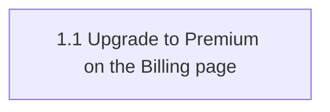

# aire State Tracking

## Project Information
- **Project Type**: Brownfield
- **Workflow Type**: Epic
- **Start Date**: 2026-10-23T11:02:51Z
- **Current Stage**: PLANNING - Workflow Planning

## Tracker
- Type: LOCAL
- Parent Epic: Atlas document 7344 — "Epic: Premium Upgrade Demo (Frontend Only)"
- Epic URL: —
- Project Key / Repo / Org: —

## Workspace State
- **Existing Code**: Yes
- **Programming Languages**: JavaScript/JSX (React 19 + Vite 8 frontend), Python (FastAPI backend)
- **Build System**: npm (src/frontend), pip requirements.txt (src/backend)
- **Project Structure**: Monolith (SPA frontend + single-file API backend)
- **Workspace Root**: C:\Users\shailendra.yadav\Desktop\projects\helix-aire-v1-demo1\billing-cycle-copy
- **Code Root**: src/ (default — no `## Code Root` override needed)
- **Reverse Engineering Needed**: No — Atlas deep dive pulled

## Helix MCP Binding
- **Server**: helix
- **Docs tool(s)**: get_solution_document_tool, list_solution_documents_tool — list and fetch Atlas solution documents (Epic, Deep Dive)
- **Graph/Search tool(s)**: codebase_agent_query, codebase_cypher_query, document_chatbot_query — targeted relationship / doc queries
- **Estate / workspace id**: solution 951 "Billing-Cycle-Helix-Workshop" (repo Billing-Cycle, last ingested commit 69f67f308492a85648aa25a9ff7d8d574031344a)
- **Resolved**: 2026-10-23T11:04:11Z

## Existing-System Context
- **Workspace type**: brownfield
- **Helix MCP**: connected
- **Source**: atlas
- **Components in scope**: src/frontend/src/pages/Billing.jsx, src/frontend/src/App.css (direct dependency, unchanged: backend GET /api/billing)
- **Atlas deep dive doc**: spec/plans/atlas-deep-dive.md
- **Recorded**: 2026-10-23T11:04:44Z

## Design References
| # | Reference | Kind | Registered | Read |
|---|-----------|------|------------|------|
| 1 | Atlas document 7342 "Story: Upgrade to Premium Button (Frontend Only).md" (v7) | Atlas story doc referenced by the Epic's Stories table | 2026-10-23T11:04:44Z | Yes (Read At Stage: Requirements Analysis) |

### Reconciliations
| Reference | Decision against reference | Reason | Decided |
|---|---|---|---|
| Atlas doc 7342 | Header epic name "Self-Serve Premium Upgrade" not followed; story treated as Epic 7344 content | User answer Q7 = A | Requirements Analysis |
| Atlas doc 7342 | Badge text and section heading made data-driven (story code left them hardcoded "Standard") | User answer Q1 = A; needed for AC-3 | Requirements Analysis |
| Atlas doc 7342 | Button auto width instead of inheriting `.btn` width:100% | User answer Q3 = B | Requirements Analysis |

## Branching
- Base Branch: main
- Epic Branch: epic/7344-premium-upgrade-demo-frontend-only
- Epic PR: (not raised — raised manually at cycle end via pr-generator)

## Atlas Artifact Sync
- **Enabled**: No
- **Source**: user opt-out
- **Recorded**: 2026-10-23T11:06:23Z

## Context Project
- **Existing Knowledge**: No
- **Existing Knowledge Path(s)**: —
- **New References**: No
- **New Reference Path(s)**: —

## Extension Configuration
| Extension | Enabled | Decided At |
|---|---|---|
| Security Baseline | Yes (always enforced) | Workflow start |
| UI/UX Mockups | No | Requirements Analysis |
| Resiliency Baseline | No | Requirements Analysis |
| Property-Based Testing | No | Requirements Analysis |
| Playwright Test Automation | Standalone only (not workflow-enforced) | Workflow start |

## UI/UX Design
- **Mode**: skip
- **Provided design path(s)**: —
- **Decided At**: Requirements Analysis

## Story Planning
- **team_size**: 2 (fixed framework default, not asked)
- **story_creation_mode**: all-at-once (fixed framework default, not asked)
- **target_story_count**: 1 (user: story-generation.md Q1 = 1, confirmed story-clarification-questions.md Q1 = A)
- **Sizing-ceiling override**: Story 1.1 — 10 ACs, multiple scenario classes; user-approved 2026-10-23T12:40:01Z. Parallelism below team_size accepted by user.

## Story Tracker
| Story | Title | Requires | Tracker ID | Status | PR | Merged | Start | End | Recorded |
|-------|-------|----------|------------|--------|----|--------|-------|-----|----------|
| 1.1 | Upgrade to Premium on the Billing page (frontend only) | none | LOCAL | Ready for Development | — | — | | | 2026-10-23T12:40:50Z |

## Dependency Graph

- **Ready now (no prerequisites)**: 1.1
- **Blocked**: none
- **Inferred edges**: none (single story)
- **Parallelism**: 1 independent story, below team_size 2, accepted by the user at User Stories (single-story override)
- **Recorded**: 2026-10-23T12:40:50Z

## Code Location Rules
- **Application Code**: src/ (NEVER in spec/)
- **Documentation**: spec/ only
- **Structure patterns**: See code-generation.md Critical Rules

## Stage Progress
- [x] Workspace Detection — Tracker Selection (LOCAL)
- [x] Workspace Detection — Parent Epic Capture (Atlas doc 7344)
- [x] Workspace Detection — Helix MCP gate (Epic + Deep Dive both found; Reverse Engineering SKIPPED)
- [x] Workspace Detection — Epic branch created
- [x] Workspace Detection — Atlas Artifact Sync Opt-In (No)
- [x] Workspace Detection — Context Opt-In (1 no, 2 no)
- [x] Requirements Analysis (approved 2026-10-23T12:36:06Z)
- [x] User Stories (GATE 1 approved 2026-10-23T12:40:50Z; LOCAL — no push)
- [x] Dependency Graph (2026-10-23T12:40:50Z)
- [ ] Workflow Planning
