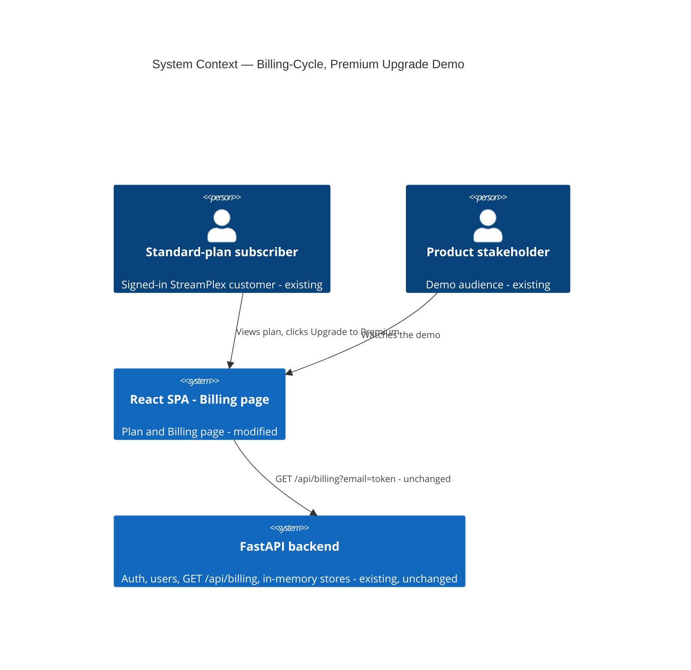
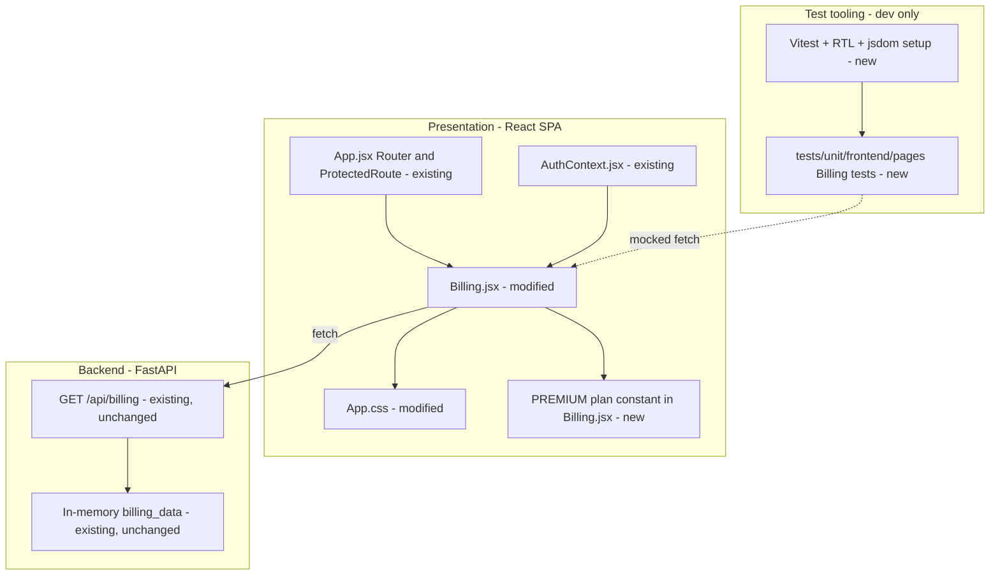
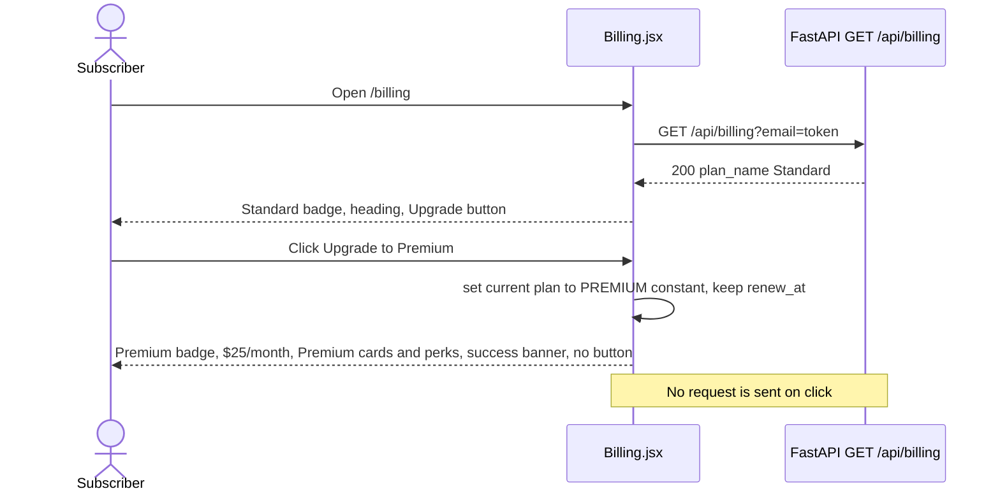

# Architecture — Billing-Cycle (StreamPlex) — Premium Upgrade Demo

> **Version**: 1.0.0 · **Generated**: 2026-10-27T14:44:13Z · **AIRE**: v1.0
> **Derived from**: spec/plans/atlas-deep-dive.md (Atlas doc 6849), spec/plans/epic-brief.md (Atlas doc 7344), spec/plans/requirements.md v1, spec/plans/stories.md, spec/plans/executions.md
> **Existing-system baseline**: Atlas via Helix MCP, Billing-Cycle-Helix-Workshop (solution_id 951), repository Billing-Cycle @ main
> **Design stages**: Application Design, Functional Design, NFR Requirements, NFR Design and Infrastructure Design were all SKIPPED (rationale in `spec/plans/executions.md`). This document therefore records the Atlas starting state plus the decisions already approved in `requirements.md` and `stories.md`. It introduces no new architecture.

## 1. System Context

StreamPlex Billing-Cycle is a full-stack monolith. A FastAPI backend serves the JSON API and, in production, the built React single-page app. A signed-in subscriber uses the Billing page to see their plan. This cycle changes only the Billing page in the browser. The backend, the auth flow and the in-memory data stores are unchanged.

Text alternative: the subscriber and the demo stakeholder use the React SPA Billing page (modified). The SPA calls the unchanged FastAPI backend through the existing `GET /api/billing?email=<token>` endpoint only.

## 2. Component Inventory

| Component | Responsibility | Status | Source |
|---|---|---|---|
| `main.jsx` | Mounts the React root | existing (unchanged) | Atlas atlas-deep-dive.md, Frontend Components |
| `App.jsx` (Router, Layout, ProtectedRoute) | Routing and the auth guard for `/billing` | existing (unchanged) | Atlas atlas-deep-dive.md, Frontend Components |
| `AuthContext.jsx` | Auth state; token (the user's email) persisted in localStorage | existing (unchanged) | Atlas atlas-deep-dive.md, Frontend Components |
| `Billing.jsx` | Billing page: fetches `/api/billing`, renders plan card, usage cards and perks. **Gains**: current-plan state, plan-driven badge and heading, Upgrade button, Premium plan constant, success banner, fail-safe fetch | existing (modified) | Atlas atlas-deep-dive.md + requirements.md REQ-F-01..12, REQ-NF-04, REQ-NF-08 |
| `App.css` | Page styles. **Gains**: Upgrade button, success banner and Premium badge styles | existing (modified) | requirements.md REQ-NF-03 |
| Frontend unit-test setup (Vitest + React Testing Library + jsdom, config in `src/frontend/`) | Runs unit tests for the Billing page | new (dev only) | requirements.md REQ-NF-05, REQ-NF-06; stories.md Story 1.1 |
| Billing page unit tests (`tests/unit/frontend/pages/`) | Unit tests mirroring `src/frontend/src/pages/Billing.jsx` | new | stories.md Stories 1.1-1.6; directory-structure rule 4a |
| FastAPI `main.py` (`/api/auth/*`, `/api/users/me`, `/api/billing`) | API, in-memory `users` and `billing_data` | existing (unchanged) | Atlas atlas-deep-dive.md, Backend Components |

Text alternative:
- Inside the SPA, `App.jsx` and `AuthContext.jsx` (existing) feed `Billing.jsx` (modified). `Billing.jsx` uses `App.css` (modified) and a new Premium plan constant, and fetches the existing `GET /api/billing`, which reads the in-memory store.
- New, dev-only test tooling runs the new Billing unit tests against a mocked fetch.

## 3. Layering and Boundaries

- **Frontend only.** This cycle changes files under `src/frontend/` and adds tests under `tests/unit/frontend/`. Nothing under `src/backend/` changes (REQ-NF-01).
- **One network call.** The Billing page calls only the existing `GET /api/billing`. The upgrade adds no request of any kind (REQ-F-03, REQ-NF-01).
- **State scope.** The upgrade lives in the Billing page component's own React state. It is not lifted into `AuthContext` or any global store, and not written to localStorage, sessionStorage, cookies or IndexedDB (REQ-F-11, REQ-NF-09). Reload or remount always starts again from the API response.
- **Single rendering path.** Standard and Premium are drawn by the same JSX. Only the data object changes (REQ-NF-04).
- **Tests stay out of `src/`.** Unit tests live under `tests/unit/frontend/`, mirroring `src/frontend/src/`. The test runner configuration lives in `src/frontend/` (where `package.json` is) and points at that folder.

## 4. Data Architecture

**No data store, schema or model changes.** The backend's in-memory `billing_data` dict and its response shape `{plan_name, price, renew_at, usages[], included_usage{}}` are unchanged (Atlas, Database Analysis).

The only new data is a **frontend constant** describing Premium. It mirrors the existing response shape so the same rendering path draws it (REQ-NF-04):

| Field | Standard (from API, existing) | Premium (frontend constant, new) |
|---|---|---|
| `plan_name` | "Standard" | "Premium" |
| `price` | "$20/month" | "$25/month" |
| `renew_at` | from API | from API (unchanged, REQ-F-08) |
| `usages[video-quality].value` / `help` | "Full HD (1080p)" / "...on the Standard plan." | "4K Ultra HD + HDR" / "The best video resolution available on the Premium plan." |
| `usages[screens].value` | "Can watch on 2 devices at once" | "Can watch on 4 devices at once" |
| `usages[downloads].value` | "Can download on 2 devices" | "Can download on 6 devices" |
| `included_usage.items` | Ad-free streaming, Spatial audio (select titles) | Ad-free streaming, Spatial audio (select titles), Dolby Atmos (select titles), each 100% |
| `included_usage.help` | "Perks included in your Standard plan." | "Perks included in your Premium plan." |

No ER diagram: the cycle introduces and changes no store or schema.

## 5. API and Integration Contracts

| Contract | Direction | Shape | Error model | Change |
|---|---|---|---|---|
| `GET /api/billing?email=<token>` | SPA consumes | 200: `{plan_name, price, renew_at, usages[], included_usage{}}` | 401 `{"detail": "Not authenticated"}` when the email is unknown | **None**. Consumption changes: a non-OK response or a rejected request is no longer used as billing data (REQ-NF-08) |

Key flow, the upgrade click:

Text alternative: the page loads Standard from the API. The click replaces the displayed plan with the Premium constant in component state, keeping `renew_at`, and shows the banner. No request is sent on click.

## 6. Cross-Cutting Decisions

- **AuthN/AuthZ**: unchanged. `ProtectedRoute` guards `/billing`; the token is the user's email (existing debt, out of scope, see Section 11).
- **Error handling**: the Billing fetch handles both a rejected request and a non-OK response. In either case it keeps the existing "Loading billing..." state and shows no internal detail (REQ-NF-08, Story 1.3). No new user-facing error UI (Q9).
- **Output safety**: all text, including the Premium values and the banner, is rendered as JSX text. No `dangerouslySetInnerHTML` (REQ-NF-07).
- **Accessibility**:
  - The Upgrade control is a native `<button>` with a visible focus outline.
  - The success banner is a polite live region (`role="status"`) (REQ-NF-02).
- **Logging and observability**: no change. The frontend adds no logging.
- **Configuration and secrets**: none added.
- **Supply chain**:
  - The test tooling is added as `devDependencies` only.
  - `src/frontend/package-lock.json` must be committed. It is listed in `src/frontend/.gitignore` today, so Story 1.1 has to remove that entry to meet REQ-NF-06 and Story 1.1 AC-4.
  - `npm audit` is recorded with the story evidence.
- **Generated output**: the coverage output (`src/frontend/coverage/`) is generated and stays uncommitted. Story 1.1 should ignore it in `src/frontend/.gitignore`; it is currently untracked but not ignored.

## 7. Non-Functional Targets

| Concern | Target | Source | How it is verified |
|---|---|---|---|
| Upgrade responsiveness | Plan display switches in the same render as the click, with no network request | requirements.md REQ-F-03, REQ-NF-01 | Unit test asserts the new values right after the click and zero additional fetch calls |
| Accessibility | Keyboard-operable button with visible focus; banner announced via `role="status"` | requirements.md REQ-NF-02 | Unit tests (role queries, keyboard events) + manual test plan |
| Unit test coverage | At or above `unitTestCoverageMin` on changed files | tests/.evals/config.json | `npm run test:coverage` in `src/frontend/` |
| Supply chain | No high or critical advisories in new dev dependencies | requirements.md REQ-NF-06, config `dependencyVulnerabilitiesAllowed` | `npm audit` |

## 8. Infrastructure and Deployment

No change. In development, the Vite dev server (port 5173) proxies `/api` to FastAPI on port 8000. In production, FastAPI serves the built SPA from `src/frontend/dist`. Nothing is deployed differently.

## 9. Delta from the Existing System

| Area | Before (Atlas) | After | Reason |
|---|---|---|---|
| Billing page plan text | "Standard" badge and heading hardcoded; `plan_name` unused | Badge and heading follow the current plan | REQ-F-07 (Story 1.2) |
| Upgrade call to action | None; page is read-only | Header "Upgrade to Premium" button, shown only when the plan is exactly "Standard" | REQ-F-01, REQ-F-02 (Story 1.4) |
| Plan switch | None | Click switches local state to the Premium constant; no request; reload reverts | REQ-F-03 to REQ-F-08, REQ-F-11 (Story 1.5) |
| Post-upgrade feedback | None | Persistent success banner (`role="status"`); button hidden | REQ-F-09, REQ-F-10 (Story 1.6) |
| Billing fetch failure | Atlas Flow 4: "401 silently ignored, data stays null". **Code**: the 401 body is passed to `setData`, and rendering then fails on `data.usages.map`. A rejected request is unhandled | Rejection caught; non-OK body never used as data; page stays on "Loading billing..." | REQ-NF-08 (Story 1.3) |
| Frontend tests | None (0 tests, no runner) | Vitest + RTL + jsdom; tests under `tests/unit/frontend/` | REQ-NF-05, REQ-NF-06 (Story 1.1) |
| `src/frontend/.gitignore` | Ignores `package-lock.json`; does not ignore `coverage/` | Lock file tracked; `coverage/` ignored | REQ-NF-06 (Story 1.1) |

**Atlas observation** (not an edit to Atlas, per helix-atlas-integration.md Section 5.3): Atlas Flow 4 describes the 401 path as "data stays null". The current code does not behave that way. This document follows the code for the Before column, and Story 1.3 closes the gap.

## 10. Verifiable Constraints

### ARCH-01 — Frontend-only boundary
- **Constraint**: Change no backend file, and add no network call beyond the existing `GET /api/billing`.
- **Verifiable as**: The diff must not modify any file under `src/backend/`, and must not add any new `fetch(`, `XMLHttpRequest`, `axios` or other HTTP call, nor any new request URL, in `src/frontend/`. Score 0 if either occurs.
- **Weight**: 0.25
- **Source**: spec/plans/requirements.md (REQ-NF-01, REQ-F-03)

### ARCH-02 — Single Premium data source and rendering path
- **Constraint**: Define the Premium plan values once, as a constant with the `/api/billing` response shape, and render them through the same JSX path as the Standard data.
- **Verifiable as**: In the diff, Premium values ("$25/month", "4K Ultra HD + HDR", "Can watch on 4 devices at once", "Can download on 6 devices", "Dolby Atmos (select titles)") appear only inside one constant object, never as JSX literals. No second, Premium-only copy of the plan-card, usage-card or perks markup is added. Score 0 if Premium values are hardcoded in markup or the markup is duplicated for Premium.
- **Weight**: 0.20
- **Source**: spec/plans/requirements.md (REQ-NF-04)

### ARCH-03 — Upgrade lives in component state only
- **Constraint**: Keep the upgraded plan in the Billing page component's React state; never persist or globalise it.
- **Verifiable as**: The diff must not write plan or upgrade state to `localStorage`, `sessionStorage`, `document.cookie` or IndexedDB, must not add it to `AuthContext` or another context or global store, and must not send it to the server. Score 0 if any of these occurs.
- **Weight**: 0.20
- **Source**: spec/plans/requirements.md (REQ-F-11, REQ-NF-09)

### ARCH-04 — Escaped output only
- **Constraint**: Render all new text through JSX text nodes; never inject raw HTML.
- **Verifiable as**: The diff must not add `dangerouslySetInnerHTML`, `innerHTML`, `outerHTML` or `insertAdjacentHTML` anywhere under `src/frontend/`. Score 0 on any occurrence.
- **Weight**: 0.15
- **Source**: spec/plans/requirements.md (REQ-NF-07)

### ARCH-05 — Fail-safe billing fetch
- **Constraint**: Handle both a rejected request and a non-OK response on the Billing fetch, without using the error body as data or showing internal details.
- **Verifiable as**: Any changed fetch chain in `Billing.jsx` must have a rejection handler (`.catch` or try/catch around `await`), and must check `response.ok` (or the status) before calling the data setter. No status code, response body or error message may be rendered to the user. Score 0 if the changed fetch lacks either guard or displays error internals.
- **Weight**: 0.10
- **Source**: spec/plans/requirements.md (REQ-NF-08)

### ARCH-06 — Dev-only, pinned test tooling
- **Constraint**: Add test libraries only as devDependencies, with exact versions pinned in a committed lock file.
- **Verifiable as**: Any test library (vitest, @testing-library/*, jsdom) added in the diff must appear under `devDependencies`, never `dependencies`. A diff that changes `src/frontend/package.json` dependencies must also include `src/frontend/package-lock.json`. Score 0 if a test library lands in `dependencies` or the lock file is missing from such a diff.
- **Weight**: 0.10
- **Source**: spec/plans/requirements.md (REQ-NF-05, REQ-NF-06)

Weights: 0.25 + 0.20 + 0.20 + 0.15 + 0.10 + 0.10 = 1.00

## 11. Explicitly Out of Scope

- Any backend endpoint, model, store or migration, including a real upgrade or entitlement change. That belongs to the separate "Self-Serve Premium Upgrade" Epic.
- Confirmation modal, proration, payment, downgrade, other plan tiers.
- Persisting the upgrade, and global state management for plans.
- A visible error state for a failed billing load (only the fail-safe handling in ARCH-05).
- Pre-existing security debt recorded by Atlas:
  - the email used as the bearer token
  - plaintext passwords in the mock store
  - CORS `allow_origins=["*"]`
  - missing HTTP security headers
  - missing structured logging
- Browser (Playwright) automation in the implement workflows. It is standalone only, via `/playwright-implement`.
- CI pipeline: the user opted out at the STOP checkpoint.
