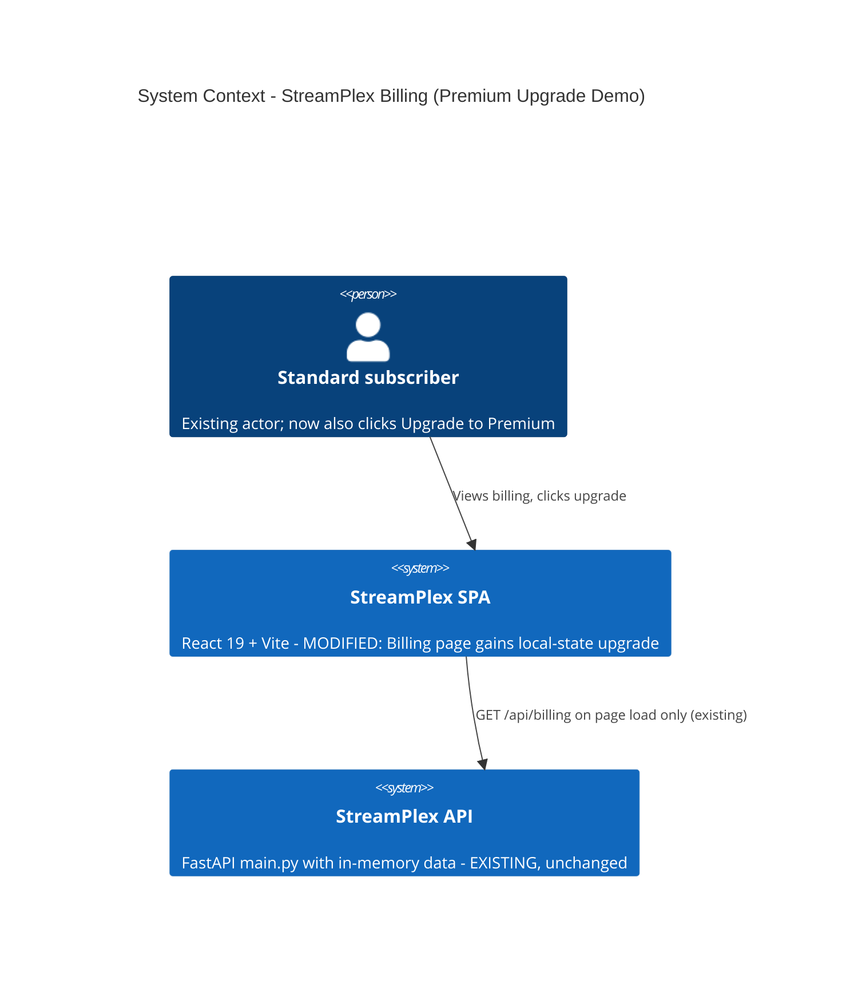
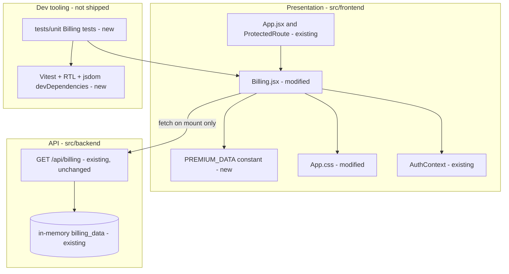
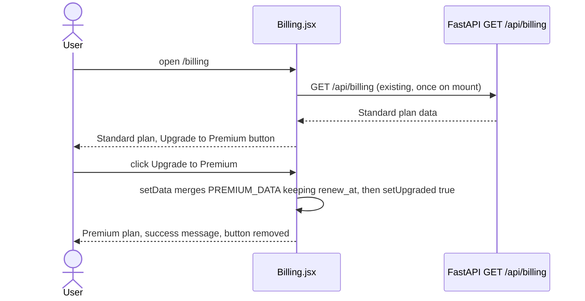

# Architecture: Billing-Cycle (StreamPlex), Premium Upgrade Demo

> **Version**: 1.0.0 · **Generated**: 2026-10-23T12:52:00Z · **AIRE**: v1.0
> **Derived from**: `spec/plans/atlas-deep-dive.md` (Atlas doc 6849), `spec/plans/requirements.md` v1, `spec/plans/stories.md`, `spec/plans/executions.md`, `runtime-artifacts/aire-state.md` (`## Design References` and `### Reconciliations`; Atlas story doc 7342)
> **Existing-system baseline**: Atlas via Helix MCP, solution 951 "Billing-Cycle-Helix-Workshop" (repo Billing-Cycle, ingested commit 69f67f3)
> **Design stages**: Application Design, Functional Design, NFR Requirements, NFR Design and Infrastructure Design were all **skipped** (see `spec/plans/executions.md`). Each section below states the default that applies instead. No new architecture is introduced.

## 1. System Context

StreamPlex is a full-stack monolith. A React 19 single-page app (Vite 8) calls a single-file FastAPI backend that keeps users and billing data **in memory** (Atlas: Architectural Style and Patterns). A Standard subscriber logs in and views the Billing page. This cycle adds an "Upgrade to Premium" interaction that runs **entirely in the browser**: the backend and its contract are unchanged and not called by the upgrade.

Text alternative: a Standard subscriber uses the StreamPlex SPA, which is modified. The SPA calls the existing, unchanged StreamPlex API only once, on Billing page load (`GET /api/billing`). The upgrade click makes no call.

## 2. Component Inventory

| Component | Responsibility | Status | Source |
|---|---|---|---|
| `Billing` (`src/frontend/src/pages/Billing.jsx`) | Loads billing data, renders plan and usage. Now also renders data-driven plan labels, the conditional upgrade button, the local upgrade handler and the success message | existing (modified) | Atlas Frontend Components; requirements REQ-F-01..10 |
| `PREMIUM_DATA` constant (in `Billing.jsx`) | Hardcoded Premium plan values merged into state on upgrade | new | Atlas story doc 7342 Step 1; REQ-F-03 |
| `App.css` | Global styles. Gains `.upgrade-btn` (auto width) and `.upgrade-success` | existing (modified) | REQ-F-08; story 7342 |
| `IncludedUsageCard`, `UsageIcon`, `InfoIcon` (in `Billing.jsx`) | Render perks, icons and tooltips | existing (unchanged) | Atlas Frontend Components |
| `AuthContext` | Supplies `token` (the user's email) used by the billing fetch | existing (unchanged) | Atlas Flow 4 |
| `App.jsx` / `ProtectedRoute` | Routes `/billing` to `Billing` behind the auth guard | existing (unchanged) | Atlas Architectural Style |
| FastAPI `GET /api/billing` (`src/backend/main.py`) | Returns `plan_name`, `price`, `renew_at`, `usages[]`, `included_usage{}` | existing (unchanged) | Atlas Flow 4 |
| Frontend unit-test harness (Vitest, React Testing Library, jsdom; tests in `tests/unit/`) | Unit tests for the Billing page | new (dev-only) | REQ-NF-04 |

Text alternative: `App.jsx` renders `Billing.jsx` (modified). `Billing.jsx` reads `AuthContext` and uses the new `PREMIUM_DATA` constant and the modified `App.css`. It calls the unchanged `GET /api/billing` only on mount, and that endpoint reads the existing in-memory store. The new unit tests exercise `Billing.jsx` using the dev-only Vitest harness.

## 3. Layering and Boundaries

- **Presentation (SPA)** may call the API only through the existing `fetch('/api/billing?...')` in the `Billing` mount effect. **The upgrade path performs no I/O**: no `fetch`, XHR, router navigation or storage write.
- **Upgrade state is component-local.** It lives in the existing `Billing` `useState` (`data` / `setData`) plus a boolean `upgraded` flag. No React context, global store, `localStorage` or `sessionStorage` is introduced for it. A reload or remount therefore re-fetches and restores Standard (REQ-F-10).
- **API layer**: `src/backend/**` is out of bounds for this cycle (REQ-NF-01).
- **Tests** live under the repo-root `tests/unit/`, never under `src/` (AIRE five-roots rule). Test tooling is dev-only.

## 4. Data Architecture

No store, schema or persisted model is introduced or changed (Functional Design skipped: no new data model). The only data change is in-memory **client state**. On click, `data` becomes `{ ...prev, ...PREMIUM_DATA, renew_at: prev.renew_at }`, which has the same shape as the existing `/api/billing` response:

| Field | Standard (from API, existing) | Premium (`PREMIUM_DATA`, new) |
|---|---|---|
| `plan_name` | "Standard" | "Premium" |
| `price` | "$20/month" | "$40/month" |
| `renew_at` | from API | **preserved** from previous state |
| `usages[]` | Full HD (1080p); 2 devices; 2 downloads | 4K Ultra HD; 4 devices; 6 downloads |
| `included_usage.items[]` | Ad-free; Spatial audio | Ad-free; Spatial audio; Dolby Vision |

No `erDiagram` is included because no store or schema changes.

## 5. API and Integration Contracts

- **Consumed (existing, unchanged)**: `GET /api/billing?email=<token>` returns `200 {plan_name, price, renew_at, usages[], included_usage{title, items[], help}}` (Atlas Flow 4). The contract is not modified.
- **Exposed**: none. The new behaviour is UI-only.
- **Sequence of the new interaction** (no backend participant after load):

Text alternative: on opening `/billing`, `Billing.jsx` calls `GET /api/billing` once and renders the Standard plan with the upgrade button. Clicking the button updates local state only. The page re-renders as Premium with the success message and without the button, and there is no further API call.

## 6. Cross-Cutting Decisions

- **AuthN/AuthZ**: unchanged. `ProtectedRoute` and `AuthContext` are not modified. The pre-existing auth weaknesses Atlas records (email as token, token in `localStorage` and in the query string) are **out of scope and must not be extended** by this cycle.
- **Error handling**: unchanged for the fetch. The upgrade handler is synchronous, pure state assignment, and cannot throw on loaded data. The button renders only after `data` is loaded.
- **Logging**: none added. No `console.*` of tokens or user data.
- **Accessibility**: a native `<button>` with a visible focus outline. The success message uses `role="status"` (REQ-NF-03).
- **Configuration and secrets**: none.
- **Resilience and observability**: N/A (the resiliency extension is off; demo, frontend-only).

## 7. Non-Functional Targets

| Concern | Target | Source | How it is verified |
|---|---|---|---|
| Network on upgrade | 0 requests after the initial load | REQ-NF-01 | Unit test asserts `fetch` call count stays 1 |
| Regressions | Existing Standard display is identical | REQ-NF-02 | Unit test characterizes current display; manual test plan |
| Accessibility | Keyboard-operable, visible focus, `role="status"` | REQ-NF-03 | Unit test (role query) and manual keyboard check |
| Unit coverage | At least `unitTestCoverageMin` on changed files | REQ-NF-04; `tests/.evals/config.json` | Vitest coverage (lcov) |
| Supply chain | devDependencies exact-pinned, lock file committed | REQ-NF-05; SECURITY-10 | Diff of `package.json` and `package-lock.json` |

## 8. Infrastructure and Deployment

Unchanged (Infrastructure Design skipped). Locally, Vite serves on :5173 and proxies `/api` to FastAPI on :8000. In production, FastAPI serves the built SPA through `StaticFiles` (Atlas Flow 6). The new devDependencies are not part of the production bundle. CI/CD is not configured for this cycle (user opt-out).

## 9. Delta from the Existing System

| Area | Before (Atlas) | After | Reason |
|---|---|---|---|
| Billing page interactivity | Read-only | "Upgrade to Premium" button for Standard users; local-state switch to Premium | Epic 7344 |
| Plan badge and heading text | Hardcoded "Standard" | Rendered from `data.plan_name` | REQ-F-05 (Q1 = A) |
| Styles | No upgrade styles | `.upgrade-btn` (auto width), `.upgrade-success` | REQ-F-08, REQ-F-06 |
| Frontend tests | None (0% coverage, no runner) | Vitest, RTL and jsdom devDependencies; `tests/unit/` Billing tests | REQ-NF-04 |
| Backend and API | `GET /api/billing` | Unchanged | REQ-NF-01 |

## 10. Verifiable Constraints

### ARCH-01: No network or I/O in the upgrade path
- **Constraint**: The upgrade click handler only updates component state, with no network, storage or navigation side effects.
- **Verifiable as**: Inspect the upgrade handler and anything it calls in the diff. Score 0 if it calls `fetch`, `XMLHttpRequest`, axios or any HTTP client, writes `localStorage`/`sessionStorage`/cookies, or triggers navigation or a page reload.
- **Weight**: 0.25
- **Source**: spec/plans/requirements.md (REQ-NF-01, REQ-F-10)

### ARCH-02: Upgrade state is local to the Billing component and preserves renew_at
- **Constraint**: The upgrade is applied through the existing `Billing` `setData` state as a functional merge of the Premium constant that keeps the previous `renew_at`, with no new global store or context.
- **Verifiable as**: Score 0 if the diff introduces a new React context, global store or module-level mutable state for plan data, or replaces `data` without carrying over the previous `renew_at` value.
- **Weight**: 0.20
- **Source**: spec/plans/requirements.md (REQ-F-03, REQ-F-04); Atlas story doc 7342 Step 3

### ARCH-03: Plan labels are data-driven
- **Constraint**: The current-plan badge and the "What's included with" heading render the plan name from `data.plan_name`.
- **Verifiable as**: Score 0 if, after the change, `Billing.jsx` still renders a hardcoded "Standard" or "Premium" literal as the badge text or inside the "What's included with" heading, instead of `data.plan_name`.
- **Weight**: 0.15
- **Source**: spec/plans/requirements.md (REQ-F-05); runtime-artifacts/aire-state.md Reconciliations

### ARCH-04: Premium values defined once as a module-level constant
- **Constraint**: All Premium plan values live in a single `PREMIUM_DATA` constant declared outside the `Billing` component.
- **Verifiable as**: Score 0 if any Premium value ("$40/month", "4K Ultra HD", "Dolby Vision (select titles)") is declared inside the component body, or duplicated in more than one place in production code.
- **Weight**: 0.10
- **Source**: Atlas story doc 7342 Step 1; spec/plans/requirements.md (REQ-F-03)

### ARCH-05: Backend untouched
- **Constraint**: This cycle makes no change to the backend or its API contract.
- **Verifiable as**: Score 0 if the diff modifies any file under `src/backend/`.
- **Weight**: 0.15
- **Source**: spec/plans/requirements.md (REQ-NF-01); spec/plans/epic-brief.md (Out of Scope)

### ARCH-06: Test code and tooling placement
- **Constraint**: Unit tests live under the repo-root `tests/unit/`, and new test tooling is added only as exact-pinned devDependencies.
- **Verifiable as**: Score 0 if test files are added under `src/`, if any new package is added to `dependencies` (not `devDependencies`), or if a newly added devDependency uses a range specifier (`^`, `~`, `*`, `latest`) rather than an exact version.
- **Weight**: 0.15
- **Source**: spec/plans/requirements.md (REQ-NF-04, REQ-NF-05); common/directory-structure.md

Weights: 0.25 + 0.20 + 0.15 + 0.10 + 0.15 + 0.15 = **1.00**

## 11. Explicitly Out of Scope

- Any backend endpoint, upgrade API, proration, or confirmation modal
- Persisting the plan change (server, `localStorage`, or anywhere else)
- A downgrade flow or other plan tiers
- New global state management, routing changes, or new components or files in `src/frontend/src/` beyond `Billing.jsx` and `App.css`
- Remediating the pre-existing auth and secret weaknesses recorded in the Atlas deep dive
