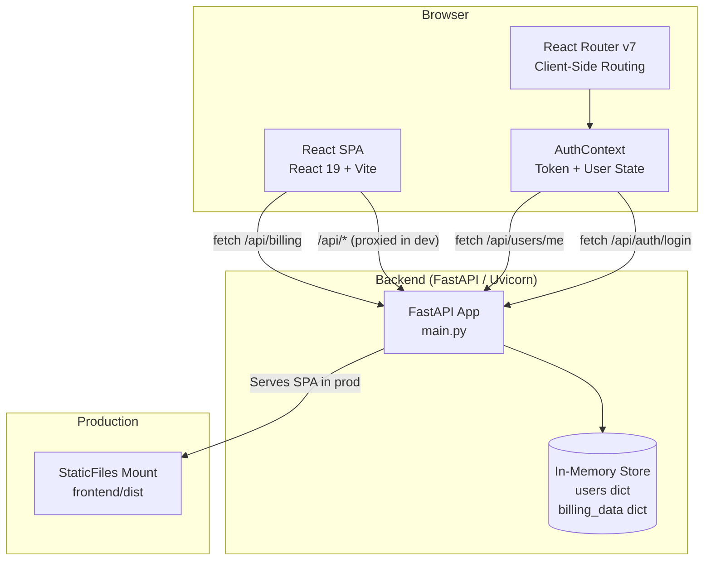
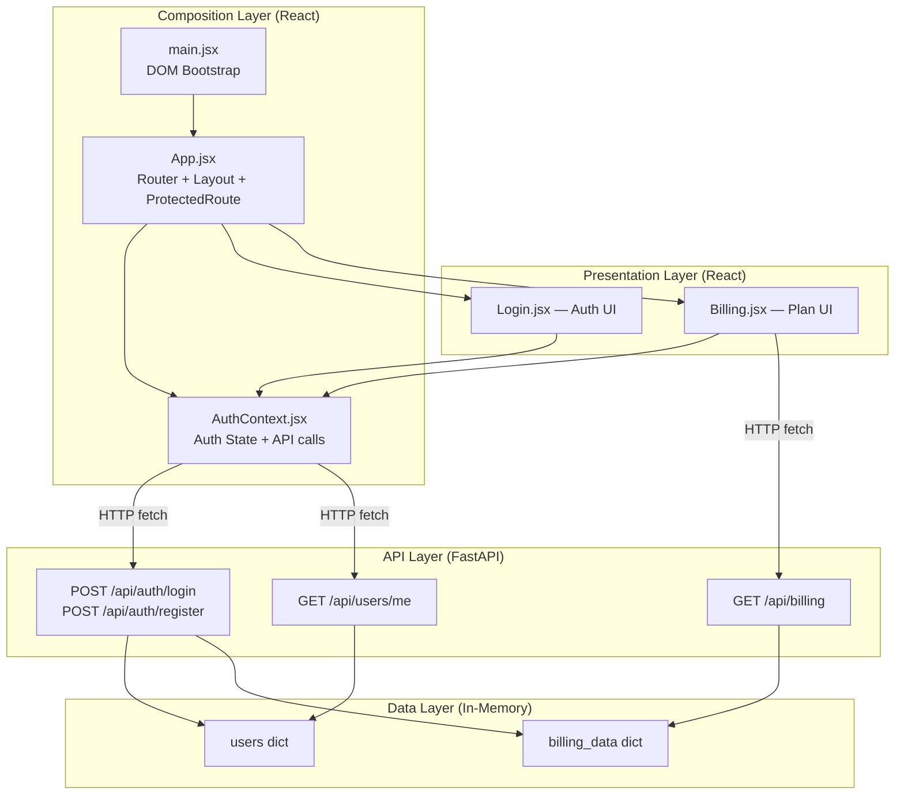
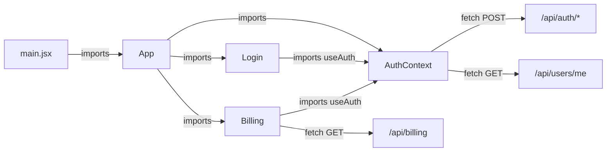
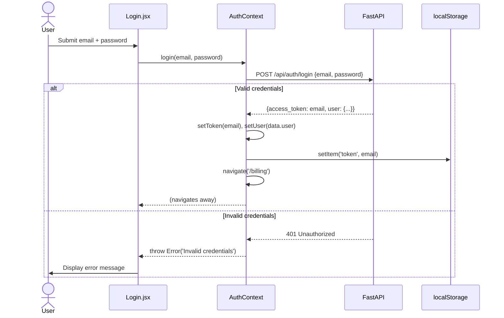
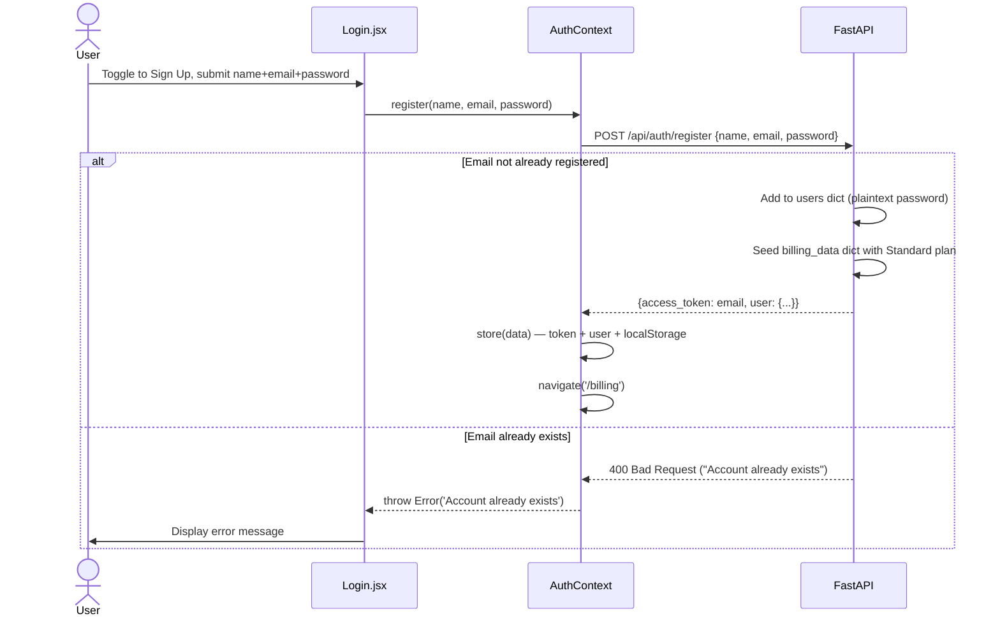
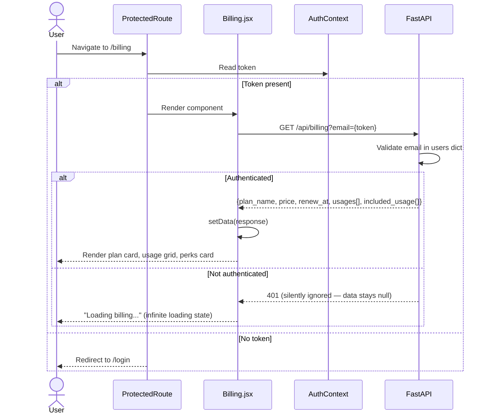
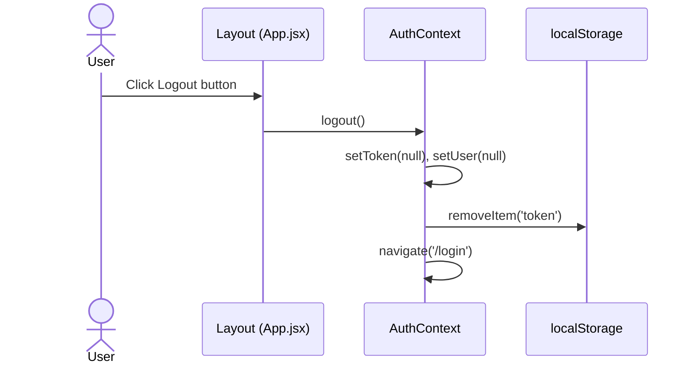
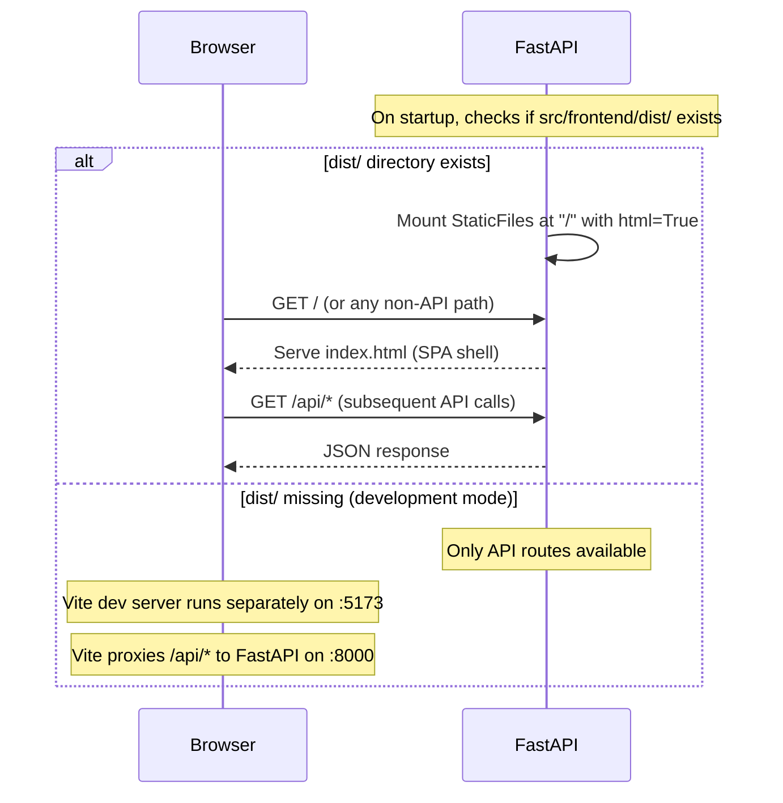
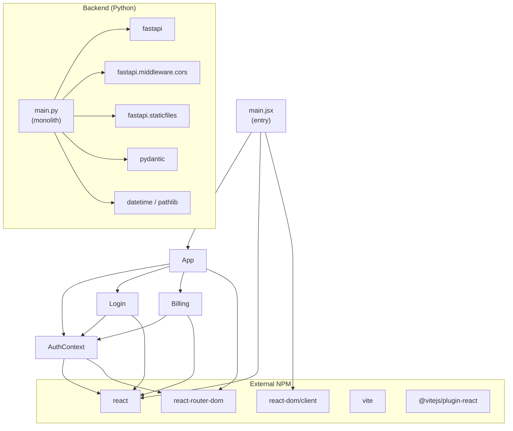

> **Source**: Atlas via Helix MCP
> **Server / tool**: helix · get_solution_document_tool (document_id 6849, "Deep Dive: Billing-Cycle.md", artifact_type analysis, version 29, lifecycle CURRENT)
> **Estate**: Billing-Cycle-Helix-Workshop (solution_id 951) — repository Billing-Cycle, branch main
> **Scope pulled**: the whole deep dive document (Atlas holds one deep dive for this estate). Components in scope for this cycle, selected from the Epic's Referenced Paths plus one hop: frontend Billing page (src/frontend/src/pages/Billing.jsx), frontend styles (src/frontend/src/App.css), and the read-only backend GET /api/billing contract (src/backend/main.py, plan_name field)
> **Fetched**: 2026-10-27T13:51:02Z
> **Freshness**: Atlas document last updated 2026-10-15T09:03:35Z; knowledge graph last ingested at commit 69f67f308492a85648aa25a9ff7d8d574031344a, which is not in this workspace's git history (this workspace is the billing-cycle-copy repository)
> **Transformation**: content copied verbatim except 10 occurrences of the section-sign character, replaced with ">" (Appendix D cross-references) per the CLAUDE.md content rule. Nothing else was changed.

# Deep Dive Analysis: Billing-Cycle

**Created:** 2026-10-15
**For:** Shailendra
**Analysis Depth:** Exhaustive
**Status:** COMPLETE
**Steps Completed:** 13 of 13

> **Purpose:** Exhaustive system analysis covering architecture, flows, dependencies, code quality, testing, security, performance, and documentation with prioritized strategic recommendations.

**Scope Configuration:**
- **Focus Areas:** All (comprehensive)
- **Code Quality Analysis:** Yes
- **Security Considerations:** Yes
- **Mode:** YOLO (automated)

---

## Executive Summary

### System Overview

**Billing-Cycle** (internally branded as **StreamPlex**) is a full-stack proof-of-concept application demonstrating a subscription billing dashboard for a streaming service. It consists of a React 19 single-page application (Vite 8 build toolchain) and a Python FastAPI backend served by Uvicorn. The entire codebase is 652 lines of code across 9 source files — a lean, focused POC.

The system implements a complete authentication flow (login, registration, session restore, logout), a protected billing dashboard showing plan details and usage features, and a unified production deployment model where the FastAPI process serves the SPA's built output via a `StaticFiles` mount. The frontend and backend share URL space via a Vite dev proxy in development.

**Architecturally**, the system is a single-tier full-stack monolith with no database, no external service integrations, and no persistence layer. All data lives in Python dictionaries that reset on every server restart. The codebase is clean and readable at POC scale, but carries critical security, persistence, and structural gaps that must be fully redesigned before any production deployment. This is emphatically a demo application, not a production system.

### Complexity Assessment

- **Overall Complexity:** Low (by design — deliberately minimal POC)
- **Lines of Code:** 652 total (441 JSX frontend, 163 Python backend, 48 config/JSON)
- **Components:** 6 frontend components + 1 backend monolith = 7 significant components
- **External Dependencies:** 8 frontend npm packages + 3 Python packages (11 total; all unpinned)
- **Technical Debt:** High — concentrated in security, persistence, testing, and documentation

### Top 10 Critical Findings

1. **[Security - Critical]: Authentication is fundamentally broken** — the "access_token" returned by the API is literally the user's email address. It is trivially forgeable, stored in `localStorage` (XSS-exposed), and transmitted as a plaintext GET query parameter (visible in server logs). No cryptographic verification is performed on any subsequent request.

2. **[Security - Critical]: Passwords stored in plaintext** — the in-memory `users` dict stores raw password strings. Any memory dump, log output, or debug session exposes all credentials.

3. **[Security - Critical]: Wildcard CORS with credentials** — `allow_origins=["*"]` combined with `allow_credentials=True` is invalid per the CORS specification. FastAPI raises a RuntimeError about this combination; browsers will reject responses under this config.

4. **[Persistence - Critical]: No data persistence** — all user accounts and billing data live in Python dictionaries that are destroyed on every server restart. The system cannot function as a real application in this state.

5. **[Testing - Critical]: Zero test coverage** — not a single unit, integration, or end-to-end test exists anywhere in the codebase. Authentication logic, route protection, and billing data fetching are completely untested.

6. **[Architecture - High]: Backend is a single-file monolith** — all routes, models, data stores, CORS config, and static file serving are in one 163-line `main.py`. Any growth makes this file unmaintainable.

7. **[Security - High]: Hardcoded demo credentials in production code** — `tpg@example.com`/`password` is the seeded user, and `Login.jsx` pre-fills the email and password fields with these credentials via `useState`. Both are committed to source control.

8. **[Documentation - High]: Near-total absence of documentation** — no root README, no setup guide, no API documentation, no architecture docs. A new developer cannot run the application without reading the source code.

9. **[Quality - Medium]: 35% code duplication** — the billing data structure is defined twice verbatim: once as seed data (lines 31-68) and again inside the `register` route handler (lines 106-141). Plan changes require synchronized edits in two places.

10. **[Performance - Medium]: No frontend caching or error handling** — billing data and user profile are re-fetched on every component mount with no cache. `Billing.jsx` silently swallows API errors, producing an infinite "Loading billing..." state.

### Risk Assessment

| Risk Category | Level | Impact | Mitigation Priority |
|---------------|-------|--------|---------------------|
| Security | 🔴 High | Auth token forgeable; passwords plaintext; CORS misconfigured; no session invalidation — app cannot be safely exposed to users | Immediate — before any external access |
| Technical Debt | 🟠 High | Backend monolith, 35% duplication, 9 code smells, no tests — will compound rapidly if features are added | Short-term — this sprint |
| Scalability | 🔴 High | In-memory store cannot survive restarts, cannot scale horizontally, has no connection pooling — hard ceiling at 1 instance | Medium-term — introduce DB |
| Maintainability | 🟡 Medium | Clean naming, no circular deps, consistent style — but zero documentation and zero tests mean every future change carries discovery overhead | Short-term |
| Documentation | 🔴 High | No README, no setup guide, no API docs — team onboarding is completely blocked | Immediate — generate-readme workflow |

---

## Comprehensive Reconnaissance

### Directory Structure

```
Billing-Cycle/
└── src/
    ├── backend/
    │   ├── main.py                    # FastAPI application (all routes, models, data)
    │   ├── requirements.txt           # Python dependencies
    │   └── .gitignore
    └── frontend/
        ├── index.html                 # HTML shell
        ├── vite.config.js             # Vite build config + dev proxy
        ├── package.json               # NPM manifest
        ├── .oxlintrc.json             # Linter config
        ├── .gitignore
        ├── public/
        │   ├── favicon.svg
        │   └── icons.svg
        └── src/
            ├── main.jsx               # React DOM entry point
            ├── App.jsx                # Router, layout, protected routes
            ├── App.css                # Global styles
            ├── index.css              # Base/reset styles
            ├── context/
            │   └── AuthContext.jsx    # Auth state, login/register/logout
            ├── pages/
            │   ├── Login.jsx          # Login & Sign-Up page
            │   └── Billing.jsx        # Plan & billing dashboard
            └── assets/
                ├── hero.png
                ├── react.svg
                └── vite.svg
```

### Technology Stack

**Programming Languages:**

| Language | Files | Lines of Code | Percentage |
|----------|-------|---------------|------------|
| JSX/React (TypeScript-parsed) | 5 | 441 | 68% |
| Python | 1 | 163 | 25% |
| JSON | 2 | 32 | 5% |
| JavaScript | 1 | 14 | 2% |

**Frameworks & Libraries:**

| Framework/Library | Version | Purpose | Status |
|-------------------|---------|---------|--------|
| React | ^19.2.8 | Frontend UI framework | Current (latest) |
| React DOM | ^19.2.8 | DOM rendering | Current |
| React Router DOM | ^7.18.2 | Client-side routing | Current |
| Vite | ^8.2.2 | Build tool & dev server | Current |
| @vitejs/plugin-react | ^6.1.0 | React HMR/JSX transform via Oxc | Current |
| FastAPI | unversioned (latest) | Python web framework / API | Current |
| Uvicorn[standard] | unversioned (latest) | ASGI server | Current |
| python-multipart | unversioned (latest) | Form data parsing | Current |
| Pydantic | (FastAPI dependency) | Request/response validation | Current |

**Build & Tooling:**

- **Build System:** Vite 8.2.2 (frontend) / Uvicorn ASGI (backend)
- **Package Manager:** npm (frontend) — no lock file committed; pip (backend) via requirements.txt (no versions pinned)
- **Linter:** OxLint ^1.79.0
- **Testing Framework:** None detected — no test files exist
- **CI/CD:** None detected — no `.github/`, `.gitlab-ci.yml`, or similar config found

### Comprehensive Statistics

| Metric | Value |
|--------|-------|
| Total Source Files | 9 (excl. assets, git objects) |
| Total LOC | 652 |
| Code Files | 7 (5 JSX, 1 Python, 1 JS) |
| Test Files | 0 |
| Config Files | 3 (package.json, vite.config.js, .oxlintrc.json) |
| Documentation Files | 1 (frontend README — boilerplate only) |
| Average File Size | ~72 LOC |
| Largest File | `Billing.jsx` (163 LOC) / `main.py` (163 LOC) — tied |
| Code-to-Comment Ratio | ~0 comments across entire codebase (no inline docs) |

### Entry Points

**Application Entry Points:**

- `src/frontend/src/main.jsx` — React DOM bootstrap; mounts `<App />` in StrictMode
- `src/backend/main.py` — FastAPI `app` instance; `uvicorn src.backend.main:app` to start

**API Endpoints (4 total across 1 module):**

| Method | Path | Purpose |
|--------|------|---------|
| POST | `/api/auth/login` | Authenticate user with email/password |
| POST | `/api/auth/register` | Create new user account |
| GET | `/api/users/me?email=` | Fetch current user profile |
| GET | `/api/billing?email=` | Fetch billing plan and usage data |

**CLI Interfaces:** None

**Background Jobs:** None

**Scheduled Tasks:** None

**Static File Serving:** In production, FastAPI mounts the built frontend at `/` from `src/frontend/dist/`

---

## Deep Architectural Analysis

### Architectural Style & Patterns

**Primary Style:** **Full-Stack Monolith with SPA frontend** — a single Python FastAPI backend serves all API routes and (in production) statically hosts the React frontend via `StaticFiles`. The frontend is a React Single-Page Application with client-side routing. Both the backend and frontend are housed in a single repository under `src/`.

Evidence:
- Single `main.py` file defines all routes, all in-memory data stores, all Pydantic models, and mounts the SPA
- Single `App.jsx` manages all routing and layout
- No service separation, no message queues, no microservice boundaries

**Detected Patterns:**

| Pattern | Location | Description |
|---------|----------|-------------|
| **Context API (State Management)** | `AuthContext.jsx` | Centralized auth state (user, token, login, register, logout) injected via React Context — clean and correct for this scale |
| **Protected Routes** | `App.jsx` — `ProtectedRoute` component | Route-level auth guard that redirects unauthenticated users to `/login` |
| **Layout Wrapper** | `App.jsx` — `Layout` component | Shell component rendering shared header/nav around page content |
| **Fetch-on-Mount** | `Billing.jsx`, `AuthContext.jsx` | `useEffect` + `fetch` pattern for data loading after component mount |
| **Repository-Style In-Memory Store** | `main.py` — `users` and `billing_data` dicts | Simulated data layer using Python dicts; mimics a repository but without abstraction |
| **Pydantic Request Models** | `main.py` — `LoginRequest`, `RegisterRequest`, `TokenRequest` | Input validation via Pydantic BaseModel on all POST endpoints |
| **Vite Dev Proxy** | `vite.config.js` | Proxies `/api/*` to `localhost:8000` during development, enabling unified URL space |

**Anti-Patterns Detected:**

| Anti-Pattern | Location | Impact | Recommendation |
|-------------|----------|--------|----------------|
| **Wildcard CORS** | `main.py` L10-16 — `allow_origins=["*"]` | High security risk in production — any origin can make credentialed API calls | Restrict to known origins; never use `*` with `allow_credentials=True` (these two settings conflict per CORS spec and FastAPI warns about this) |
| **God Module (Backend)** | `main.py` — routes, models, data, config all in 163 lines | Zero separation of concerns; adding any feature requires editing the same file | Split into `models.py`, `routers/`, `data/` (or a real DB) |
| **Token = Email in plaintext** | `main.py` L90 — `"access_token": payload.email` / `AuthContext.jsx` L13 | Email used as bearer token; stored in `localStorage`; passed as query param in GET requests — trivially forgeable, XSS-vulnerable, exposed in server logs | Implement proper JWT or session tokens |
| **Passwords stored in plain text** | `main.py` — `users` dict stores raw password strings | Any memory dump or log leak exposes all credentials | Hash passwords with bcrypt/argon2 before storing |
| **Business logic in page components** | `Billing.jsx` — inline API fetch with no error handling | Untestable, duplicated if more pages need billing data | Extract to a custom hook or service layer |
| **Hardcoded demo credentials pre-filled** | `Login.jsx` L8-9 — `useState('tpg@example.com')` / `useState('password')` | Dev shortcut left in production code; signals POC nature | Remove before any real deployment |

### Architecture Diagrams

#### High-Level System Architecture



#### Layer Diagram



#### Module Interactions



### Complete Component Catalog

#### Backend Components

| Component | Path | Responsibility | Complexity | Issues |
|-----------|------|---------------|------------|--------|
| **FastAPI App** | `src/backend/main.py` | Entire backend: CORS config, all routes, all models, in-memory store | Simple (163 LOC) | God module, no separation |
| **LoginRequest** | `main.py:70` | Pydantic model: email + password validation | Simple | None |
| **RegisterRequest** | `main.py:75` | Pydantic model: name + email + password | Simple | None |
| **TokenRequest** | `main.py:81` | Pydantic model: token field (unused in current routes) | Simple | Unused model |
| **`users` dict** | `main.py:19` | In-memory user store with hardcoded seed user | Simple | Not persistent; reset on restart |
| **`billing_data` dict** | `main.py:31` | In-memory billing store with hardcoded seed data | Simple | Not persistent; reset on restart |

#### Frontend Components

| Component | Path | Responsibility | Dependencies | Complexity |
|-----------|------|---------------|--------------|------------|
| **main.jsx** | `src/frontend/src/main.jsx` | React DOM root mount; wraps App in StrictMode | React, ReactDOM, App | Simple |
| **App.jsx** | `src/frontend/src/App.jsx` | BrowserRouter, route definitions, Layout shell, ProtectedRoute guard | React Router, AuthContext, Login, Billing | Simple/Medium |
| **AuthContext.jsx** | `src/frontend/src/context/AuthContext.jsx` | Auth state management; login/register/logout API calls; localStorage token persistence | React, React Router | Medium |
| **Login.jsx** | `src/frontend/src/pages/Login.jsx` | Combined login + sign-up form UI; toggleable mode | AuthContext | Medium |
| **Billing.jsx** | `src/frontend/src/pages/Billing.jsx` | Billing dashboard: plan info, usage cards, included perks; fetches /api/billing | AuthContext | Medium |

### Architectural Assessment

**Strengths:**

- **Clean layer separation on the frontend**: Context API correctly isolates auth state from UI components; pages are pure presentational with logic delegated to context
- **Vite proxy eliminates CORS complexity** during development — frontend calls `/api/*` as if co-located, with the proxy handling the backend redirect
- **Pydantic validation** on all POST endpoints provides automatic request parsing and error responses with zero boilerplate
- **Production deployment model is elegant**: single server process serves both API and SPA via `StaticFiles` mount — no Nginx/reverse-proxy needed for simple deployments
- **React Router v7 protected routes** correctly enforce auth boundaries; unauthenticated users are redirected rather than shown errors

**Weaknesses:**

- **Backend is a single-file monolith with zero separation of concerns** — all business logic, routing, models, and data co-exist in `main.py`
- **No real persistence** — all data lives in Python dictionaries that reset on every server restart
- **Authentication is fundamentally broken for production**: token = plaintext email, passwords stored in plain text, wildcard CORS with credentials
- **No test coverage** anywhere in the codebase
- **No error handling on the frontend** — `Billing.jsx` silently ignores fetch errors; loading state shows indefinitely if API fails
- **No CI/CD pipeline** — no automated testing, linting enforcement, or deployment process

**Recommendations:**

- **Immediate**: Split `main.py` into dedicated router, model, and service modules — standard FastAPI project structure (e.g., `routers/`, `models.py`, `services/`)
- **Immediate**: Replace plaintext token with JWT; hash passwords with bcrypt; restrict CORS origins
- **Short-term**: Add a real database (SQLite via SQLAlchemy for simplicity, or PostgreSQL for production-readiness)
- **Short-term**: Extract `useBilling()` hook from `Billing.jsx` for reusability and testability
- **Medium-term**: Add unit tests for backend routes (pytest + httpx TestClient) and frontend components (Vitest + React Testing Library)

---

## Comprehensive Flow Analysis

**Flows Identified: 6 across 4 categories** — Authentication (3), Business Operations (1), Error Handling (2), Background/Integration (0)

---

### Flow 1: User Login

**Purpose:** Authenticate an existing user and establish a frontend session.



**Decision Points:** Credential match check against in-memory `users` dict (no rate limiting, no lockout)
**Error Handling:** HTTP 401 propagated to UI error state — user sees message
**Edge Cases:** Token = email — any user who knows another user's email can forge a token client-side; no server-side session validation on subsequent requests

---

### Flow 2: User Registration

**Purpose:** Create a new user account with default Standard plan and billing data.



**Decision Points:** Email uniqueness check (O(1) dict key lookup)
**Security Gap:** Password stored in plaintext; renew_at calculated as `today + 30 days`

---

### Flow 3: Session Restore (Page Refresh)

**Purpose:** Re-hydrate user session from localStorage token on app load.

```mermaid
sequenceDiagram
    participant Browser
    participant AuthContext
    participant FastAPI

    Browser->>AuthContext: App mounts; useState reads localStorage 'token'
    alt Token exists in localStorage
        AuthContext->>FastAPI: GET /api/users/me?email={token}
        alt User found
            FastAPI-->>AuthContext: User object (without password)
            AuthContext->>AuthContext: setUser(data)
        else User not found
            FastAPI-->>AuthContext: 401
            AuthContext->>AuthContext: logout() — clears token, redirects to /login
        end
    else No token
        AuthContext->>AuthContext: remain unauthenticated; ProtectedRoute redirects to /login
    end
```

**Edge Case:** Since token = email, any manually crafted `localStorage['token']` will be accepted as long as a user with that email exists in the in-memory store

---

### Flow 4: View Billing Dashboard

**Purpose:** Load and display the user's plan, usage features, and plan perks.



**Performance Notes:** No caching — re-fetches on every mount; no loading skeletons
**Error Handling Gap:** Fetch errors are silently swallowed; no `.catch()` handler

---

### Flow 5: Logout

**Purpose:** Terminate the user session.



**Notes:** Purely client-side — no server-side session invalidation. Since there are no real sessions (token = email), there is nothing to invalidate server-side.

---

### Flow 6: Production Static File Serving

**Purpose:** Serve the React SPA in production from the FastAPI process.



---

### Flow Interactions

| Shared Component | Used In Flows | Potential Conflict |
|-----------------|---------------|--------------------|
| `AuthContext` | All 5 client flows | Single context instance — token state is global; rapid login/logout could cause race conditions |
| `users` in-memory dict | Login, Register, Session Restore, Billing | No locking — concurrent requests (multi-tab) write to the same Python dict; no thread safety guarantee |
| `localStorage['token']` | Session Restore, Logout | Cleared on logout but persists across tabs — logging out in one tab does not affect other open tabs |
| `FastAPI /api/users/me` | Session Restore | Called on every app mount — adds unnecessary latency on every page refresh |

**Transaction Boundaries:** None — no database, no transactions. All state mutations are immediate dict operations.

**Concurrency Considerations:** FastAPI with Uvicorn runs async, but the in-memory dict store is shared mutable state with no locking. Under concurrent registration requests, there is a theoretical TOCTOU race on the email uniqueness check (check-then-write without atomicity).

---

## Exhaustive Dependency Analysis

### Internal Dependencies

#### Dependency Graph



#### Coupling Metrics

| Module | Afferent Coupling (Ca) | Efferent Coupling (Ce) | Instability (Ce/Ca+Ce) | Assessment |
|--------|------------------------|------------------------|------------------------|------------|
| `AuthContext.jsx` | 3 (App, Login, Billing) | 2 (react, react-router-dom) | 0.40 | Moderately stable — high fan-in, low fan-out |
| `App.jsx` | 1 (main.jsx) | 4 (AuthContext, Login, Billing, react-router-dom) | 0.80 | Unstable — orchestrates everything |
| `Login.jsx` | 1 (App.jsx) | 2 (AuthContext, react) | 0.67 | Moderately unstable |
| `Billing.jsx` | 1 (App.jsx) | 2 (AuthContext, react) | 0.67 | Moderately unstable |
| `main.jsx` | 0 | 3 (App, react, react-dom/client) | 1.00 | Maximally unstable (entry point — expected) |
| `main.py` | 0 | 6 (fastapi, cors, staticfiles, pydantic, datetime, pathlib) | 1.00 | Maximally unstable (monolith entry — expected but concerning) |

#### Circular Dependencies

**None detected.** The import graph is strictly hierarchical in the frontend:
`main.jsx → App.jsx → AuthContext.jsx / Login.jsx / Billing.jsx`

No cycles. Pages depend on context; context does not depend on pages.

Backend is a single file with no internal imports, so circular dependencies are structurally impossible in the current form.

### External Dependencies

#### Frontend Dependencies

| Dependency | Current Ver | Purpose | License | Vulnerabilities | Update Rec |
|------------|------------|---------|---------|-----------------|------------|
| `react` | ^19.2.8 | UI framework | MIT | None known | ✅ Up to date |
| `react-dom` | ^19.2.8 | DOM renderer | MIT | None known | ✅ Up to date |
| `react-router-dom` | ^7.18.2 | Client-side routing | MIT | None known | ✅ Up to date |
| `vite` | ^8.2.2 | Build tool & dev server | MIT | None known | ✅ Up to date |
| `@vitejs/plugin-react` | ^6.1.0 | React + HMR via Oxc compiler | MIT | None known | ✅ Up to date |
| `oxlint` | ^1.79.0 (devDep) | Rust-based linter | MIT | None known | ✅ Up to date |
| `@types/react` | ^19.2.18 (devDep) | TypeScript types for React | MIT | None known | ✅ Up to date |
| `@types/react-dom` | ^19.2.4 (devDep) | TypeScript types for ReactDOM | MIT | None known | ✅ Up to date |

> ⚠️ **No lockfile committed** (`package-lock.json` or `yarn.lock` is absent from the repo). Version ranges with `^` mean any compatible minor/patch can install. Builds are not reproducible.

#### Backend Dependencies

| Dependency | Current Ver (pinned?) | Purpose | License | Vulnerabilities | Update Rec |
|------------|----------------------|---------|---------|-----------------|------------|
| `fastapi` | **Unpinned** | Web framework / API | MIT | None known (current) | ⚠️ Pin version |
| `uvicorn[standard]` | **Unpinned** | ASGI server | BSD | None known (current) | ⚠️ Pin version |
| `python-multipart` | **Unpinned** | Form data parsing | Apache-2.0 | CVE history — pin to ≥0.0.9 | ⚠️ Pin version |
| `pydantic` | Transitive via FastAPI | Data validation | MIT | None known | N/A |
| `starlette` | Transitive via FastAPI | ASGI toolkit | BSD | None known | N/A |

> ⚠️ **No versions pinned in `requirements.txt`** — `pip install -r requirements.txt` will install whatever is latest at install time. Reproducibility and security posture cannot be guaranteed.

### External Service Integrations

**None.** The system is fully self-contained:
- No third-party APIs called
- No payment processors (despite the billing domain name)
- No email/SMS services
- No analytics or monitoring integrations
- No OAuth / SSO providers
- No CDN or object storage

The billing data is entirely hardcoded in-memory. This is a **POC/demo** — not a real billing system.

### Database Analysis

**No database.** The system uses two Python dictionaries as an in-memory store:

| Store | Keys | Value Shape | Persistence |
|-------|------|-------------|-------------|
| `users` | email string | `{id, name, email, password, plan, price, renew_at}` | ❌ Lost on restart |
| `billing_data` | email string | `{plan_name, price, renew_at, usages[], included_usage{}}` | ❌ Lost on restart |

**Seed data:** One hardcoded user (`tpg@example.com` / `password`) with Standard plan is pre-populated on startup.

**Migration strategy:** None applicable — no schema, no migrations.

**Query patterns:** Direct Python dict `.get()` / `in` operator — O(1) lookups; no ORM, no SQL.

**Performance considerations:** Entire dataset lives in process memory. Fine for a demo; completely unsuitable for production (no durability, no multi-process sharing, no horizontal scaling).

---

## Code Quality & Technical Debt

**Overall Quality Assessment: Fair** — The code is clean and readable for a POC, but carries significant structural and security debt that must be addressed before any production use.

---

### Complexity Metrics

| File | LOC | Functions | Complexity Assessment |
|------|-----|-----------|----------------------|
| `src/backend/main.py` | 163 | 4 routes + 3 models | Low cyclomatic — all routes are simple dict lookups; medium cognitive — the register route duplicates 30+ lines verbatim from the users/billing seed data |
| `src/frontend/src/pages/Billing.jsx` | 163 | 8 | Low-medium — UsageIcon is a switch-like if/else chain; IncludedUsageCard is clean; main Billing component is straightforward |
| `src/frontend/src/pages/Login.jsx` | 135 | 7 | Low — single form with toggle state; well-structured |
| `src/frontend/src/context/AuthContext.jsx` | 66 | 8 | Low-medium — clean async logic; `useEffect` dep array missing `logout` |
| `src/frontend/src/App.jsx` | 62 | 4 | Low — route setup only |

**Worst offender:** `main.py` register route (lines 93–142) — 50 lines that duplicate the billing_data seed structure from lines 31–68. Pure copy-paste with no abstraction.

---

### Code Duplication

**Estimated duplication: ~35%** (significant for a 652 LOC codebase)

| Duplication Instance | Location | LOC Duplicated | Severity |
|---------------------|----------|----------------|----------|
| Billing data seed structure | `main.py` L31-68 vs L106-141 | ~36 lines | High — changes to plan structure must be made in 2 places |
| Import `'../App.css'` pattern | `Login.jsx`, `Billing.jsx` | trivial | Low |
| `AuthContext` import pattern | `Login.jsx`, `Billing.jsx` | trivial | Low |

---

### Code Smells Detected

| Smell | Location | Description | Severity |
|-------|----------|-------------|----------|
| **Dead Model** | `main.py:81` — `TokenRequest` | Pydantic model defined but never used in any endpoint | Low |
| **Magic Strings** | `main.py` — plan names `"Standard"`, `"$20/month"`, `"Oct 30, 2026"` hardcoded across register + seed | Price and plan details in 3+ places; no constants or config | Medium |
| **Feature Envy** | `Billing.jsx:81` — raw `fetch` call inside page component | Data fetching belongs in a hook/service, not embedded in the component | Medium |
| **Primitive Obsession (token)** | Throughout — email string used as auth token | The "token" is just the user's email; no semantic wrapper or type safety | High |
| **Inconsistent Error Handling** | `Billing.jsx` vs `AuthContext.jsx` | Login/register errors propagate to UI; billing fetch errors are silently swallowed | Medium |
| **Hardcoded demo state** | `Login.jsx:8-9` — email+password pre-filled | `useState('tpg@example.com')` / `useState('password')` left in production code | High |
| **Missing useEffect dependency** | `AuthContext.jsx:11-20` — `useEffect([token])` calls `logout` without including it in deps array | React linting rule violation; could cause stale closure behavior | Low |
| **Switch-by-id anti-pattern** | `Billing.jsx:25-49` — `UsageIcon` renders different SVGs via `if (id === 'video-quality')` | Icon selection tied to magic IDs; not extensible | Low |
| **CORS wildcard + credentials** | `main.py:10-16` — `allow_origins=["*"]` + `allow_credentials=True` | This combination is invalid per CORS spec and FastAPI emits a runtime warning for it | Critical |

**Total: 9 code smells** | **Critical: 1 | High: 2 | Medium: 3 | Low: 3**

---

### Technical Debt Inventory

#### High Priority (Address Before Any Production Use)

| # | Debt Item | Location | Impact | Effort |
|---|-----------|----------|--------|--------|
| 1 | **Plaintext passwords** | `main.py` — `users` dict | Credentials leak on any memory exposure or log | Low — add bcrypt, 1–2h |
| 2 | **Token = email string** | `main.py` L90, `AuthContext.jsx` | Trivially forgeable; no expiry; exposed in server logs via GET params | Medium — implement JWT, 4–8h |
| 3 | **Wildcard CORS + credentials** | `main.py:10-16` | Invalid CORS config; security vulnerability in production | Low — restrict origins, 30min |
| 4 | **No data persistence** | Entire backend | All data lost on restart; unusable as a real application | High — add DB layer (SQLite → 1–2 days) |

#### Medium Priority (Next Development Cycle)

| # | Debt Item | Location | Impact | Effort |
|---|-----------|----------|--------|--------|
| 5 | **Duplicate billing seed data** | `main.py:31-68 vs 106-141` | Plan changes must be synchronized manually | Low — extract helper function, 30min |
| 6 | **Backend monolith** | `main.py` | All concerns in one file; blocks team scaling | Medium — restructure FastAPI project, 4–8h |
| 7 | **Missing error handling in Billing.jsx** | `Billing.jsx:80-84` | API failures result in infinite "Loading..." | Low — add `.catch()` + error state, 1h |
| 8 | **No lockfile** | `package.json` (no lock) | Non-reproducible frontend builds | Low — commit `package-lock.json`, 5min |
| 9 | **Unpinned Python deps** | `requirements.txt` | Non-reproducible backend; potential CVE exposure | Low — pin versions, 30min |

#### Acceptable Debt (Low Impact — Monitor, Not Urgent)

| # | Debt Item | Notes |
|---|-----------|-------|
| 10 | `TokenRequest` unused model | Remove at next cleanup pass |
| 11 | `UsageIcon` switch-by-id | Acceptable at current scale; revisit if icons expand |
| 12 | Missing `useEffect` dep | Low practical risk at current scale; oxlint should catch it |

---

### TODO / FIXME Comments

**Zero** TODO/FIXME/HACK/console.log comments found across the entire codebase. The codebase is clean of developer annotations, though the absence of comments overall (0 inline documentation) is itself a quality signal.

---

### Naming & Style Consistency

- **Frontend:** Consistent PascalCase for React components, camelCase for functions — good
- **Backend:** Snake_case throughout — correct Python convention
- **CSS class naming:** kebab-case throughout (`login-page`, `usage-card`, etc.) — consistent
- **Magic strings:** Plan name `"Standard"`, price `"$20/month"` not extracted to constants — minor inconsistency

---

## Test Coverage Analysis

### Test Suite Overview

| Test Type | Count | Percentage |
|-----------|-------|------------|
| Unit Tests | **0** | — |
| Integration Tests | **0** | — |
| End-to-End Tests | **0** | — |
| **Total** | **0** | **0%** |

**Test Framework:** None configured. No `pytest.ini`, `vitest.config`, `jest.config`, or test runner scripts detected in `package.json` (`scripts` has only `dev`, `build`, `lint`, `preview`).

### Coverage Metrics

**Overall Coverage: 0%** — no tests exist anywhere in the codebase.

Coverage is not measurable because there is no test runner or coverage tooling configured.

### Coverage by Component

| Component | Coverage | Assessment |
|-----------|----------|------------|
| `main.py` (all 4 routes) | 0% | 🔴 Critical |
| `AuthContext.jsx` (login, register, logout, session restore) | 0% | 🔴 Critical |
| `App.jsx` (routing, ProtectedRoute) | 0% | 🔴 Critical |
| `Login.jsx` (form submission, toggle, error display) | 0% | 🔴 Critical |
| `Billing.jsx` (data fetch, render, error case) | 0% | 🔴 Critical |

### Testing Gaps

**Every component and flow is untested.** Critical gaps in order of risk:

| Gap | Business Impact | Risk |
|-----|----------------|------|
| No auth tests (login/register/logout) | Auth bypass bugs reach production undetected | 🔴 Critical |
| No billing data fetch test | Billing page breakage not caught in CI | 🔴 Critical |
| No route protection test | ProtectedRoute guard could silently break | 🔴 Critical |
| No session restore test | Refresh behavior untested — token invalidation silent | High |
| No backend route validation tests | Invalid payloads accepted silently | High |
| No error-handling tests | Error states (API failures, network errors) untested | Medium |
| No concurrent registration test | Race condition on email uniqueness check unverified | Medium |

**Missing test types:** All of them — unit, integration, e2e, smoke.

### Testing Recommendations

**Priority 1 — Establish testing infrastructure (1–2 days):**
- Backend: Add `pytest` + `httpx` `TestClient` for FastAPI route tests — zero configuration required
- Frontend: Add `vitest` + `@testing-library/react` — install and configure in `vite.config.js`

**Priority 2 — Write critical path tests (3–5 days):**
1. Backend: POST `/api/auth/login` — valid credentials, invalid credentials, missing fields
2. Backend: POST `/api/auth/register` — new user, duplicate email
3. Backend: GET `/api/billing` — authenticated user, unauthenticated request
4. Frontend: `AuthContext` — login flow, logout, session restore from localStorage
5. Frontend: `ProtectedRoute` — redirects unauthenticated, renders children when authenticated

**Priority 3 — CI enforcement (0.5 days):**
- Add GitHub Actions workflow: run `pytest` on push; run `vitest --run` on push; fail PR if tests fail

**Test quality target:** Aim for ≥80% statement coverage on `main.py` and `AuthContext.jsx` as a first milestone. These two files carry all auth and data logic.

---

## Security Considerations

> ⚠️ **Disclaimer:** This is NOT a security audit. This is a pattern-based review flagging areas for professional security assessment. The findings below describe architectural and code patterns that carry known risk classes — they should be confirmed and remediated by a qualified security professional before any production deployment.

---

### Authentication

**Assessment: 🔴 Critical — Fundamentally broken for any production use**

| Pattern | Current Implementation | Risk |
|---------|----------------------|------|
| Token type | Email string used as bearer token | Anyone who knows a user's email can forge authentication |
| Token storage | `localStorage` | Vulnerable to XSS — any injected script can read the token |
| Token transmission | GET query parameter (`?email=token`) | Token appears in server logs, browser history, proxy logs, and Referer headers |
| Password storage | Plaintext in Python dict | Any memory dump, log, or debug output exposes all credentials |
| Session management | None — no expiry, no invalidation | Tokens are permanent; logout is client-side only; no server-side revocation |
| Session restore | Calls `/api/users/me?email={token}` on every app load | Auth "check" is just a dict lookup — no cryptographic verification |

### Authorization

**Assessment: 🟡 Partial — Frontend-only enforcement**

- `ProtectedRoute` in `App.jsx` correctly prevents unauthenticated navigation to `/billing` client-side
- **Gap:** All 4 API endpoints rely solely on the `email` query param / request body — there is no middleware-level authentication. Any request to `/api/billing?email=tpg@example.com` succeeds without any credential verification if the route handler finds the email in the dict. In the current POC, the "auth" and the "data request" are the same thing.
- **No RBAC** — all users have identical access; there is no admin role or permission system

### Input Validation

**Assessment: 🟢 Adequate for current scope**

- Pydantic models (`LoginRequest`, `RegisterRequest`) validate that required fields are present and typed correctly on POST endpoints
- FastAPI auto-returns 422 Unprocessable Entity for malformed request bodies
- **Gap:** GET endpoints accept email as a raw query string with no format validation — a crafted email string won't break the app (dict lookup returns None gracefully) but there is no canonical email format enforcement

### Output Encoding / XSS

**Assessment: 🟢 Low risk (React handles this)**

- React's JSX renderer auto-escapes string interpolation in `{data.price}`, `{data.renew_at}`, `{user?.name}`, etc.
- No use of `dangerouslySetInnerHTML` anywhere in the codebase
- SVGs are hardcoded strings, not user-controlled
- **Primary XSS vector** remains `localStorage` token theft via any future XSS injection, but the current UI does not create XSS surfaces

### Secret Management

**Assessment: 🔴 Critical**

| Secret | Current Handling | Risk |
|--------|-----------------|------|
| Hardcoded seed password | `"password"` in `main.py:24` | Visible in source control forever |
| Hardcoded email | `"tpg@example.com"` seed user | Demo credential in production code |
| Pre-filled login form | `useState('password')` in `Login.jsx:9` | Credentials exposed in source; attackers know the demo account |
| No `.env` / secrets management | All config embedded in code | No separation between code and config |

### CORS Configuration

**Assessment: 🔴 Critical**

```python
# main.py:10-16
app.add_middleware(
    CORSMiddleware,
    allow_origins=["*"],        # ← Any origin
    allow_credentials=True,     # ← With credentials
    allow_methods=["*"],
    allow_headers=["*"],
)
```

The combination of `allow_origins=["*"]` and `allow_credentials=True` is **invalid per the CORS specification** and FastAPI will raise a `RuntimeError` about this in recent versions. A browser will reject CORS responses with `Access-Control-Allow-Origin: *` when credentials are present. This means CORS is effectively misconfigured and may silently fail in production depending on the FastAPI version.

### Vulnerability Pattern Summary

| Vulnerability Class | Pattern Detected | Location | Severity |
|-------------------|-----------------|----------|----------|
| Broken Authentication | Email-as-token, no JWT/session | `main.py`, `AuthContext.jsx` | 🔴 Critical |
| Sensitive Data Exposure | Plaintext passwords in memory | `main.py` — `users` dict | 🔴 Critical |
| Sensitive Data Exposure | Token in GET query params (server logs) | `AuthContext.jsx:13`, `Billing.jsx:81` | 🔴 Critical |
| Security Misconfiguration | Wildcard CORS + credentials | `main.py:10-16` | 🔴 Critical |
| Improper Auth | No server-side session verification | All API endpoints | 🟠 High |
| Insecure Storage | Auth token in localStorage | `AuthContext.jsx:8,25` | 🟠 High |
| Hardcoded Credentials | Seed user + pre-filled form | `main.py:19-28`, `Login.jsx:8-9` | 🟠 High |
| Missing CSRF Protection | No CSRF tokens on POST endpoints | `main.py` — all POST routes | 🟡 Medium |
| No Rate Limiting | Login endpoint has no lockout | `main.py:85-90` | 🟡 Medium |

**SQL Injection:** Not applicable — no SQL or ORM in use.
**Path Traversal:** Not applicable — only one `Path` usage for the static files directory, not user-controlled.
**Insecure Deserialization:** Not applicable — Pydantic handles all deserialization with type safety.

### Top Security Recommendations

| Priority | Recommendation | Effort |
|----------|---------------|--------|
| 🔴 Immediate | Replace email-as-token with proper JWT (e.g., `python-jose`) with expiry and signing | Medium (4–8h) |
| 🔴 Immediate | Hash passwords with `bcrypt` or `argon2-cffi` before storing | Low (2h) |
| 🔴 Immediate | Fix CORS — restrict `allow_origins` to known domains; remove `allow_credentials=True` with wildcard | Low (30min) |
| 🟠 High | Move token from localStorage to `httpOnly` cookie to prevent XSS theft | Medium (4h) |
| 🟠 High | Add server-side auth middleware (FastAPI `Depends`) that verifies JWT on every protected route | Medium (4–8h) |
| 🟠 High | Remove hardcoded seed credentials and pre-filled login form before any deployment | Low (30min) |
| 🟡 Medium | Add rate limiting on `/api/auth/login` (e.g., `slowapi`) | Low (2h) |
| 🟡 Medium | Add CSRF protection for POST endpoints if cookie-based auth is adopted | Medium (4h) |

**Professional Security Review Recommended: Yes — before any production deployment.** The authentication and authorization design is fundamentally unsuitable for production. The issues listed above are not edge cases; they are core to how the system identifies and trusts users.

---

## Performance & Scalability Analysis

### Performance Patterns

**Overall Performance Assessment: Low concern for POC scale; high concern for any production load**

The system is extremely lightweight — 652 LOC total, 4 API endpoints, no database. At POC scale (1 user, demo data), performance is essentially not a constraint. The analysis below focuses on what would need to change at production scale.

| Pattern | Location | Issue | Impact |
|---------|----------|-------|--------|
| **Fetch-on-every-mount (no caching)** | `Billing.jsx:80-84`, `AuthContext.jsx:11-20` | Billing data and user profile are re-fetched on every component mount | Network latency on every navigation/refresh |
| **No loading skeleton / deferred rendering** | `Billing.jsx:86-92` | Shows "Loading billing..." text; no progressive enhancement | Poor perceived performance on slow connections |
| **O(n) user lookup** | `main.py:87-88` — `users.get(payload.email)` | Dict lookup is O(1) — this is fine; no issue | None |
| **Full CORS preflight on every API call** | All endpoints — wildcard CORS | OPTIONS preflight is cached by browser but still adds 1 RTT on first call per endpoint | Minor — acceptable |
| **Static files served via Python** | `main.py:160-163` — `StaticFiles` mount | Serving a React SPA from a Python process is inefficient vs Nginx/CDN | Medium — Python not optimized for static asset serving |
| **No request batching** | `Billing.jsx` + `AuthContext.jsx` | Page load triggers 2 separate API calls (`/api/users/me` + `/api/billing`) | Minor at current scale; adds up at volume |

### Caching Analysis

**Current Caching: None**

| Caching Layer | Status | Notes |
|---------------|--------|-------|
| HTTP response caching (Cache-Control headers) | ❌ None | FastAPI endpoints return no cache headers |
| Browser-side data cache | ❌ None | Data re-fetched on every component mount |
| In-memory server cache | ❌ None | The in-memory dict store *is* effectively a cache of what would be DB data, but this is by accident, not design |
| CDN / edge caching | ❌ None | No CDN configured |

**Caching Opportunities:**

1. **Billing data** — changes infrequently; ideal for a React Query / SWR cache with a 60s stale-while-revalidate window
2. **User profile** (`/api/users/me`) — same; fetched on every app mount but almost never changes
3. **Static assets** — Vite produces hashed filenames for JS/CSS bundles; a CDN or Nginx with far-future cache headers would be a free win
4. **FastAPI response caching** — `fastapi-cache2` or a simple `lru_cache` decorator could cache billing lookups once a real DB is added

### Scalability Considerations

**Horizontal Scaling Readiness: 🔴 Not ready**

| Component | Stateful? | Scaling Concern |
|-----------|-----------|----------------|
| FastAPI process | 🔴 Yes — in-memory dict | Cannot run multiple instances; each process has its own isolated `users` and `billing_data` dict |
| React SPA | ✅ Stateless | Can be served from any CDN or static host |
| Authentication | 🔴 Yes — email-as-token | No shared session store; tokens have no server-side state to verify |

**Single Points of Failure:**
- The entire application (API + SPA serving + data) runs in one Python process — process crash = total outage
- No health check endpoint, no readiness/liveness probe
- No graceful degradation if the in-memory store becomes stale or corrupted

**Bottlenecks at Scale:**
- In-memory dict will consume increasing RAM as users register (no eviction)
- Single-threaded Python event loop under Uvicorn handles concurrency via `asyncio`, but none of the route handlers are `async` — all are synchronous functions, which blocks the event loop during execution
- No connection pooling (not applicable without a DB, but relevant once one is added)

### Performance Recommendations

**Quick Wins (< 1 day each):**
1. **Make route handlers `async`** — change `def login()` → `async def login()` across all 4 endpoints; prevents event loop blocking
2. **Add `Cache-Control: max-age=60` header** to `/api/billing` response — reduces repeat fetches
3. **Add a `/health` endpoint** — `@app.get("/health") async def health(): return {"status": "ok"}` — required for load balancers and monitoring

**Strategic Improvements:**
1. **Replace in-memory store with a real database** — eliminates the horizontal scaling blocker entirely
2. **Add React Query or SWR** for frontend data fetching — provides caching, background refresh, deduplication, and loading/error states with minimal code
3. **Serve static assets via Nginx or CDN** — offload SPA serving from the Python process; Python should only handle API routes
4. **Add `uvicorn --workers N`** — once the in-memory state is removed and a shared DB is in place, Uvicorn workers allow true horizontal scaling within one machine

**Monitoring Recommendations:**
- Add structured logging to all route handlers (request ID, latency, status code)
- Add Prometheus metrics endpoint (FastAPI `prometheus-fastapi-instrumentator` — one line to add)
- Track API response time p95/p99 — the in-memory store will show near-zero latency now but real DB queries will need monitoring from day one

---

## Documentation Audit

### Existing Documentation Assessment

| Document Type | Status | Quality | Completeness | Notes |
|---------------|--------|---------|--------------|-------|
| Project README | ❌ Missing | — | 0% | No root-level README exists |
| Frontend README | ⚠️ Boilerplate only | 1/5 | 5% | `src/frontend/README.md` is the Vite starter template — describes Vite/Oxlint, says nothing about the actual application |
| API Documentation | ❌ Missing | — | 0% | No OpenAPI/Swagger docs written; FastAPI auto-generates `/docs` at runtime, but no custom descriptions on any endpoint |
| Architecture Docs | ❌ Missing | — | 0% | No architecture decision records, no design docs |
| Setup/Deploy Guide | ❌ Missing | — | 0% | No instructions for how to run the frontend, backend, or the combined system |
| Troubleshooting Guide | ❌ Missing | — | 0% | None |
| Runbooks | ❌ Missing | — | 0% | None |
| Code Comments | ❌ Minimal | 1/5 | <5% | One inline comment: `# In-memory mock store (no database)` on `main.py:18` and `# Serve the built frontend if it exists (production build)` on `main.py:160`. Zero JSX inline comments. |

**Documentation KB Query Result:** No documentation indexed in the knowledge base — consistent with the near-complete absence of written documentation.

### Code Comment Quality

- **Backend:** 2 inline comments in 163 lines — explains the in-memory store and the production static-file mount. No docstrings on any route handler or model.
- **Frontend:** Zero comments in 441 lines of JSX. The code is generally readable but the `AuthContext` token-as-email pattern, the `ProtectedRoute` logic, and the `Billing.jsx` fetch strategy are completely undocumented.
- **Self-documenting code assessment:** Naming is generally good (`AuthContext`, `ProtectedRoute`, `Layout`) but the security anti-patterns are completely invisible without documentation — the fact that the "token" is actually the user's email is a critical piece of tribal knowledge with no documentation.

### Critical Knowledge Gaps

| # | Gap | Why It Matters | Affected Components |
|---|-----|---------------|---------------------|
| 1 | **No setup instructions** | A new developer cannot run the app without knowing to: run `npm install && npm run dev` in `src/frontend/` AND `pip install -r requirements.txt && uvicorn src.backend.main:app --reload` separately | All |
| 2 | **Token = email is undocumented** | The "access_token" in auth responses is literally the user's email. No code comment, no README note. Breaking assumption that will confuse every future developer | `AuthContext.jsx`, `main.py` |
| 3 | **Production deployment process** | How the frontend build gets into `src/frontend/dist/` and how the combined monolith is started is nowhere documented | `main.py:160-163`, `vite.config.js` |
| 4 | **Demo credentials** | The hardcoded test user (`tpg@example.com` / `password`) is undocumented — a new developer must read source code to know the app is pre-seeded | `main.py:19-28`, `Login.jsx:8-9` |
| 5 | **Vite proxy role** | The proxy in `vite.config.js` is essential for development (without it, all `/api` calls return 404 from the Vite dev server) but is never explained | `vite.config.js` |
| 6 | **In-memory data lifecycle** | No documentation that all data resets on server restart — a new developer will spend time debugging "lost registrations" | `main.py:18-68` |
| 7 | **No environment variable documentation** | There are no env vars currently, but there's no documented plan for them either — a future developer adding a DB connection string has no guide | Entire backend |

### Tribal Knowledge Dependencies

| Area | Tribal Knowledge | Risk if Lost |
|------|-----------------|--------------|
| Auth token design | "The access_token is the user's email" — this is a POC shortcut, not documented anywhere | Medium — confusing but discoverable from code |
| Production setup | Run `npm run build` in frontend, then `uvicorn` from repo root with specific working directory assumptions | High — the Path resolution in `main.py:161` is relative and assumes a specific CWD |
| Demo login | `tpg@example.com` / `password` pre-seeded — no README or comment | Low for demo; medium for onboarding |
| App name | The application displays "StreamPlex" in the UI but the repo is named "Billing-Cycle" — the product context is entirely undocumented | Medium — confusing branding mismatch |

### Documentation Priorities

**Priority 1 — Critical (Blocks Onboarding):**
1. **Root README** — project purpose, setup steps (frontend + backend), demo credentials, known limitations
2. **Setup guide** — `npm install && npm run dev` (frontend) + `pip install -r requirements.txt && uvicorn ...` (backend) — with env requirements

**Priority 2 — High (Complex/Risk Areas):**
3. **Auth design documentation** — explain that token = email (POC design), security implications, and what production auth should look like
4. **API endpoint documentation** — add FastAPI route docstrings so `/docs` generates useful Swagger UI descriptions
5. **Production deployment guide** — how to build the SPA, how the FastAPI monolith serves it

**Priority 3 — Medium (Maintainability):**
6. **Architecture Decision Records** — document why FastAPI was chosen, why in-memory store, what the intended production architecture would be
7. **Code comments on auth logic** — especially `AuthContext.jsx` token management and `main.py` route handlers

---

## Comprehensive Recommendations

### Immediate Actions (Do Now)

*Security and production-blocking issues — address before any external access*

| # | Action | Severity | Effort | Why It Can't Wait |
|---|--------|----------|--------|-------------------|
| 1 | **Hash passwords with bcrypt/argon2** — replace plaintext dict storage | 🔴 Critical | 2h | Credential leak on any exposure — any log, debug session, or memory dump |
| 2 | **Replace email-as-token with JWT** (`python-jose`) | 🔴 Critical | 4–8h | Current "token" is trivially forgeable; no expiry; breaks any security model |
| 3 | **Fix CORS config** — restrict origins; remove wildcard+credentials combo | 🔴 Critical | 30min | Invalid per CORS spec; FastAPI raises RuntimeError; browser will reject responses |
| 4 | **Remove hardcoded demo credentials** from `Login.jsx` pre-filled state | 🔴 High | 30min | Credentials visible in source control forever; signals POC code in production |
| 5 | **Add root-level README** with setup instructions and demo credentials note | 🟠 High | 2h | Without it, no new developer can run the app |

### Short-Term Improvements (Next Sprint)

*High-ROI improvements — low effort, high value*

| # | Improvement | Value | Effort |
|---|-------------|-------|--------|
| 1 | **Add server-side auth middleware** (`FastAPI Depends`) to verify JWT on protected routes | Closes the authorization gap — endpoints currently accept any email string | 4–8h |
| 2 | **Extract billing data helper function** — eliminate the 36-line duplicate between seed data and register route | Prevents plan structure drift; one source of truth | 30min |
| 3 | **Add error handling to `Billing.jsx`** — `.catch()` handler + error state display | Prevents silent infinite loading state on API failure | 1h |
| 4 | **Make route handlers `async`** in `main.py` | Prevents event loop blocking; free performance improvement | 30min |
| 5 | **Commit `package-lock.json`** and **pin Python dependencies** in `requirements.txt` | Reproducible builds; closes CVE exposure from unpinned `python-multipart` | 30min |
| 6 | **Add API setup guide** — document how to start frontend + backend separately | Directly unblocks every new developer onboarding | 2h |
| 7 | **Add FastAPI route docstrings** — populate `/docs` with useful endpoint descriptions | Free documentation via auto-generated Swagger UI | 2h |

### Medium-Term Strategy (Next Quarter)

*Architectural and quality improvements for a maintainable production system*

| # | Initiative | Current State | Desired State | Effort |
|---|-----------|--------------|---------------|--------|
| 1 | **Introduce a real database** (SQLite → PostgreSQL) | In-memory Python dicts — data lost on restart, no horizontal scaling | Persistent, queryable, production-ready data layer | 3–5 days |
| 2 | **Restructure backend** into routers, models, services | Single `main.py` monolith | Standard FastAPI layout: `routers/`, `models.py`, `services/` | 1–2 days |
| 3 | **Establish test suite** — pytest (backend) + Vitest + React Testing Library (frontend) | 0 tests | ≥80% coverage on auth and billing logic | 3–5 days |
| 4 | **Move token from `localStorage` to `httpOnly` cookie** | XSS-accessible localStorage | XSS-safe httpOnly cookie with CSRF protection | 1–2 days |
| 5 | **Extract `useBilling()` hook** from `Billing.jsx` | Data fetching in component body | Reusable, testable hook with loading/error/data states | 4h |
| 6 | **Add CI/CD pipeline** (GitHub Actions) | No automation | Lint + test on every PR; reject failing PRs | 1 day |

### Long-Term Evolution (6-12 Months)

*Production-grade evolution of the architecture and technology stack*

| # | Evolution | Benefit | Migration Approach | Effort |
|---|----------|---------|-------------------|--------|
| 1 | **Production auth** — OAuth2/OIDC or full JWT refresh token rotation | Industry-standard security posture; supports SSO, MFA | Replace current auth endpoints with an auth library (`authlib`, `fastapi-users`) | 1–2 weeks |
| 2 | **Migrate to TypeScript** (frontend) | Type safety, better IDE support, catches token/shape errors at compile time | Rename `.jsx` → `.tsx`, add tsconfig, fix type errors incrementally | 3–5 days |
| 3 | **Add billing domain** — integrate a real payment processor (Stripe, Paddle) | The app is named "Billing-Cycle" but has no real billing — complete the vision | Design billing data model → integrate Stripe Checkout/Customer Portal → replace mock data | 3–4 weeks |
| 4 | **Infrastructure as Code** | Deployable, reproducible environments | Add Dockerfile (multi-stage: `npm run build` + uvicorn) + docker-compose | 2–3 days |
| 5 | **Add observability** — structured logging, metrics, distributed tracing | Production visibility; performance baselines; alerting | Integrate `structlog`, Prometheus instrumentation, OpenTelemetry | 1 week |

### Suggested Follow-Up Workflows

| Workflow | Priority | Rationale |
|----------|----------|-----------|
| **generate-readme** | 🔴 Immediate | No README exists — this single workflow would produce the most immediate team value |
| **document-apis** | 🟠 High | Generates structured API documentation from the 4 FastAPI endpoints |
| **migration-strategy** | 🟡 Medium | If the team wants to evolve from POC to production, a migration plan would scope the work |
| **assess-tech-debt** | 🟡 Medium | For a detailed remediation plan with story-level breakdowns of the debt items found above |
| **capture-decisions** | 🟡 Medium | Document the architectural decisions made (in-memory store, monolith, email token) as ADRs before the originals are lost |

---

## Getting Started

### To Run Locally:

**Backend (Terminal 1):**
```bash
cd Billing-Cycle/src/backend
pip install -r requirements.txt
uvicorn main:app --reload --port 8000
# API available at http://localhost:8000
# Swagger UI at http://localhost:8000/docs
```

**Frontend (Terminal 2):**
```bash
cd Billing-Cycle/src/frontend
npm install
npm run dev
# App available at http://localhost:5173
# /api/* requests are proxied to localhost:8000 by vite.config.js
```

**Demo credentials (pre-seeded):**
- Email: `tpg@example.com`
- Password: `password`

**Production build (single process):**
```bash
cd Billing-Cycle/src/frontend && npm run build
# Then from repo root:
cd Billing-Cycle && uvicorn src.backend.main:app --port 8000
# Serves SPA + API at http://localhost:8000
```

> ⚠️ All registered users and data are lost on backend restart (no database).

### Configuration:

- **Main config:** `src/frontend/vite.config.js` (Vite build + dev proxy)
- **Backend config:** No config file — all settings hardcoded in `src/backend/main.py`
- **Environment variables:** None currently used. For production: add a `.env` file with `SECRET_KEY`, `DATABASE_URL`, and `ALLOWED_ORIGINS`
- **Frontend proxy:** In development, Vite proxies `/api/*` to `http://localhost:8000` automatically

### Testing:

- **Run tests:** ❌ No test suite configured
- **Test location:** ❌ No test files exist
- To add backend tests: `pip install pytest httpx` → create `src/backend/tests/`
- To add frontend tests: `npm install -D vitest @testing-library/react` → create `src/frontend/src/__tests__/`

---

## Quick Reference Card

**Entry Points:**

- Frontend: `src/frontend/src/main.jsx` (React DOM bootstrap)
- Backend: `src/backend/main.py` (FastAPI app — `uvicorn main:app`)
- App root: `src/frontend/src/App.jsx` (router + layout)
- Tests: ❌ None exist

**Key Files:**

- Frontend config: `src/frontend/vite.config.js`
- Frontend deps: `src/frontend/package.json`
- Backend deps: `src/backend/requirements.txt`
- Auth logic: `src/frontend/src/context/AuthContext.jsx`
- Billing page: `src/frontend/src/pages/Billing.jsx`
- Login page: `src/frontend/src/pages/Login.jsx`

**API Endpoints:**

| Method | Path | Purpose |
|--------|------|---------|
| POST | `/api/auth/login` | Authenticate |
| POST | `/api/auth/register` | Create account |
| GET | `/api/users/me?email=` | Fetch profile |
| GET | `/api/billing?email=` | Fetch billing data |

**Demo user:** `tpg@example.com` / `password`

---

## Appendices

### Appendix A: Complete File Inventory

| File | Type | LOC | Purpose |
|------|------|-----|---------|
| `src/backend/main.py` | Python | 163 | FastAPI app — all routes, models, in-memory data |
| `src/backend/requirements.txt` | Config | 3 | Python dependencies (unpinned) |
| `src/frontend/src/main.jsx` | JSX | 10 | React DOM entry point |
| `src/frontend/src/App.jsx` | JSX | 62 | Router, layout, protected route |
| `src/frontend/src/context/AuthContext.jsx` | JSX | 66 | Auth state, API calls, localStorage |
| `src/frontend/src/pages/Login.jsx` | JSX | 135 | Login + sign-up form |
| `src/frontend/src/pages/Billing.jsx` | JSX | 163 | Billing dashboard |
| `src/frontend/src/App.css` | CSS | ~80 (est.) | Global styles |
| `src/frontend/src/index.css` | CSS | ~30 (est.) | Base/reset styles |
| `src/frontend/package.json` | JSON | 24 | NPM manifest, scripts, dependencies |
| `src/frontend/vite.config.js` | JS | 14 | Vite build config + dev proxy |
| `src/frontend/.oxlintrc.json` | JSON | 8 | Linter config |
| `src/frontend/index.html` | HTML | ~12 (est.) | SPA shell |
| `src/frontend/README.md` | Docs | 16 | Vite boilerplate (not project docs) |
| **Total** | | **652+** | |

**Assets (not counted in LOC):** `hero.png`, `react.svg`, `vite.svg`, `favicon.svg`, `icons.svg`

### Appendix B: Full Dependency List

**Frontend (npm):**

| Package | Version | Purpose | Type |
|---------|---------|---------|------|
| react | ^19.2.8 | UI framework | prod |
| react-dom | ^19.2.8 | DOM renderer | prod |
| react-router-dom | ^7.18.2 | Client-side routing | prod |
| vite | ^8.2.2 | Build tool & dev server | dev |
| @vitejs/plugin-react | ^6.1.0 | React HMR via Oxc | dev |
| oxlint | ^1.79.0 | Rust linter | dev |
| @types/react | ^19.2.18 | TypeScript types | dev |
| @types/react-dom | ^19.2.4 | TypeScript types | dev |

**Backend (pip):**

| Package | Version | Purpose |
|---------|---------|---------|
| fastapi | unpinned | Web framework |
| uvicorn[standard] | unpinned | ASGI server |
| python-multipart | unpinned | Form parsing |
| pydantic | transitive | Data validation |
| starlette | transitive | ASGI toolkit |

### Appendix C: All Metrics Tables

**Codebase Metrics:**

| Metric | Value |
|--------|-------|
| Total source files | 9 |
| Total LOC | 652 |
| Frontend LOC (JSX/JS) | 450 |
| Backend LOC (Python) | 163 |
| Config/JSON LOC | 39 |
| Test files | 0 |
| Test coverage | 0% |
| Code comments | ~2 inline comments total |
| External dependencies | 11 (8 npm + 3 pip) |
| API endpoints | 4 |
| React components | 7 (App, Layout, ProtectedRoute, AuthProvider, Login, Billing, InfoIcon, UsageIcon, IncludedUsageCard) |

**Code Quality Metrics:**

| Metric | Value |
|--------|-------|
| Code smells detected | 9 |
| Critical smells | 1 (wildcard CORS) |
| High smells | 2 (plaintext token, hardcoded creds) |
| Duplicate code estimate | ~35% |
| Circular dependencies | 0 |
| TODO/FIXME comments | 0 |
| Unused code | 1 model (`TokenRequest`) |

**Coupling Metrics:**

| Module | Ca (Afferent) | Ce (Efferent) | Instability |
|--------|--------------|--------------|-------------|
| AuthContext.jsx | 3 | 2 | 0.40 |
| App.jsx | 1 | 4 | 0.80 |
| Login.jsx | 1 | 2 | 0.67 |
| Billing.jsx | 1 | 2 | 0.67 |
| main.jsx | 0 | 3 | 1.00 |
| main.py | 0 | 6 | 1.00 |

### Appendix D: Diagram Collection

All Mermaid diagrams are embedded inline in their respective sections above:

- **High-Level System Architecture** → Deep Architectural Analysis > Architecture Diagrams
- **Layer Diagram** → Deep Architectural Analysis > Architecture Diagrams
- **Module Interaction Diagram** → Deep Architectural Analysis > Architecture Diagrams
- **Internal Dependency Graph** → Exhaustive Dependency Analysis > Internal Dependencies
- **Flow 1: User Login** → Comprehensive Flow Analysis > Flow 1
- **Flow 2: User Registration** → Comprehensive Flow Analysis > Flow 2
- **Flow 3: Session Restore** → Comprehensive Flow Analysis > Flow 3
- **Flow 4: View Billing Dashboard** → Comprehensive Flow Analysis > Flow 4
- **Flow 5: Logout** → Comprehensive Flow Analysis > Flow 5
- **Flow 6: Production Static File Serving** → Comprehensive Flow Analysis > Flow 6

---

## Referenced Paths

> Drift detection manifest: paths categorized by how much a change would invalidate this document.

### High Relevance

- `Billing-Cycle/src/backend/main.py` - Core backend: all routes, models, data stores, CORS config — changes affect architecture, flows, security, and API sections
- `Billing-Cycle/src/frontend/src/context/AuthContext.jsx` - Auth state management, all login/register/logout/session-restore flows
- `Billing-Cycle/src/frontend/src/App.jsx` - Router configuration, ProtectedRoute, Layout — changes affect architectural and flow sections
- `Billing-Cycle/src/frontend/src/pages/Login.jsx` - Login/signup form and hardcoded demo credential pre-fill
- `Billing-Cycle/src/frontend/src/pages/Billing.jsx` - Billing dashboard, data fetching, component structure

### Medium Relevance

- `Billing-Cycle/src/frontend/package.json` - Frontend dependencies and scripts; version changes affect tech stack section
- `Billing-Cycle/src/backend/requirements.txt` - Backend dependencies (unpinned); changes affect dependency section
- `Billing-Cycle/src/frontend/vite.config.js` - Build config and dev proxy; changes affect dev setup docs
- `Billing-Cycle/src/frontend/src/main.jsx` - React entry point

### Low Relevance

- `Billing-Cycle/src/frontend/README.md` - Boilerplate Vite README; not project documentation
- `Billing-Cycle/src/frontend/.oxlintrc.json` - Linter configuration

---

*Generated by Software Archaeology (SAR) Module - Web Platform*
*Analysis Type: Deep Dive (Exhaustive)*
