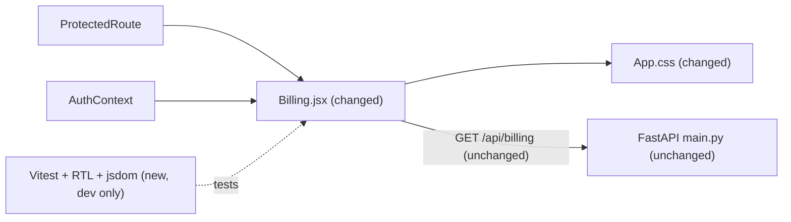
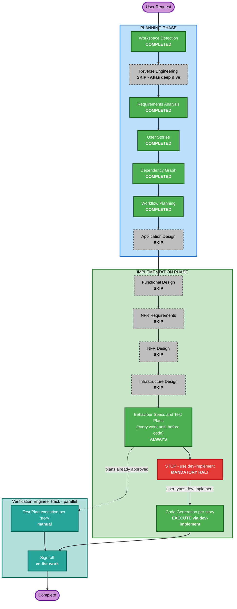

# Execution Plan

**Epic**: HELIX-7344 — Premium Upgrade Demo (Frontend Only)
**AIRE Framework**: v1.0
**Generated**: 2026-10-27T14:19:58Z (auto-approved, no gate)

## Detailed Analysis Summary

### Transformation Scope (Brownfield)
- **Transformation Type**: Single component
- **Primary Changes**: The Billing page (`src/frontend/src/pages/Billing.jsx`) gains a plan-aware header button, a local Premium plan state, and a post-upgrade success banner. Styles go in `src/frontend/src/App.css`. A Vitest + React Testing Library + jsdom setup is added to `src/frontend/package.json` as dev dependencies.
- **Related Components** (from `spec/plans/atlas-deep-dive.md`):
  - `ProtectedRoute` and `AuthContext`: unchanged, but they supply the token that `Billing.jsx` reads.
  - FastAPI `GET /api/billing`: read only, unchanged.

### Change Impact Assessment
- **User-facing changes**: Yes. On the Standard plan the Billing page shows an "Upgrade to Premium" button. A click switches the page to Premium values and shows a success banner. A reload reverts it.
- **Structural changes**: No. There are no new components outside the Billing page, no new routes and no new modules. Small helper components may be added inside `Billing.jsx`, following the file's existing pattern (`InfoIcon`, `UsageIcon`, `IncludedUsageCard`).
- **Data model changes**: No. The Premium values are a frontend constant shaped like the existing `/api/billing` response, and nothing is persisted.
- **API changes**: No. The frontend still makes only one call, the existing `GET /api/billing`.
- **NFR impact**: Small and fully specified in `requirements.md`:
  - accessibility (REQ-NF-02)
  - supply chain for the dev dependencies (REQ-NF-06)
  - fail-safe fetch (REQ-NF-08)

### Component Relationships (Brownfield)



Text alternative:
- ProtectedRoute and AuthContext feed the Billing page.
- The Billing page reads `App.css` and calls the unchanged `GET /api/billing`.
- The new dev-only test tooling exercises the Billing page.

### Risk Assessment
- **Risk Level**: Low. The change is frontend-only, touches one page and keeps no persistent state.
- **Rollback Complexity**: Easy. Reverting the story commits restores today's read-only page.
- **Testing Complexity**: Simple. Unit tests run against a mocked `/api/billing`. No backend or browser automation is needed for the implement gates.

## Workflow Visualization



### Text Alternative

```
Phase 1: PLANNING
- Workspace Detection (COMPLETED)
- Reverse Engineering (SKIPPED - Atlas deep dive pulled via Helix)
- Requirements Analysis (COMPLETED)
- User Stories (COMPLETED - 6 stories, GATE 1 approved)
- Dependency Graph (COMPLETED)
- Workflow Planning (COMPLETED)
- Application Design (SKIP)

Phase 2: IMPLEMENTATION
- Functional Design (SKIP)
- NFR Requirements (SKIP)
- NFR Design (SKIP)
- Infrastructure Design (SKIP)
- STOP CHECKPOINT: behavior.feature, architecture.md, rubrics,
  CI pipeline (if opted in), Behaviour Specs and Test Plans (ONE approval)
- MANDATORY STOP - Code Generation only via dev-implement, one story at a time

Verification Engineer track (parallel): run each story's approved test plan
after its PR merges, sign off with ve-list-work
```

## Phases to Execute

### PLANNING PHASE
- [x] Workspace Detection (COMPLETED)
- [x] Reverse Engineering (SKIPPED). Atlas deep dive `Deep Dive: Billing-Cycle.md` pulled via Helix MCP into `spec/plans/atlas-deep-dive.md`.
- [x] Requirements Analysis (COMPLETED). `requirements.md` v1: REQ-F-01 to REQ-F-12, REQ-NF-01 to REQ-NF-09.
- [x] User Stories (COMPLETED). 6 stories, GATE 1 approved, LOCAL tracker.
- [x] Dependency Graph (COMPLETED)
- [x] Execution Plan (COMPLETED)
- [x] Application Design - SKIP
  - **Rationale**: All changes stay within the existing Billing page component. No new services, no service layer and no new component dependencies. The few rules involved (button visibility, plan switch) are already fully specified in the story ACs.

### IMPLEMENTATION PHASE
- [x] Functional Design - SKIP
  - **Rationale**: No new data model or schema; the Premium values are a frontend constant in the existing response shape. The business logic is two simple rules (show the button on "Standard"; switch local plan state on click), already pinned down by REQ-F-01 to REQ-F-12 and the story ACs.
- [x] NFR Requirements - SKIP
  - **Rationale**: The stack is already decided: React 19 + Vite 8, plus Vitest/RTL/jsdom chosen at Requirements Analysis Q8. The NFRs are already written as REQ-NF-01 to REQ-NF-09. The change has no performance, scalability or availability impact.
- [x] NFR Design - SKIP
  - **Rationale**: NFR Requirements is skipped, and no new NFR patterns are needed.
- [x] Infrastructure Design - SKIP
  - **Rationale**: No infrastructure, deployment or cloud resource changes. The existing Vite dev server and FastAPI static-serving path are unchanged.
- [ ] Behaviour Specs & Test Plans - EXECUTE (ALWAYS, at the STOP CHECKPOINT, ONE approval)
  - **Rationale**: Every work unit's `.feature` contract and manual test plan are written and approved before any code is generated (`implementation/specs-and-test-plans.md`).
- [ ] Code Generation - EXECUTE (ALWAYS, per story via `dev-implement`)
  - **Rationale**: Each story is implemented on its own story branch cut from the Epic branch, with unit tests that meet `unitTestCoverageMin`. No story adds or changes an API endpoint, so the API & Contract Testing Gate is not expected to apply.

### Verification Engineer TRACK (parallel; started by the Verification Engineer, not planned or executed by this workflow)
- Test Plan: authored for every work unit at the STOP CHECKPOINT. The Verification Engineer reviews it and executes it once the work unit's PR merges, in parallel with development.
- Verification Engineer Sign-off: run by the Verification Engineer with **`ve-list-work`** on the epic branch once story PRs merge.
  - **Rationale**: Test-plan sign-off is not an Implementation stage at epic or story level. It is not scheduled here and never runs automatically.

## Package Change Sequence (Brownfield)

Only the frontend package (`src/frontend/`) changes. The backend package (`src/backend/`) is untouched. Story order follows `spec/plans/dependency-graph.yml`:
1. 1.1 first.
2. Then 1.2, 1.3 and 1.4 in parallel.
3. Then 1.5.
4. Then 1.6.

## Estimated Timeline
- **Total Phases**: 7 planning stages (6 executed or completed, Application Design skipped) + STOP checkpoint + 6 per-story implement runs
- **Estimated Duration**: About 1 developer-day across the 6 stories, in line with the Epic's "under 1 day" target. The test tooling (1.1) is the largest single piece.

## Success Criteria
- **Primary Goal**: A Standard user can click "Upgrade to Premium" on the Billing page and see the whole plan display switch to Premium instantly, with no backend change.
- **Key Deliverables**:
  - Updated `Billing.jsx` and `App.css`
  - Vitest/RTL/jsdom unit tests and coverage
  - Per-story `.feature` contracts and manual test plans
- **Quality Gates**:
  - Unit tests at or above `unitTestCoverageMin`
  - Security Baseline review clean
  - Blocking J1 (architecture rubric) and J2 gates pass
  - Automated code review clean
- **Integration Testing**: The upgrade flow works end to end across stories 1.2, 1.4, 1.5 and 1.6 (covered by the cross-story `spec/behavior.feature` journey written at the STOP checkpoint).
- **Operational Readiness**: Not applicable. No deployable infrastructure changes, so no monitoring, logging or alerting work.
