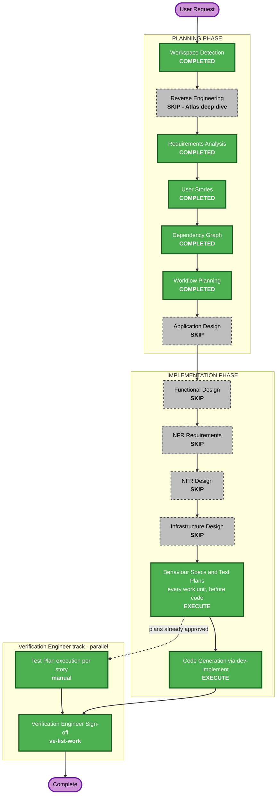

# Execution Plan: Premium Upgrade Demo (Frontend Only)

**Epic**: Atlas document 7344 (LOCAL)
**Generated**: 2026-10-23T12:41:30Z
**AIRE Framework**: v1.0

## Detailed Analysis Summary

### Transformation Scope (Brownfield)
- **Transformation Type**: Single component change
- **Primary Changes**: the Billing page (`src/frontend/src/pages/Billing.jsx`) gains data-driven plan labels, a conditional "Upgrade to Premium" button, a local-state upgrade handler and a success message; `src/frontend/src/App.css` gains two style rules
- **Related Components**: the frontend dev tooling (`src/frontend/package.json` and `package-lock.json`) gains Vitest, React Testing Library and jsdom as devDependencies; there is a new `tests/unit/` tree

### Change Impact Assessment
- **User-facing changes**: Yes. A new CTA and success message appear on the Billing page, and the plan labels become data-driven.
- **Structural changes**: No. The work stays within the existing `Billing` component boundary, with no new components, routes or services.
- **Data model changes**: No. Only a frontend constant (`PREMIUM_DATA`) is added, with the same shape as the existing `/api/billing` response.
- **API changes**: No. `GET /api/billing` is untouched and no new call is made (REQ-NF-01).
- **NFR impact**: Minimal. Accessibility (REQ-NF-03) and dev-dependency supply chain (REQ-NF-05) are both already specified in `requirements.md`.

### Component Relationships
- **Primary Component**: `src/frontend/src/pages/Billing.jsx` (Major change: new behaviour)
- **Shared Components**: `src/frontend/src/App.css` (Minor change: two new rules)
- **Dependent Components**: `App.jsx` routes `/billing` to `Billing`, with no change; `AuthContext` supplies `token`, with no change
- **Upstream (unchanged)**: backend `GET /api/billing` in `src/backend/main.py`
- **Supporting Components**: frontend dev tooling (Configuration-only change: devDependencies and a test script)

### Risk Assessment
- **Risk Level**: Low. The change is isolated, frontend-only, and has no persistence or API change.
- **Rollback Complexity**: Easy. Reverting a single story PR undoes it.
- **Testing Complexity**: Simple. Unit tests use React Testing Library with a mocked `fetch`.

## Workflow Visualization

Text alternative: Workspace Detection, Requirements Analysis, User Stories, Dependency Graph and Workflow Planning are completed. Reverse Engineering is skipped because the Atlas deep dive was used. Application Design, Functional Design, NFR Requirements, NFR Design and Infrastructure Design are skipped. Behaviour Specs and Test Plans execute at the STOP checkpoint, followed by per-story Code Generation via `dev-implement`. The Verification Engineer track runs in parallel and ends with `ve-list-work` sign-off.

## Phases to Execute

### PLANNING PHASE
- [x] Workspace Detection (COMPLETED)
- [x] Reverse Engineering (SKIPPED: the Atlas deep dive was pulled via Helix)
- [x] Requirements Analysis (COMPLETED)
- [x] User Stories (COMPLETED)
- [x] Dependency Graph (COMPLETED)
- [x] Execution Plan (COMPLETED)
- [x] Application Design: SKIP
  - **Rationale**: the change stays within the existing `Billing` component boundary, with no new components, services or methods beyond a local handler that is fully specified in Story 1.1 and Atlas story doc 7342

### IMPLEMENTATION PHASE
- [x] Functional Design: SKIP
  - **Rationale**: there is no new data model, schema or complex business rule; the only rule is `plan_name === "Standard"`, and the Premium data shape is already fixed in `requirements.md` REQ-F-03
- [x] NFR Requirements: SKIP
  - **Rationale**: the stack is already determined (React 19 + Vite 8). The test tooling was chosen in Requirements Analysis (Vitest, React Testing Library, jsdom: REQ-NF-04), and accessibility and supply chain are already specified (REQ-NF-03, REQ-NF-05). There are no performance or scalability concerns.
- [x] NFR Design: SKIP
  - **Rationale**: NFR Requirements is skipped, and there are no NFR patterns to incorporate
- [x] Infrastructure Design: SKIP
  - **Rationale**: there are no infrastructure, deployment or cloud changes
- [ ] Behaviour Specs and Test Plans: EXECUTE (ALWAYS, at the STOP CHECKPOINT, with one approval)
  - **Rationale**: Story 1.1's `.feature` contract and manual test plan are written and approved before any code is generated
- [ ] Code Generation: EXECUTE (ALWAYS, per story via `dev-implement`)
  - **Rationale**: implementation of Story 1.1

### Verification Engineer TRACK (parallel; started by the Verification Engineer, not scheduled here)
- Test Plan: authored at the STOP CHECKPOINT, and executed by the Verification Engineer once Story 1.1's PR merges
- Verification Engineer Sign-off: run with `ve-list-work` on the epic branch

## Package Change Sequence
Single package (`src/frontend`), with no cross-package sequencing. `src/backend` is unchanged.

## Estimated Timeline
- **Total Phases**: 8 executed or executing (5 planning stages, the STOP checkpoint, code generation and Verification Engineer sign-off); 6 skipped
- **Estimated Duration**: under 1 day of implementation (Epic success metric)

## Success Criteria
- **Primary Goal**: a Standard user can upgrade to Premium on the Billing page, entirely in local state
- **Key Deliverables**: the updated `Billing.jsx` and `App.css`; a frontend unit-test runner; Billing page unit tests; the behaviour spec and manual test plan for Story 1.1
- **Quality Gates**: unit tests at the coverage threshold; the Security Baseline (SECURITY-10); automated code review with blocking J1/J2
- **Integration Testing**: the Billing page renders correctly against the unchanged `/api/billing`
- **Operational Readiness**: N/A (demo, frontend-only; no new monitoring or logging)
